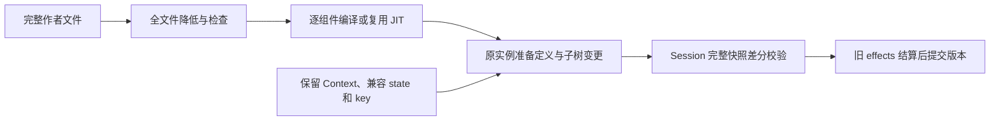

# 引擎原生声明式 UI

完整 ToolShelf（收折、类别页签、工具内容）和 Parameters（路径栏、名称栏、内容页签、滚动区、查询、Position、组件列表），以及 Scene Tree 的树行和查询、ViewportTools 图标菜单入口，已由 [editor.ui.source](../../../assets/editor.ui.source) 定义。它们使用同一份 Source/JIT、文档 Runtime、SS、Session、布局与绘制设施。停靠、资产浏览器、菜单内容和总外壳仍由 C++ 描述。区域评估与后续次序见[编辑器 DSL 迁移](dsl-migration.md)。

Parameters 的过滤器位于对象标题之后、属性页签之前，同一查询筛选字段和组件。`Items<PropertyPage>` 由当前 Actor 的真实组成提供：有根组件时提供 Transform，Components 展示组成；无选择时显示空状态。字段页与浏览器功能不由编辑器外壳固定挂按钮。ViewportTools 在场景路径栏末尾提供显示与辅助图标菜单，复用同一原生 popup 和命令链。

本文是当前实现的用法与契约说明，包含 2026-10-05 的源码局部更新。Qt/QML、Unity UI Toolkit 与 Flutter 的官方资料比对及演进起点见[更新机制研究](../../research/ui-dsl-update-comparison-20261005.md)。

**当前支持数据局部更新和保留兼容实例的源码 patch。保存后全文件检查、按组件复用 JIT；已有 Instance / Runtime Context 保持，变化的定义和子树经过同一个可拒绝事务提交。新增、删除或不兼容的子组件才建立、结束对应生命周期。**

阅读入口：[作者语法](#声明输入与组合)、[控件和属性](#控件与状态)、[更新粒度](#更新粒度数据变化与源码变化)、[新增组件](#在现有编辑器里新增组件)、[源码 patch 契约](#源码-patch-契约)。

## 编辑与保存

### 默认更新策略

**正式默认方案是保存触发、同步准备、事务提交。** 源码更新在当前输入处理完成后的安全点，由 Runtime 所在线程顺序执行；准备期间暂停推进界面，完成后继续。允许保存操作产生可测量的短暂停顿，优先保证更新顺序、对象身份和失败恢复清楚可控。

- 编译、定义检查和子树准备形成可拒绝的候选；失败继续使用已接受版本。Session 接受并结算旧交互 effects 后，统一提交新定义与成员关系。
- 优先减少实际工作量：复用未变 Program、保留兼容 Instance / Context、避免无关绑定求值，并优化实际昂贵的准备或提交阶段。
- 编译准备与运行时发布职责分开，但共享一套候选、校验、提交和回收机制。保持 `request → prepare → publish` 的清楚顺序，不另建一套热更状态或生命周期入口。
- 后台编译由实际工程中的持续卡顿证据决定，当前不列为既定后续任务。需要时先明确不可变编译输入、过期结果拒绝、关闭时在途任务收束与所属线程提交，再调整同一条链的调度方式。
- 性能评估分别定位编译、候选准备、提交及最终呈现的成本。降低文件去抖时间、增加线程数不能代替这些测量；单次耗时样本不构成时间上限。

这是长期支持的同步模式。当前 Program 的全部操作仍限定 Runtime 线程；选择后台调度须经明确的并发契约演进。

### 保存流程

Dev 和 Release 开发工作树的构建均优先读取 `assets/editor.ui.source`；该文件不存在时读取可执行文件旁部署的同名文件。在 VS Code 保存这份文件即可更新运行中的面板，无需重新编译 C++ 或重开工程。

- 每 100 ms 检查文件时间与大小，变化稳定 200 ms 后读取；相同内容不重复编译。单文件上限 1 MiB。
- 候选成功后在下一次控件提交中替换。状态栏显示版本和本次编译耗时。
- 语法、类型、实例构建或控件批次校验失败时，状态栏显示文件诊断，已有界面继续工作。修正并再次保存即可恢复。
- 同名、同类型 state 及兼容声明节点保留身份；正在编辑的字段继续使用原 Session 草稿。删除、禁用或业务对象换绑仍按原输入合同结算旧交互。
- 去抖后的编译在 UI 安全点同步执行，遵循上述默认更新策略。

该流程针对 `.ui.source`。SS 文件、C++、多文件 imports、语言服务与调试器尚未接入保存更新。

文件监测依赖修改时间和大小；读取后再按完整内容去重。保持时间戳和大小不变的外部写入不在当前检测保证内。编辑源码会触发同步编译或代码复用，以及定义和子树准备；200 ms 去抖不是热更总耗时上限。

## 声明、输入与组合

一份文件可声明多个有名 `ui` 类型，可在声明前定义使用显式参数的普通 Source 辅助函数。每个类型使用一个生成的 `void __ui_dispatch(uint operation)`；实例共享 Program，不为每个属性或列表项编译代码。更新仍检查完整类型与组合关系；同一 Runtime 中，同名类型的生成代码完全相同时，只共享上一已接受模块的 Program。每版的源码映射、声明和子类型关系独立建立。共享 Program 发布后不再修改，不建立历史版本缓存。

```text
ui Query(in TextEditBinding edit) {
    Row row {
        single_line: true;
        align_center: true;
        gap: 8;
        Text label { text: "Filter"; width: 48; single_line: true; }
        TextField field { edit: input.edit; }
    }
}
ui Inspector(in TextEditBinding query, in bool visible) {
    Column inset {
        classes: "parameter-inset";
        Query query { edit: input.query; mounted: input.visible; }
    }
}
```

组件参数必须显式提供。布局由所属容器表达，组合节点本身不额外插入一圈内边距。节点名在组件内唯一；组件类型不能与内建节点重名。`input`、`state`、`event`、`node` 和 `__ui_` 前缀用于语言接线，组件输入不能叫 `mounted`。

### 文件与名称规则

- 编码为 UTF-8，扩展名约定为 `.ui.source`，支持 Source 的行注释和块注释。
- 文件先写普通 Source 辅助函数，再写一个或多个 `ui Name(in Type input, ...) { ... }`；组件之间可以前向引用。辅助函数不能穿插在 `ui` 声明之间。
- `state bool name = ...;` 和 `state double name = ...;` 必须位于组件体开头、节点之前。没有字符串、集合或对象类型的局部 state。
- 节点写作 `Type node_name { property: expression; }`。属性和 state 初始化以分号结束；节点和事件体以花括号结束。
- 一个组件至少有一个节点，可有多个根节点。节点名在整个组件内唯一，嵌套容器不会另开命名空间；两个不同组件可使用同样的内部节点名。
- `input.name` 是只读宿主数据；`state.name` 是局部状态；`node.name` 是当前组件内声明拥有的控件 key；`event.checked` 只在 Foldout、ToggleButton 的激活事件中可用。
- `node.name` 不接受组件、Repeat 或 TextField 节点。TextField 的实际 key 来自宿主 `TextEditBinding`。
- 组件属性按子组件的输入名称传参，所有声明输入都必须提供，没有默认实参、隐式捕获父输入、插槽或属性继承。

表达式和事件体最终交给现有 Source 编译器；数值、条件、辅助函数与循环沿用 [LANGUAGE.md](../../../LANGUAGE.md)。UI 降低器禁止 `self`、`new`、`async`、`yield` 和 `__ui_` 内部名称。它不是任意执行 Source 业务代码的入口。

| 输入 | 宿主值与用途 |
| --- | --- |
| `bool` / `double` | 有限标量，表达式由既有 Source 编译器检查 |
| `Text` | 拥有式文字快照，用于 text、classes 或 filter |
| `EditBinding` | 既有类型化数值字段、分组重置与事务路由 |
| `TextEditBinding` | 稳定编辑 key、权威文字和 enabled；走共享单行编辑器 |
| `ActionBinding` | 非零宿主动作 target 和 enabled；控件实例 key 独立，业务执行仍走现有命令入口 |
| `Key` | 宿主分配的 UI 身份；例如树的逻辑父行 |
| `Items<RowType>` | 不可变项列表，每项有稳定宿主 key 和 RowType 的完整输入 |

`Text` 经 plain `TextReference` 与 typed sink 复制到控件；不是 Source String 返回值的新规则。文字属性接受字符串字面量、直接 `input.text` 或直接文字编辑输入；类名仍经过 SS 的公共校验。列表转发必须保持声明的元素类型。

`TextEditBinding` 用在文字属性上时取其权威 `text`，不是 Session 中尚未提交的编辑草稿。文字引用目前不能直接参与字符串拼接、任意函数返回或条件表达式；数值/布尔绑定的表达式能力不能直接套用到 Text 引用上。`Key`、EditBinding 和 Items 是有类型的宿主引用值，不是可填写任意整数或对象地址的字段。

宿主 `InputValue` 按声明顺序传入，数量与类型必须匹配。只读文字可以在 DSL 中新增；新增业务编辑字段需要宿主提供稳定字段 key、当前值和原有命令/撤销路由。

### 动态内容

```text
ui Entry(in Text title) {
    Text label { text: input.title; single_line: true; }
}
ui Entries(in Items<Entry> entries, in bool visible) {
    Column root {
        Repeat rows { items: input.entries; mounted: input.visible; }
    }
}
```

Repeat 按宿主稳定项 key 匹配实例，排序保留状态，移除后再插入建立新生命周期。不能用列表索引或 Actor 地址充当 key。每个被重复的类型须有一个具体声明根节点，不能以另一个组件或 Repeat 作为唯一根。普通声明根使用项 key，例如 Scene Tree 的 TreeItem；TextField 的实际控件 key 仍由 edit 输入决定，不能将项身份与编辑绑定身份混为一谈。列表是不可变快照，发布后不得通过保留的可变别名修改。

`mounted: false` 在成功提交后关闭子 scope；`collapsed` 只退出布局并保留实例。Source 组合循环被拒绝。每个宿主根区域最多展开 10000 个声明节点，并最多发布 10000 个控件；剩余额度逐层传入，新建子实例前检查，因此没有输出的空参数行也不能无限扩张作用域。最终完整批次继续受 Session 的容量和树结构校验约束。尚无插槽、跨文件模块或实例虚拟化。

### 控件与状态

| 节点 | 作用与组合方式 |
| --- | --- |
| `Column` / `Row` | 纵向/横向容器，可嵌套具体控件、组件和 Repeat；通过父容器控制缩进 |
| `Text` | 文字叶，可设置 text、caption、classes 和布局属性 |
| `Button` | 普通动作按钮；可绑定 ActionBinding 或本地 on activate，二者互斥；支持既有图标与 SS 呈现 |
| `ToggleButton` | 按钮外观的布尔开关；selected 表示当前值，激活请求接受帧中的反值，不自动改变权威数据 |
| `ChoiceButton` | 互斥选项；必须声明 selection_group，支持方向键/Home/End，Tab 只访问当前选项 |
| `Combo` | 显示当前文字/图标并请求现有上下文菜单；不接受 action 或本地事件，菜单模型仍由宿主提供 |
| `List` | 带裁剪与滚动的纵向容器，可组合 Row/Column/组件；不意味着任意 Repeat 已自动虚拟化 |
| `Foldout` | 可激活的折叠标题叶；不接受子节点，展开内容由另一个 Column 的 collapsed 表达 |
| `NumberRow` | 共享参数行；必填 EditBinding，0 个字段不产生控件，非空时接受 1–4 个数值字段 |
| `TextField` | 共享单行编辑器；必填 TextEditBinding，实际控件 key 必须非零且在完整快照内唯一 |
| `Tree` | 共享树容器；实际输出的直接子控件必须为 TreeItem，可通过组件或 Repeat 产生树行 |
| `TreeItem` | 树行叶；层级用 tree_parent 表达，不通过嵌套 TreeItem 花括号表达 |
| `Repeat` | 类型化动态子作用域；items 必填，必须直接引用 Items 输入；自身不额外生成容器 |
| 用户定义的 `ui` 类型 | 命名组件调用；实例拥有独立 state；输出直接放入所属内容区 |

底层 UI 还有 Checkbox、Slider、工作区 Tab 等能力，当前 DSL 没有对应的直接节点声明。NumberRow 可消费宿主配置的数值滑条。不要将底层控件全集误认为已开放的 DSL 语法。

- `Column`、`Row`、`Text`、`Button`、`Foldout`、`NumberRow`、`TextField`、`Tree`、`TreeItem` 复用已有控件。`single_line: true` 使用同一个单行高度原语；文字编辑器和普通按钮默认使用它。
- 同一具体节点的 `height`、`expand_height`、`content_height`、`single_line` 互斥，`width`、`expand_width`、`content_width` 同样互斥。`min_width` 独立约束最后形成的宽度策略，尺寸绑定单独更新不会丢失这个约束。组件输入使用这些名字时仍按普通类型化参数处理。
- `input.name` 只读；`state bool`、`state double` 属于实例。绑定记录实际执行的 getter，每次成功求值替换依赖集。未读取的输入变化不求值该绑定；稳定输入不重建节点。
- `on activate` 用于 Foldout、Button、ChoiceButton、ToggleButton；Foldout/ToggleButton 的 `event.checked` 为 bool，Button/ChoiceButton 没有事件值。事件允许修改局部 state，支持 Source 的普通语句、辅助函数与循环。表达式不能直接访问 native context、创建业务对象或启动异步任务。
- `NumberRow.edit` 使用公共 `append_number_row`，保留 XYZ、默认值、菜单、拖调、文字草稿和原编辑事务。`TextField.edit` 使用已有文字编辑路由，保留 Unicode、IME、选区和历史。
- `TreeItem.tree_parent` 表达逻辑关系，物理 parent 仍为 Tree。可用 `node.name` 引用声明拥有的具体节点 key。树行必须按父先子后的顺序提交；状态、过滤与可见范围绘制仍归 Session。
- 字体、颜色和边框继续使用 SS；UI 声明负责结构、数据绑定及布局组合。

### 属性参考

普通宿主动作写作：

```text
ui Tool(in Text title, in ActionBinding command) {
    Button run { text: input.title; action: input.command; }
}
```

宿主提供 `ActionBinding{target, enabled}`；target 必须非零，沿现有 Application 命令/绑定入口执行。Button 的声明 key（Repeat 中为 Item.key）独立于 target，因此多个工具可以指向同一命令。动作绑定只能直接来自有类型的输入，不能用任意数字或地址构造。生成的 Control 与 target 同批准备/拒绝/提交；按下或键盘激活期间换绑会取消旧交互，旧接受帧不能触发新目标。`enabled` 与绑定的 enabled 取 AND；执行时还须重新检查业务可用性。

本地 `Button { on activate { ... } }` 可以更新局部 state，没有 `event.checked`。三个按钮节点都不能同时绑定 action 与本地 handler。图标与图文上下布局继续由 `icon`、SS 的 `icon-placement` 和字体规则决定。ToggleButton 输出明确 bool 请求；ChoiceButton 通过共同 selection_group 表达互斥选项。菜单内容（包括 check/radio）已由宿主 MenuItem 支持，尚不能直接在 DSL 声明。

属性采用命名赋值，没有 CSS 选择器或任意字段反射。未列出的属性会被拒绝。组件调用上的名称按子组件输入解析，只有 `mounted` 是结构属性。

| 属性 | 值与主要适用节点 | 当前含义 |
| --- | --- | --- |
| `text` | 字符串字面量、直接 Text/TextEditBinding 输入；文字叶及 NumberRow | 文字或参数行标题；TextField 的文字使用 edit 输入 |
| `classes` | 同上，内容为空格分隔的 SS 类名 | 使用同一 SS 解析和样式链；NumberRow 应用到其参数行根 |
| `enabled` | bool；具体控件 | 控件启用状态；编辑控件与宿主 edit.enabled、动作按钮与 action.enabled 共同约束 |
| `action` | 直接 ActionBinding 输入；Button/ChoiceButton/ToggleButton | 宿主动作绑定，target 必须非零；与本地 on activate 互斥 |
| `selected` | bool；Foldout、TreeItem、ChoiceButton、ToggleButton、Combo | 展开、行选择、组选项、开关或 Combo 打开态；不会自动写业务状态。Combo 的打开态由宿主菜单来源同步，关闭后清除 |
| `selection_group` | node 引用或直接 Key 输入；ChoiceButton | 非零组 key，最终须指向按钮的直接容器父节点 |
| `collapsed` | bool；具体控件 | 退出布局并沿现有规则结算失效交互，保留 DSL 实例 |
| `caption` | bool；Text | 在 normal / caption 样式角色之间选择 |
| `width` / `height` | 数值表达式 | 固定 DIP 尺寸；NumberRow 由共享参数布局决定，不接受这些覆盖 |
| `expand_height` | bool | true 使用伸展高度，false 使用内容高度；与同轴其他高度策略互斥 |
| `expand_width` | bool | true 使用伸展宽度，false 使用内容宽度 |
| `content_width` / `content_height` | 数值表达式 | 使用内容尺寸，并指定该轴最小值；与同轴其他尺寸策略互斥 |
| `min_width` | 数值表达式 | 独立覆盖所选宽度策略的 minimum；不依赖绑定求值顺序 |
| `wrap` | bool；Row/Column/List/Tree | 使用既有 Flex 换行，子项尺寸和所属容器决定何时换行 |
| `panel` | bool；具体控件 | 在 panel / normal 样式角色间选择，与 caption 互斥 |
| `single_line` | bool | 内容高度下限为 23 DIP / 0 DIP；不是强行裁成固定 23 DIP，字体和内距仍参与测量 |
| `gap` | 数值表达式；容器 | 流式布局子项间距 |
| `padding_left/top/right/bottom` | 数值表达式；容器布局 | 所属容器的内容缩进；不同于 SS 的文字/绘制内距 |
| `align_center` | bool；Row、Column、Tree | 设置流式布局的交叉轴对齐；Row 中可用于文字与编辑框垂直对齐 |
| `icon` | 非负整数；例如 TreeItem | 使用当前 `ui::ControlIcon` 编号，不支持图标文件路径或 DSL 枚举名称 |
| `tree_parent` | 直接 Key 输入或有效 node 引用；TreeItem | 逻辑父行；缺省为 0。父行必须在同一树中且先于子行输出 |
| `initially_expanded` | bool；TreeItem | 行插入或父关系/种类变化时的初始展开值，不是持续覆盖 Session 展开状态的双向绑定 |
| `filter` | 文字值；Tree | 原树过滤机制，保留匹配路径并临时展开 |
| `edit` | EditBinding / TextEditBinding | 分别用于 NumberRow / TextField；必填 |
| `mounted` | bool；组件调用或 Repeat，缺省 true | false 在成功提交后移除子作用域；重新挂载建立新生命周期 |
| `items` | 直接 Items 输入；Repeat | 条目顺序、稳定身份和各实例参数 |

布局数值须有限且在 0–32768 范围内；坐标和长度按 DIP。NumberRow 的外部布局放在父容器；内部文字与边框走 SS。常用图标建议由宿主从 [ControlIcon](../../../src/ui/style.hpp) 转成数值输入，避免在声明里散布易变编号。

支持事件的节点均只允许一个 `on activate { ... }`；Foldout 和 ToggleButton 提供本次请求的 bool `event.checked`，可写 `state.expanded = event.checked;`。文字、数值提交和树选择继续走宿主的原 Action/命令路由，目前没有 `on change`、`on click` 或任意宿主函数调用语法。

### 容量与失败提示

文件最多 1 MiB、64 个组件类型；每个类型最多 1024 个输入、1024 个 state、1024 个声明节点，单个类型的语法嵌套最多 64 层。实例展开和最终控件容量还受前述 10000 限额约束，Tree 逻辑层级受 Session 的 128 层限制约束。

| 现象 | 优先检查 |
| --- | --- |
| Unknown UI node / property | 是否使用尚未开放的控件或属性；DSL 不是完整 Qt/QML、HTML 或 CSS |
| Missing component input / input count/type mismatch | 子组件参数是否齐全，宿主输入数量、顺序和种类是否与声明一致 |
| nonzero / distinct key | TextEditBinding、Item.key 和实际输出控件是否具有正确且不冲突的身份 |
| Session 拒绝某个 key | 树父先子后、物理父类型、逻辑树父关系和完整批次结构是否有效 |
| 更改 state 初值后画面不变 | 源码热更保留同名同类型 state；新初值用于新增 state、类型变化或新实例 |
| 保存后没有变化 | 作者文件是否为当前构建工作树文件；是否只有未实例化的类型发生变化；状态栏是否保留了拒绝诊断 |

部分降低/编译诊断带原文件行列；运行时属性或完整 Session 拒绝有时只有组件、节点或 key 信息。当前不保证每个错误都能映射回精确源码行。

## 更新粒度：数据变化与源码变化

“局部更新”要同时说明编译、实例、控件和布局的范围。复用机器码、保留控件 key、保留原 Instance 是三件不同的事。

| 层次 | 普通输入或局部 state 变化 | `.ui.source` 内容变化 |
| --- | --- | --- |
| 读取与前端 | 不解析或编译源码 | 全文件 lower、类型与组合检查 |
| JIT | 使用现有代码 | 同 Runtime、同名、生成代码完全相同的组件复用 Program；其余按组件编译 |
| DSL 实例树 | 复用原 Instance；只求值依赖变化数据的绑定；Repeat 按项 key 增删和重排子实例 | 兼容 Instance / Context 保留；定义、代码和派生值可替换；只增删不兼容或新增/移除的子实例 |
| 控件描述 | 准备变化片段；数量变化时准备新的连续快照 | 改过代码/结构的组件重新计算本组件绑定；未变组件沿用派生值并检查子类型更新。准备子树差异，旧 owner 留到 effects 结算 |
| Session 接入 | 当前编辑器提交完整工作区快照，由 set_controls 按 key/值差分 | 同一完整快照差分入口；相同控件可保留底层状态和资源 |
| 布局与绘制 | 按控件失效、布局依赖和绘制规则处理 | 同左；不能保证增加一个节点只影响该节点的几何或像素 |

源码更新的实际顺序：



`LiveDocument::poll` 在稳定的区域表上调用原实例的 `update(inputs, candidate_type)`。修改 Position 的 Text 时，Position 保留 Context 并准备新定义；SceneTree、Components 的原实例和无变化绑定保留。只改注释且输入无变化时，更新本版元数据和源码位置，零 JIT 编译、零绑定求值、零实例创建/回收。未挂载的新类型只会编译，不会自动出现在界面上。

普通数据和源码更新共用 `Instance::update`：输入变化时，实际读取过变化输入的绑定才失效；控制流切换后依赖集合会更新。Repeat 保留相同项 key 对应的 child，mounted/collapsed 遵循各自生命周期。公开的 `publish` 和 `create(previous)` 路径已移除。

总代价仍与更大范围有关：源码更新遍历已挂载区域与子实例，替换元数据并核对依赖；没有传递依赖索引来跳过整个未变区域。Items 仍作为一个输入快照发布，变化后遍历条目匹配 key；Workspace 仍采样 World 并生成完整描述。没有单项增删数据补丁协议。

初次挂载，以及代码、结构或父关系变化的组件，会执行该组件的全部绑定，不是逐表达式热替换。未变子组件继续保留自身绑定缓存。失败回滚后可能扩大求值范围，以恢复派生属性。

### 底层 patch 入口的边界

`ui::Session::update_controls(changed_controls)` 已支持只提交部分既有 key 的**完整控件属性值**，不是只提交几个字段的补丁。它拒绝重复/不存在的 key，以及 kind、parent、布局种类和结构引用变化；不能通过它新增、删除或重挂节点。

Application 使用 `set_controls(完整工作区快照)`。该入口保留已有控件，只应用实际变化，并支持新增、删除和重挂。DSL 的源码 patch 已在实例层完成，尚未直接输出 Session 稀疏提交批次。完整合同见[持久实例与稀疏更新](../ui/updates.md)。

### 保存时保留什么

| 内容 | 当前规则 |
| --- | --- |
| World 对象、文档历史、选择和视口 | 由原宿主继续持有，UI 源码更新不重开项目或重建 World |
| DSL Instance / Runtime UI Context | 同一 Runtime、同名组件及匹配的组合位置保留原身份；仅新增、不兼容或移除子组件改变生命周期 |
| 局部 state | 兼容组件实例中按名称与 bool/double 类型迁移；新 state 使用初始化值，删除的 state 不再保留 |
| state 的初始化表达式 | 定义变化时先准备初始化值，再恢复兼容 state；修改初值不会重置现有状态。新 state 的初始化读取候选初始值，不以迁移后的旧值重新计算 |
| 声明控件 key | 同作用域内，名称、节点种类和组件类型匹配时可复用；宿主显式 aliases 优先 |
| TextField / NumberRow 字段 key | 来自原 edit 输入；业务对象换绑时宿主仍须更换或退役 key |
| 嵌套组件身份与状态 | 匹配原组合节点后保留原子实例；重命名组合节点或改变组件类型会结束旧子实例并创建新的子实例 |
| Repeat 子状态 | 在匹配的 Repeat 声明内继续按 Item.key 对应；删除后重新插入不恢复已退休实例 |
| 草稿、焦点、树展开和滚动 | 属于 Session 的状态；兼容控件可保留，删除、禁用、折叠、种类或树父关系变化仍按原规则清理 |

已有宿主根类型被删除或重命名时，当前会因缺少已挂载类型而拒绝新版本。增加或改变宿主根组件的输入，可能在迁移旧输入时被拒绝；没有自动字段迁移或名称补齐协议。即便所有输入类型不变，重排参数也会改变位置语义，应与宿主一起调整。

## 在现有编辑器里新增组件

以下片段用于说明写法，实际作者文件不包含这个演示组件。

```text
ui Notice(in Text title) {
    Text label { text: input.title; single_line: true; caption: true; }
}
```

在已有 Position 等组件的 Column 中实例化：

```text
Notice notice { title: "Additional settings"; }
```

保存后的当前行为：

1. 整文件解析和校验；编译新增 Notice、重新编译结构已变的 Position，复用其余生成代码未变化的组件。
2. Position 在原 Instance 上准备新定义；已有兼容子实例继续保留，只为新增 Notice 创建实例。其余区域保留原实例和无变化的绑定值。
3. Session 差分新增对应控件、更新布局；成功后一次提交版本，失败时保留旧版本。

| 想做的事 | 是否只改当前 DSL 即可 |
| --- | --- |
| 在已有容器添加文字、布局组、按钮或已有控件的组合 | 可以，使用当前公开节点与已有输入；业务按钮需要已有 ActionBinding |
| 修改现有组件并让它的多个实例一起变化 | 可以；所有已挂载实例在同一次提交中接纳新定义，各自保留兼容的局部 state |
| 只声明一个新 ui 类型，希望它自动显示 | 不可以，需要在已有组件中实例化，或由宿主挂载 |
| 给新字段增加文字/数值编辑与撤销 | 需要宿主提供新的 edit binding 和业务路由 |
| 增加一个全新的停靠面板类型、菜单命令或 Combo DSL 节点 | 需要对应宿主或原语接入；不是添加一个声明即可获得 |

## 源码 patch 契约

源码和输入更新使用同一个 `PreparedUpdate`。整个作者文件仍原子接受或拒绝，不把各子组件提交为混合源码版本。

1. **稳定作用域与可变定义分开。** Instance / Runtime Context 不随源码版本变化。定义相关的代码租约、状态槽位、绑定依赖、节点属性和成员匹配由 `DefinitionState` 承担。固定 native Context 接入新定义，不涉及任意 Runtime 业务类型的内存布局热替换。
2. **比较代码及语义结构。** 除 Program 外，检查输入、state、节点名称/种类/父关系、子组件类型、绑定和事件表。源码位置不用于兼容性匹配。父 dispatch 未变也继续核对新子类型，防止漏掉子组件代码或类型变化。
3. **新定义从默认属性准备。** 按名称与类型保留 state，按节点名称/种类/组件类型保留 key 与子实例；移除属性回到默认值，不残留旧派生缓存。Repeat 按 Item.key 保留实例，重命名子组件内部的根节点也继续使用宿主 item key。
4. **接受前保留旧 owner。** 候选暂借兼容子实例的拥有者，代码与元数据仍由各自租约保持。新增子实例可以提前准备；移除的子实例到 Session 接受和旧 effects 结算后才回收。成功后一起提交定义、成员关系和快照；拒绝则恢复原定义与已接受成员。
5. **源码拒绝保留先前用户事件。** 文件检查前已经收到的局部事件仍交给旧定义更新。失败源码不会把这次操作一并撤销；普通数据批次被拒绝则恢复该批次的输入和局部 state。新源码首次挂载失败不会把旧源码下合法的输入加入失败缓存。

下一步根据测量选择无关子树跳过或稀疏 Session 提交。调度方式遵循[默认更新策略](#默认更新策略)。

`Statistics::instance` 暴露实际 Context 身份；`scope_creations/scope_retirements` 计数整个根子树真实的创建和回收，包含被拒绝的新候选。它们用于证明对象保留，不能仅用最终存活数或稳定的 UI key 代替。绑定/事件计数包含当前仍挂载的子实例，删除子实例后不代表所有历史求值的累计总量。

## 单一发布链与生命周期

```text
宿主输入/命令完成 → 采样当前 World、选择与字段
  → LiveDocument 检查保存、准备候选 Module
  → Instance::update(inputs, optional_definition) → 可拒绝的定义、快照与子树变更
  → Session::set_controls → 用旧 owner 消费取消 effects
  → commit_controls 替换候选、提交子树、释放移除的 scopes
  → prepare → Renderer / RHI → accepted 命中帧
```

这条链独立于 World Tick。业务字段的写入仍是 `Action → editor::Session::begin/preview/commit/cancel → World`；JIT 回调只复制 UI 值，不重入 JIT，不调用 World 命令，不构造或销毁 Runtime 对象。

原生注册和 Source 共用文档 Runtime。每个 Instance 创建一个 UI Context；不持有 Actor 根或业务地址。C++ 按当前 World 成员采样，即使撤销历史保活了已删除 Actor，也不会继续投影为可编辑目标。

一个 LiveDocument 管理一个作者文件及稳定的具名宿主区域表。区域的 parent 和 key aliases 在其生命周期内固定，变化会明确拒绝。候选 Module 在原实例上准备新定义，旧定义与待移除子实例在完整 Session 批次被接受且取消 effects 消费后释放。隐藏的宿主区域保留实例，以便重新显示时沿用状态。

当前宿主区域以组件类型名作为键，同一 LiveDocument 中不能通过换 parent 或 aliases 再挂载一份同名根区域。组件内部的命名组合与 Repeat 可以创建同类型的多个独立子实例；两者的身份规则不同。

`KeyBinding.node` 可写 `path.bar`、`header.type`、`position.section`，按命名的静态组件逐层找到具体声明节点。路径不包含普通布局容器，也不能穿过 Repeat；动态项仍由 Item.key 决定身份。未知、重复、指向结构作用域的别名会拒绝候选，包括当前未挂载的子组件路径。点分路径不能接管 TextField 身份，后者由 TextEditBinding.key 持有。别名随同一准备/拒绝/提交链传播，不另建控件查找或动作入口。

当前 Parameters 根挂在 DockSpace 的稳定内容槽内；停靠移动改变槽的位置，不改变 DSL region 的 parent。工具架 root 的高度由 DSL 声明，C++ 读取这一固定高度给现有 DockSpace 分配剩余空间；源文件将 root 改成非固定高度时拒绝候选并保留旧版本。这个边界在整个 Editor 根接管布局时解除，当前没有第二份 56/6 高度公式。收折轨道宽度、恢复高度和箭头区域复用 UI 的同一组常量。

普通输入更新也遵循同一事务：`update` 准备整棵子树，不移除已接受的 owner；`reject_controls` 恢复输入、局部状态和快照；`commit_controls` 在取消 effects 后一次提交成员关系。重复 commit/reject/close 安全。相同的失败输入暂缓重试，已有区域仍可响应局部事件；首次挂载被拒绝时保留空视图并释放候选实例，修正输入或源码后恢复。关闭 Instance 会释放代码、元数据和子实例，即使其 C++ 外壳仍由调用方保留。

控件 key 来自宿主同一个单调分配器。Runtime 和 key 分配器必须晚于实例销毁；Workspace 保持地址稳定。文档切换先取消输入、移除旧控件及结算 effects，再关闭 UI scopes、代码租约与文档 Runtime。

旧 UiFrame 自持文字、样式和图片，没有 JIT 回调或依赖 JIT 的资源 deleter。GPU 在途数据仍按 Renderer/RHI 完成条件退休，UI accepted 不代表 GPU 已完成。

编译、创建及 Session 描述拒绝保留旧版本。描述提交后的布局/渲染失败继续沿用 Session 失败恢复，不回滚已经取消的草稿；分配失败也不伪装成可恢复语言错误。

## 模块入口

| 入口 | 责任 |
| --- | --- |
| [declaration.cpp](../../../src/ui_language/declaration.cpp) | Source Lexer、UI 结构/组合检查、表达式降低及源码位置映射 |
| [component.cpp](../../../src/ui_language/component.cpp) | 共享代码、实例状态/依赖、动态子实例及控件快照 |
| [live_document.cpp](../../../src/ui_language/live_document.cpp) | 文件去抖、候选版本、宿主区域、提交与拒绝 |
| [editor.ui.source](../../../assets/editor.ui.source) | 真实面板结构、文案、查询组合、折叠和动态列表 |
| [workspace.cpp](../../../src/editor/workspace.cpp) | World 阶段采样、原业务 key、整体工作区描述 |
| [application.cpp](../../../src/application/application.cpp) | 原生输入、Session 提交/effects 顺序、Renderer 接受链 |

`atelier_ui_language` 链接 `atelier_ui` 与 `atelier_source`，不依赖 editor、World 或 RHI；基础 UI 仍不依赖 Runtime。结构和表达式没有第二个解释器。

## 验收与成本边界

正式入口为 `cmake --build --preset <dev|release> --target editor_document_acceptance ui_acceptance atelier_editor`，窗口使用 `atelier_editor --acceptance-project output [source-project]`。

[源码 patch 验收](../../../acceptance/editor/ui_source_patch.inl) 使用真实文件、JIT、Runtime 与 Session，核对无关区域零求值、Context 身份、子组件增删/换型、state 调整、新事件执行、同帧事件与失败源码、首次挂载拒绝、草稿和最终资源回收。[组合验收](../../../acceptance/editor/composed_ui.inl) 覆盖列表重排/重挂、重复项根重命名、输入和草稿；[事务验收](../../../acceptance/editor/ui_reload_transaction.inl) 覆盖回滚、容量与幂等；[代码复用验收](../../../acceptance/editor/ui_reload_profile.inl) 覆盖租约、源码位置及 Runtime 边界。[窗口验收](../../../acceptance/editor/ui_authoring_window.inl) 保存独立作者文件副本，验证真实画面、错误恢复、输入 token、折叠状态及后续 World 字段编辑。

组件只求值失效绑定，输入只复制变化槽位；变化片段可通过 swap 提交或恢复，长度变化时准备新的连续快照。控件 key 序列不变时跳过 key 集合构造与差集统计；稳定帧不递归执行退休清理。源码按组件生成代码复用 JIT，不是一般的函数级增量编译。宿主仍逐帧采样并 describe/set_controls；这不等于整个编辑器只遍历变化节点，也不等于增量布局求解。

可选真实热更采样入口为 `atelier_editor_document_acceptance --profile-ui-reload output.csv`，在对应构建目录运行。它执行 120 轮编译、替换、失败和关闭，记录编译量、编译/准备提交耗时、实际 Context 创建/回收、Runtime 存活数和进程内存。准备提交耗时包括 Instance 与 Session 控件提交，不含后续布局和渲染。演进前的测量见[热更审计](../../research/ui-hot-reload-audit-20261005.md)，本轮结果见[源码 patch 验收](../../research/ui-source-patch-20261005.md)。

第一阶段的历史证据见[原生 UI 首片](../../research/native-ui-language-20261005.md)。第二阶段起点结果见[组件与保存更新验收](../../research/native-ui-authoring-20261005.md)。后续按实际需求迁移资产浏览器和更多 Inspector 控件，再建设插槽/跨文件组织及独立 HUD；更新调度遵循[默认更新策略](#默认更新策略)。
