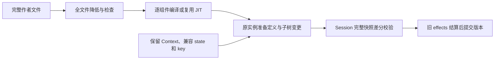

# 引擎原生声明式 UI

编辑器现有界面的装配统一到 [editor.ui.source](../../../assets/editor.ui.source)：EditorShell、菜单栏、工具架、状态栏、停靠页签与分隔条、Scene View、Parameters、Scene Tree、Entity Structure、Asset Browser、Controls、Code、Project Output，以及独立窗口内的 PopupMenu。宿主提供业务数据、稳定身份和动作；Source/JIT 产出同一套原生 Control，沿现有 SS、Session、布局与绘制链执行。区域职责与未实施的交互见[区域与手势边界](#区域与手势边界)。

Parameters 在对象标题下按需展开过滤器，连续展示检查目标的 Position/Rotation/Scale 数值行和 `Items<PropertyGroup>`，不内建 Transform／Components 页签。`PropertyRow` 根据实际字段种类使用 NumberRow、Checkbox 或枚举 Combo；规范数学元组由 NumberRow 组合。资源选择使用 `ResourceParameters` 和 `Items<ResourceProperty>` 展示只读元数据，各行 key 来自同一宿主分配器。EntityStructure 用同一 Tree/Repeat 递归展示 Entity 与组件归属，并提供组成及 Add/Remove Transform 命令；SceneTree 递归展示 Entity 组合层级。ViewportTools 在路径栏末尾提供显示菜单，ViewportMode 在视口左侧组成紧凑的选择组和枢轴菜单。所有视图沿同一原生控件和命令链工作。


本文是当前实现的用法与契约说明。Qt/QML、Unity UI Toolkit 与 Flutter 的官方资料比对见[更新机制研究](../../research/ui-dsl-update-comparison-20261005.md)。

**当前支持数据局部更新和保留兼容实例的源码 patch。保存后全文件检查、按组件复用 JIT；已有 Instance / Runtime Context 保持，变化的定义和子树经过同一个可拒绝事务提交。新增、删除或不兼容的子组件才建立、结束对应生命周期。**

阅读入口：[作者语法](#声明输入与组合)、[控件和属性](#控件与状态)、[更新粒度](#更新粒度数据变化与源码变化)、[新增组件](#在现有编辑器里新增组件)、[源码 patch 契约](#源码-patch-契约)。

## 区域与手势边界

可见结构、控件选择、布局、样式与组合由 DSL/SS 描述；C++ 拥有 World、命令、撤销、资源扫描、平台窗口/对话框、捕获和 GPU 资源。Viewport、DockSpace、Table 保留明确的原生合同，不用一个 NativePanel 包回整块 C++ 界面组装。补能力从真实区域出发，不先建脱离消费者的控件大全。

- 外壳只分配一次剩余空间。工具架、路径、对象标题和内容区各有职责；参数搜索属于被筛选内容的父层，收起返还空间。参数标签/字段共用行高与垂直中心，组合不默认再加边框或 padding；物理截图尺寸不能直接当 DIP。
- 命令按钮激活一次，没有持久开关状态；图标只是同一命令的呈现，须有可读名称。checked/selected 来自权威值，open 来自 popup 生命周期；hover、pressed、focus、disabled、invalid、modified 分别表达，不能用一个 active 标记替代。
- Table 的行、列、单元格使用稳定身份；表头、列宽、排序、键盘索引与绘制来自同一数据顺序及接受帧。数值按数值排序，单击只选择，Enter/双击才打开；过滤排除选择后清空，取消过滤不复活旧目标。空目录、无匹配与读取失败分别反馈。编辑单元格、冻结列、合并及完整多选未实现；多选须先定义当前项、锚点、选集和批量动作。
- 数值拖调、阶梯与滑条复用 Session 捕获和同一事务；文字/IME/剪贴板复用原文本会话，不在 DSL 建编辑缓存。停靠 Tab 与内容 ChoiceButton、列宽调整与资产拖放不是同一手势。
- `ControlKey` 标识 UI 实例，`ActionBinding.target` 标识动作目标。绑定与控件同批准备/拒绝/提交；换绑取消旧按下，旧接受帧不能操作新目标。执行前重新核对可用性，不能悄悄转向当前新选择。

Scene Tree 的行选择/重命名/组合换父、Parameters 的实例编辑及资源浏览现状见[编辑器](README.md#ui-样式与诊断)和[工程](projects.md)。Class 资产、模板默认值/实例覆盖、多份同类型业务面板、布局持久化、模型缩略图和跨区域资源拖放仍未建设；资源字段与视口的交互应沿同一作者事务扩展，不由 DSL 重复拥有业务状态。

未来资源拖放开始时须冻结资源身份、工程/文档代次及源控件寿命；目标协商类型与可用性，预览不创建正式 Entity，drop 时重新验证并提交一次命令/撤销。字段目标冻结对象/字段身份，禁用字段拒绝；切文档、源退役或目标关闭终止旧会话，不能在 drop 时重读“当前选择”。`DragPoint{x,y}` 只是几何，不是载荷协议。外部文件须经 Windows 适配与同一导入服务验证类型、目录/多文件和工程目标；普通外部链接不自动下载或执行。组合换父不能与空间参考混作一个操作。

设计依据：[SideFX Geometry Spreadsheet](https://www.sidefx.com/docs/houdini/ref/panes/geosheet.html)区分过滤、列和排序；[Panes](https://www.sidefx.com/docs/houdini/basics/panes.html)说明窗格组合与分隔操作。借鉴行为和责任，不复制专有素材或将外部软件未核实的隐藏状态当本项目合同。

## 编辑与保存

Code 面板的文档、保存与定位操作见[编辑器内源码工作流](source-editor.md)。原生 `CodeEditor` 通过 `document: input.document` 接收 `CodeBinding`；输入持有工作区提供的 `shared_ptr<ui::CodeDocument>`，不复制文本，不将文档放入 Runtime。控件类型 `code_editor` 可使用同一 SS；面板工具、文件菜单和诊断仍由 DSL 组合。

### 默认更新策略

**保存触发、捕获绑定、后台编译变更入口、Runtime 线程事务发布。** 首次加载与纯注释复用在 Runtime 所在线程同步完成；热更需要检查函数体或编译机器码时，由该线程降低作者文件并捕获类型与宿主绑定，再交给后台作业执行 Source 校验与 LLVM/ORC 编译，旧版界面在编译期间继续响应输入并出帧。

- 编译、定义检查和子树准备形成可拒绝的候选；失败继续使用已接受版本。Session 接受控件、结算旧交互 effects，并成功准备真实布局后，统一提交新定义与成员关系。
- 优先减少实际工作量：按源码与可达依赖复用未变 Program、保留兼容 Instance / Context、避免无关绑定求值，并优化实际昂贵的准备或提交阶段。
- 编译准备与运行时发布职责分开，但共享一套候选、校验、提交和回收机制。保持 `request → emit → publish` 的清楚顺序，不另建一套热更状态或生命周期入口；`Program::emit_entry` 只消费不可变请求快照，其余 `Program` 与 `Runtime` 操作仍限定所属线程。
- 性能评估分别定位编译、候选准备、提交及最终呈现的成本。降低文件去抖时间、增加线程数不能代替这些测量；单次耗时样本不构成时间上限。

### 保存流程

Dev 和 Release 开发工作树的构建均优先读取 `assets/editor.ui.source`；该文件不存在时读取可执行文件旁部署的同名文件。在 Code 面板或 VS Code 保存这份文件即可更新运行中的面板，无需重新编译 C++ 或重开工程。

- 每 100 ms 检查文件时间与大小，变化稳定 200 ms 后读取；相同内容不重复编译。单文件上限 1 MiB。
- 候选成功后在下一次控件提交中替换。热更后状态栏显示已接受的文档版本。
- 语法、类型、实例构建或控件批次校验失败时，状态栏显示文件诊断，已有界面继续工作。修正并再次保存即可恢复。
- 同名、同类型 state 及兼容声明节点保留身份；正在编辑的字段继续使用原 Session 草稿。删除、禁用或业务对象换绑仍按原输入合同结算旧交互。
- 去抖后的热更编译在后台执行，结果就绪后在 UI 安全点复核磁盘文件与 Runtime 类型目录并同步发布，详见[后台编译与发布](#后台编译与发布)。

该流程针对 `.ui.source`。SS 文件、C++、多文件 imports、语言服务与调试器尚未接入保存更新。

文件监测依赖修改时间和大小；读取后再按完整内容去重，在途后台编译就绪时再做一次字节复核以拦截同时间戳覆盖。保持时间戳和大小不变且落在最终复核之后的外部写入不在当前检测保证内。200 ms 去抖不是热更总耗时上限。

## 声明、输入与组合

一份文件可声明多个有名 `ui` 类型，可在声明前定义使用显式参数的普通 Source 辅助函数。每个类型生成单个 `void __ui_dispatch(uint __ui_operation)` 入口，并在函数体内以平衡二分条件树分派各绑定操作，实例共享 Program。

热更沿用上一接受版中同一 Runtime、同一类型目录下的同名组件。完整生成文本相同（例如只移动注释）时直接复用。文本有变时，Source 在该组件的环境里检查所有函数体并给出分派入口的传递可达函数。逐字节比较这些函数与其余非函数声明，相同时复用代码，有差异则用本次已检查的程序生成机器码。未使用函数中的类型错误同样拒绝候选。各版分别拥有组件声明、子类型关系和作者映射。运行报错先从机器码所属版本的区间转到当版生成文本，再定位作者文件。

`Component::compilation()` 可查询每个组件本次是重编（`compiled`）、整份输入相同（`reused_source`），还是检查依赖后复用（`reused_dependencies`）。`Module::compilation()` 提供重编和复用总数。两者都能用于普通构建的热更验收。

每份已发布分派经 `Lease::bind<void, uint32_t>()` 核验一次并持有定型代码句柄；复用 Program 时同时复用该句柄，实例准备复制固定版本持有者，不在事件热路径重复绑定。初始化、属性求值和事件都直接传递 operation，不再包装 Scalar 数组。绑定失败在组件准备阶段返回并保留源码错误映射；实例替换、状态回滚及控件提交仍沿原事务，不借定型入口绕过 Runtime Context、执行准入或清理。

UI 原生 Context 的可恢复拒绝通过 `Result` 返回，不向 `noexcept` 原生 thunk 抛异常：包括文本转换、样式类、表格视图、菜单行为、数值属性、非有限 state 写入及零 selection group。失败保留源码位置并沿原事务恢复输入、局部状态和已接受控件；修正后可继续更新或处理事件。内存耗尽仍遵循基础层 fatal 合同，不伪装成绑定错误。

声明式组件仅在确实需要新身份时分配 Key；零和最大值不能分配，耗尽通过现有结果链返回 `capacity_exceeded`。失败创建清理临时实例，失败更新保留已接受控件，已消耗编号不回退；别名和旧身份复用不额外要求剩余容量。生成执行中的类型、阶段或活动上下文前提被破坏时直接走唯一 fatal；布尔和数值 state 只能在初始化或事件处理期间写入，违反阶段前提不是可恢复的输入错误，合法阶段的非有限数值写入仍返回上述 `Result`。

声明式组件将数值行组合失败映射为 `invalid_definition`，保留源码名、节点名和首因；候选控件随失败丢弃，不发布半行。空 `EditBinding` 仍省略数值行。底层追加状态与静态诊断借用合同见 [UI 参数行](../ui/README.md)。

```text
ui Query(in TextEditBinding edit) {
    Row row {
        single_line: true;
        align_center: true;
        gap: 8;
        Text label { text: "Filter"; width: 48; single_line: true; }
        TextField field { edit: input.edit; }
    }
}
ui Inspector(in TextEditBinding query, in bool visible) {
    Column inset {
        classes: "section-body";
        Query query { edit: input.query; mounted: input.visible; }
    }
}
```

组件参数必须显式提供。布局由所属容器表达，组合节点本身不额外插入一圈内边距。节点名在组件内唯一；组件类型不能与内建节点重名。`input`、`state`、`event`、`node` 和 `__ui_` 前缀用于语言接线，组件输入不能叫 `mounted`。

### 文件与名称规则

- 编码为 UTF-8，扩展名约定为 `.ui.source`，支持 Source 的行注释和块注释。
- 文件先写普通 Source 辅助函数与模块常量，再写一个或多个 `ui Name(in Type input, ...) { ... }`；组件之间可以前向引用。辅助函数不能穿插在 `ui` 声明之间；`.ui.source` 暂不支持声明 Source `struct` 或 `enum` 类型。
- `state bool name = ...;` 和 `state double name = ...;` 必须位于组件体开头、节点之前。没有字符串、集合或对象类型的局部 state。
- 节点写作 `Type node_name { property: expression; }`。属性和 state 初始化以分号结束；节点和事件体以花括号结束。
- 一个组件至少有一个节点，可有多个根节点。节点名在整个组件内唯一，嵌套容器不会另开命名空间；两个不同组件可使用同样的内部节点名。
- `input.name` 是只读宿主数据；`state.name` 是局部状态；`node.name` 是当前组件内声明拥有的控件 key；`event.checked` 只在 Foldout、ToggleButton 的激活事件中可用。
- `node.name` 不接受组件、Repeat 或 TextField 节点。TextField 的实际 key 来自宿主 `TextEditBinding`。
- 组件属性按子组件的输入名称传参，所有声明输入都必须提供，没有默认实参、隐式捕获父输入、插槽或属性继承。

表达式和事件体最终交给现有 Source 编译器；数值、条件、辅助函数与循环沿用 [LANGUAGE.md](../../../LANGUAGE.md)。UI 降低器禁止 `self`、`new`、`async`、`yield` 和 `__ui_` 内部名称。它不是任意执行 Source 业务代码的入口。

| 输入 | 宿主值与用途 |
| --- | --- |
| `bool` / `double` | 有限标量，表达式由既有 Source 编译器检查 |
| `Text` | 拥有式文字快照，用于 text、classes 或 filter |
| `EditBinding` | 既有类型化数值字段、分组重置与事务路由 |
| `TextEditBinding` | 稳定编辑 key、权威文字和 enabled；走共享单行编辑器 |
| `ActionBinding` | 非零宿主动作 target 和 enabled；控件实例 key 独立，业务执行仍走现有命令入口 |
| `TableBinding` | 共享不可变 TableData、当前行/列和 enabled；表格几何、输入及可见绘制复用原生 Table |
| `TooltipBinding` | 可为空的共享不可变 Tooltip，包含 title、identity、description；只拥有文字，不保留对象或借用元数据 |
| `Key` | 宿主分配的 UI 身份；例如树的逻辑父行 |
| `Items<RowType>` | 不可变项列表，每项有稳定宿主 key 和 RowType 的完整输入 |

`Text` 经 plain `TextReference` 与 typed sink 复制到控件；不是 Source String 返回值的新规则。文字属性接受字符串字面量、直接 `input.text` 或直接文字编辑输入；类名仍经过 SS 的公共校验。列表转发必须保持声明的元素类型。

`TextEditBinding` 用在文字属性上时取其权威 `text`，不是 Session 中尚未提交的编辑草稿。文字引用目前不能直接参与字符串拼接、任意函数返回或条件表达式；数值/布尔绑定的表达式能力不能直接套用到 Text 引用上。`Key`、EditBinding、TableBinding、TooltipBinding 和 Items 是有类型的宿主引用值，不是可填写任意整数或对象地址的字段。

宿主 `InputValue` 按声明顺序传入，数量与类型必须匹配。只读文字可以在 DSL 中新增；新增业务编辑字段需要宿主提供稳定字段 key、当前值和原有命令/撤销路由。

### 动态内容

```text
ui Entry(in Text title) {
    Text label { text: input.title; single_line: true; }
}
ui Entries(in Items<Entry> entries, in bool visible) {
    Column root {
        Repeat rows { items: input.entries; mounted: input.visible; }
    }
}
```

Repeat 按宿主稳定项 key 匹配实例，排序保留状态，移除后再插入建立新生命周期。不能用列表索引或 Entity 地址充当 key。每个被重复的类型须有一个具体声明根节点，不能以另一个组件或 Repeat 作为唯一根。普通声明根使用项 key，例如 Scene Tree 的 TreeItem；TextField 的实际控件 key 仍由 edit 输入决定，不能将项身份与编辑绑定身份混为一谈。列表是不可变快照，发布后不得通过保留的可变别名修改。

`mounted: false` 在成功提交后关闭子 scope；`collapsed` 只退出布局并保留实例。Source 组合循环被拒绝。每个宿主根区域最多展开 10000 个声明节点，并最多发布 10000 个控件；剩余额度逐层传入，新建子实例前检查，因此没有输出的空参数行也不能无限扩张作用域。最终完整批次继续受 Session 的容量和树结构校验约束。尚无插槽、跨文件模块或实例虚拟化。

### 控件与状态

| 节点 | 作用与组合方式 |
| --- | --- |
| `Column` / `Row` / `Overlay` | 纵向、横向及覆盖容器，可嵌套具体控件、组件和 Repeat；通过父容器控制缩进 |
| `Table` | model 必填，直接接收 TableBinding；支持 details/list/tiles 呈现，共享选择、虚拟绘制、滚动与键盘交互，Details 另有表头排序和列宽 |
| `Text` | 文字叶，可设置 text、caption、classes 和布局属性 |
| `Button` | 普通动作按钮；可绑定 ActionBinding 或本地 on activate，二者互斥；支持既有图标与 SS 呈现 |
| `ToggleButton` | 按钮外观的布尔开关；selected 表示当前值，激活请求接受帧中的反值，不自动改变权威数据 |
| `ChoiceButton` | 互斥选项；必须声明 selection_group，支持方向键/Home/End，Tab 只访问当前选项 |
| `Combo` | 显示当前文字/图标并请求现有上下文菜单；不接受 action 或本地事件，菜单模型仍由宿主提供 |
| `List` | 带裁剪与滚动的纵向容器，可组合 Row/Column/组件；不意味着任意 Repeat 已自动虚拟化 |
| `Checkbox` | 原生勾选框；selected 为权威值，激活输出 bool，可使用本地 on activate |
| `ParameterRow` | 共享标签＋内容区域，直接子节点进入统一的参数内容槽；保留单行尺寸和窄面板换行 |
| `Viewport` | 原生视口挂载位置；相机、渲染和输入由既有宿主负责 |
| `Tab` | 工作区可拖动页签，使用原生捕获、拖动、取消链；内容页签继续使用 ChoiceButton |
| `Splitter` | 有界拖动控件，value/minimum/maximum/step 表达范围，vertical 选择拖动方向；拖动值按从按下点起的总位移计算，越过范围的那段保留，指针回到范围内分割条才跟回，始终在指针下 |
| `Popup` / `MenuItem` | 独立菜单根和菜单项；支持普通命令、checkbox、radio、子菜单分支 |
| `Foldout` | 可激活的折叠标题叶；不接受子节点，展开内容由另一个 Column 的 collapsed 表达 |
| `NumberRow` | 共享参数行；必填 EditBinding，0 个字段不产生控件，非空时接受 1–4 个数值字段 |
| `TextField` | 共享单行编辑器；必填 TextEditBinding，实际控件 key 必须非零且在完整快照内唯一 |
| `Tree` | 共享树容器；实际输出的直接子控件必须为 TreeItem，可通过组件或 Repeat 产生树行 |
| `TreeItem` | 树行叶；位置、深度和展开值由宿主的 `row` 输入给出，不通过嵌套 TreeItem 花括号表达 |
| `Repeat` | 类型化动态子作用域；items 必填，必须直接引用 Items 输入；自身不额外生成容器 |
| 用户定义的 `ui` 类型 | 命名组件调用；实例拥有独立 state；输出直接放入所属内容区 |

Slider 仍通过 NumberRow 的 EditBinding 提供，和数值字段共享同一属性与事务；目前没有独立 Slider 声明。

- `Column`、`Row`、`Text`、`Button`、`Foldout`、`NumberRow`、`TextField`、`Tree`、`TreeItem` 复用已有控件。`single_line: true` 使用同一个单行高度原语；Text 同时关闭自动换行并在宽度不足时显示末尾省略号。完整文字参与固有宽度测量，省略仅影响绘制，避免短标题反复缩短。文字编辑器保留原有水平滚动，普通按钮保持单行。
- 同一具体节点的 `height`、`expand_height`、`content_height`、`single_line` 互斥，`width`、`expand_width`、`content_width`、`shrink_width`、`flex_width`、`grow_width` 同样互斥。`min_width` 独立约束最后形成的宽度策略，尺寸绑定单独更新不会丢失这个约束。组件输入使用这些名字时仍按普通类型化参数处理。
- `input.name` 只读；`state bool`、`state double` 属于实例。绑定记录实际执行的 getter，每次成功求值替换依赖集。未读取的输入变化不求值该绑定；稳定输入不重建节点。
- `on activate` 用于 Foldout、Checkbox、Button、ChoiceButton、ToggleButton；Foldout/Checkbox/ToggleButton 的 `event.checked` 为 bool，Button/ChoiceButton 没有事件值。事件允许修改局部 state，支持 Source 的普通语句、辅助函数与循环。表达式不能直接访问 native context、创建业务对象或启动异步任务。
- `Checkbox.action` 可接收 `ActionBinding`，发送带 bool 值的宿主动作，供真实属性事务使用；与 `on activate` 局部事件互斥，遵循同一接受帧换绑和取消合同。
- `NumberRow.edit` 使用公共 `append_number_row`，保留 XYZ、默认值、菜单、拖调、文字草稿和原编辑事务。`TextField.edit` 使用已有文字编辑路由，保留 Unicode、IME、选区和历史。
- Tree 需要宿主提供展平后的行：`Tree.rows` 是宿主展平后的总行数，每个 `TreeItem.row` 直接引用一个 `TreeRowBinding` 输入（行号、深度、分支、展开、主行、连接线），物理 parent 仍为 Tree。宿主持有层级、展开与过滤，只描述窗口附近的行；Session 只排布这些行，展开请求以 `expand` 动作交给宿主。语言暂不提供展平函数，工程 UI 需要树时再开放。
- 字体、颜色和边框继续使用 SS；UI 声明负责结构、数据绑定及布局组合。

### 属性参考

普通宿主动作写作：

```text
ui Tool(in Text title, in ActionBinding command) {
    Button run { text: input.title; action: input.command; }
}
```

宿主提供 `ActionBinding{target, enabled}`；target 必须非零，沿现有 Application 命令/绑定入口执行。Button 的声明 key（Repeat 中为 Item.key）独立于 target，因此多个工具可以指向同一命令。动作绑定只能直接来自有类型的输入，不能用任意数字或地址构造。生成的 Control 与 target 同批准备/拒绝/提交；按下或键盘激活期间换绑会取消旧交互，旧接受帧不能触发新目标。`enabled` 与绑定的 enabled 取 AND；执行时还须重新检查业务可用性。

本地 `Button { on activate { ... } }` 可以更新局部 state，没有 `event.checked`。三个按钮节点都不能同时绑定 action 与本地 handler。图标与图文上下布局继续由 `icon`、SS 的 `icon-placement` 和字体规则决定。ToggleButton 输出明确 bool 请求；ChoiceButton 通过共同 selection_group 表达互斥选项。菜单内容由 PopupMenu / PopupEntry 声明，宿主 MenuItem 提供命令数据和当前值。

属性采用命名赋值，没有 CSS 选择器或任意字段反射。未列出的属性会被拒绝。组件调用上的名称按子组件输入解析，只有 `mounted` 是结构属性。

| 属性 | 值与主要适用节点 | 当前含义 |
| --- | --- | --- |
| `text` | 字符串字面量、直接 Text/TextEditBinding 输入；文字叶及 NumberRow/ParameterRow | 文字或参数行标题；TextField 的文字使用 edit 输入 |
| `classes` | 同上，内容为空格分隔的 SS 类名 | 使用同一 SS 解析和样式链；NumberRow 应用到其参数行根 |
| `tooltip` | 直接 TooltipBinding 输入，或字符串字面量／直接 Text/TextEditBinding 输入；全部具体节点 | 前者提供完整说明快照，后者提供纯文本说明正文；ParameterRow/NumberRow 设置在参数行根，由子控件继承 |
| `tooltip_title` / `tooltip_identity` | 字符串字面量／直接 Text/TextEditBinding 输入；全部具体节点 | 纯文本说明的可选标题和类型身份；不能与完整 TooltipBinding 同时声明 |
| `enabled` | bool；具体控件 | 控件启用状态；编辑控件与宿主 edit.enabled、动作按钮与 action.enabled 共同约束 |
| `action` | 直接 ActionBinding 输入；Button/ChoiceButton/ToggleButton/Table | 宿主激活动作，target 必须非零；按钮与本地 on activate 互斥，Table 不支持本地 handler |
| `model` | 直接 TableBinding 输入；Table | 必填，快照指针有效，允许空行集；宿主保存行列数据、选择和已提交列宽，绑定本身只复制共享引用与小值 |
| `view` | Text；Table | `details`（默认）、`list` 或 `tiles`；List/Tiles 展示每行首列的名称和图标，保留完整模型 |
| `row_height`、`header_height` | number；Table | DIP，默认 23/25，范围 12–256；Details 使用二者，List 使用行高 |
| `tile_width`、`tile_height` | number；Table | DIP，默认 90/66，范围 12–4096；Tiles 按实际可用宽度自动换行，窄于一格时缩至内容宽度 |
| `item_gap` | number；Table | DIP，默认 3，范围 0–256；List 行间距、Tiles 行列间距，末行不附加尾间距 |
| `empty_text` | Text；Table | 空模型的提示文字，由同一控件绘制；不创建虚拟资源行 |
| `context` | 直接 Key/TextEditBinding 输入或 node 引用；具体单控件 | 设置既有上下文菜单路由，输入的零 Key 关闭右键入口；请求 source 始终是真实来源控件；NumberRow 的分组菜单继续由 EditBinding 决定 |
| `selected` | bool；Foldout、TreeItem、ChoiceButton、ToggleButton、Combo | 展开、行选择、组选项、开关或 Combo 打开态；不会自动写业务状态。Combo 的打开态由宿主菜单来源同步，关闭后清除 |
| `selection_group` | node 引用或直接 Key 输入；ChoiceButton | 非零组 key，最终须指向按钮的直接容器父节点 |
| `collapsed` | bool；具体控件 | 退出布局并沿现有规则结算失效交互，保留 DSL 实例 |
| `caption` | bool；Text | 在 normal / caption 样式角色之间选择 |
| `width` / `height` | 数值表达式 | 固定 DIP 尺寸；NumberRow 由共享参数布局决定，不接受这些覆盖 |
| `expand_height` | bool | true 使用伸展高度，false 使用内容高度；与同轴其他高度策略互斥 |
| `expand_width` | bool | true 使用伸展宽度，false 使用内容宽度 |
| `content_width` / `content_height` | 数值表达式 | 使用内容尺寸，并指定该轴最小值；与同轴其他尺寸策略互斥 |
| `shrink_width` | 数值表达式 | 首选宽度，可收缩而不额外增长；映射既有 Flex 的固定 basis、grow=0、shrink=1，与其他宽度策略互斥 |
| `min_width` | 数值表达式 | 独立覆盖所选宽度策略的 minimum；不依赖绑定求值顺序 |
| `wrap` | bool；Row/Column/List/Tree | 使用既有 Flex 换行，子项尺寸和所属容器决定何时换行 |
| `panel` | bool；具体控件 | 在 panel / normal 样式角色间选择，与 caption 互斥 |
| `single_line` | bool | 内容高度下限为 23 DIP / 0 DIP；Text 为 true 时禁止自动换行，宽度不足在末尾显示省略号。字体和内距仍参与测量；输入控件保持其水平滚动行为 |
| `gap` | 数值表达式；容器 | 流式布局子项间距 |
| `padding_left/top/right/bottom` | 数值表达式；容器布局 | 所属容器的内容缩进；不同于 SS 的文字/绘制内距 |
| `align_center` | bool；Row、Column、Tree | 设置流式布局的交叉轴对齐；Row 中可用于文字与编辑框垂直对齐 |
| `icon` | 非负整数；例如 TreeItem | 使用当前 `ui::ControlIcon` 编号，不支持图标文件路径或 DSL 枚举名称 |
| `row` | 直接 `TreeRowBinding` 输入；TreeItem | 宿主展平后的行：行号、深度、是否分支、展开值、是否主行和连接线。主行变为主行时滚动显露一次 |
| `rows` | 非负整数，不超过 `ui::maximum_tree_rows`；Tree | 宿主展平后的总行数，决定滚动范围；描述的 TreeItem 行号必须小于它 |
| `edit` | EditBinding / TextEditBinding | 分别用于 NumberRow / TextField；必填 |
| `mounted` | bool；组件调用或 Repeat，缺省 true | false 在成功提交后移除子作用域；重新挂载建立新生命周期 |
| `items` | 直接 Items 输入；Repeat | 条目顺序、稳定身份和各实例参数 |

布局数值须有限且在 0–32768 范围内；坐标和长度按 DIP。NumberRow 的外部布局放在父容器；内部文字与边框走 SS。常用图标建议由宿主从 [ControlIcon](../../../modules/gui/ui/include/ui/style.hpp) 转成数值输入，避免在声明里散布易变编号。

### 参数说明与悬浮提示

说明通过同一个原生 `Control.tooltip` 进入 Session，不另建 DSL 专用浮窗。反射参数和 World 设置传入宿主缓存的不可变 `TooltipBinding`；`nullptr` 表示当前节点没有独立说明。宿主仅在说明变化时替换快照，控件也保留内容相同的已有快照，避免数值刷新导致悬浮计时或控件描述反复变化。

```text
ui PropertyHelp(in Text label, in EditBinding edit, in TooltipBinding help) {
    NumberRow value { text: input.label; edit: input.edit; tooltip: input.help; }
}

ui HelpExample() {
    Text label {
        text: "Position";
        tooltip_title: "Position (m)";
        tooltip_identity: "Entity.position · Vector3";
        tooltip: "相对于当前 Space Reference 的位置，单位 m。\n改变它会移动 Entity。";
    }
}
```

文字使用 UTF-8，支持中英文与 `\n` 换行，沿用原生 Tooltip 的文字长度与字符校验；说明不是富文本，也不会执行其中的表达式。普通文本属性只在对应绑定需要重新求值时生成说明快照，不在每帧绘制时分配。参数行的 label、分量编辑器和滑条从父行获得相同说明，子节点可以声明自己的说明。组合组件通过显式 `TooltipBinding` 输入转发；Repeat 的说明随稳定项身份更新。说明不改变 edit/action、撤销、Scene 保存或对象生命周期。

热更继续走既有可拒绝的控件发布事务：成功替换后，删除的说明随旧定义退出；拒绝候选时仍使用已接受的说明。Tooltip 只保留拥有式文字，因此类型重载、对象删除和组件退役不会留下元数据悬空引用。

支持事件的节点均只允许一个 `on activate { ... }`；Foldout 和 ToggleButton 提供本次请求的 bool `event.checked`，可写 `state.expanded = event.checked;`。文字、数值提交和树选择继续走宿主的原 Action/命令路由，目前没有 `on change`、`on click` 或任意宿主函数调用语法。

### 外壳、停靠和独立菜单

- EditorShell 声明菜单栏、工具架内容槽、工作区和状态栏。菜单栏、工具架、状态栏是固定高度的外围区域；宿主读取声明产生的实际高度，为 DockSpace 提供剩余空间。该约束会在源码发布前检查，不在 C++ 复制高度公式。
- DockSpace::presentation 只提供分割位置、比例范围、稳定页签和内容槽身份。DockWorkspace 通过 Repeat 组合 DockPane、PaneTabs、PaneDivider 和 PaneSlot；分隔条三个动作的尺寸与排布属于 DSL。拖放使用接受帧中的实际页签栏高度。分隔条的编辑预览由 DockSpace 保留，复用 DockPreview 的 DSL 外观；已提交的面板尺寸仅在松手后改变，取消时直接退休预览。
- `Item.keys` 可为重复组件内部的具体节点提供命名 KeyBinding，根节点始终由 Item.key 持有。`Item.parent` 可指定既有宿主内容槽；省略时使用 Repeat 的父节点。父节点必须在完整控件批次中先出现，重复身份和非法父链由 Session 拒绝。换父节点复用同一可回滚实例准备链，不另建控件注册入口。
- `out_of_flow`、`offset_x/y`、`anchor_x/y`、`pivot_x/y` 直接使用现有布局合同；只有 offset 允许负数。`flex_width` 是可收缩的内容宽度，`grow_width` 同时允许扩张，值表示最小宽度。
- `context` 可直接引用 Key、node.name 或 TextEditBinding；文字编辑菜单通过同一编辑绑定取得目标身份，和字段换绑一起更新。
- `modified` 绑定已有修改状态；`red/green/blue` 为 0–1 的线性颜色通道，用于 Controls 的动态色块。固定视觉继续使用 SS。
- MenuItem 的 `menu_behavior` 接受 `command`、`checkbox`、`radio`；radio_group 为 Key，radio 组保持唯一选择；menu_branch 表示宿主子菜单。命令内容仍来自同一业务命令目录，快捷键和分隔线由 PopupEntry 组合。
- PopupHost 复用原生窗口、交换链和 Source 实例，消费 LiveDocument 最近已提交的组件定义；菜单测量、屏幕边界和焦点仍由原生设施处理。主窗口与菜单分别提交自身 Session 的接受帧。菜单候选失败时取消该菜单并报告诊断，不执行旧菜单目标；工程切换先关闭菜单并释放所有菜单 JIT scope，再销毁旧 Runtime。

### 表格与宿主

```text
ui AssetResults(in TableBinding model, in ActionBinding open, in Key menu, in Text view) {
    Table results {
        model: input.model;
        view: input.view;
        action: input.open;
        context: input.menu;
        classes: "asset-table";
        expand_height: true;
        min_width: 64;
    }
}
```

宿主提供 `TableBinding{data, selection, enabled}`，并用普通 KeyBinding 固定 `results` 身份。数据保持不可变，切换当前单元格只更新轻量 selection。嵌套组件和 Repeat 沿同一有类型的参数传递机制，不为每个数据格创建 Source 实例。

Table 不接受子节点或本地 `on activate`。`select`、`table_sort`、`table_column_resize` 仍以真实 Table key 派给宿主；只有 Enter/双击的 `activate` 转入 action。右键请求记录真实来源与行列身份。节点 enabled、model.enabled 和 action.enabled 共同约束可用状态。

Session 是 TableData 完整校验与交互的唯一入口。非法快照使同一候选批次被拒绝，原实例与界面仍可继续使用；源码 patch 保留兼容 Table key、共享数据和当前选择。菜单路由和 TableLayout 也保存在接受帧中，换绑或切换呈现后旧画面不能触发新动作，旧按压及已打开的旧菜单会取消。浏览器外壳与三种结果视图的保存更新复用同一个 LiveDocument。

行列内容保存在 TableData，呈现尺寸保存在 Control.table_layout；改变视图或密度不复制、重新校验整个目录。List/Tiles 为每个可见资源产生一个单元格几何，不创建 Button 或 Source 子实例。左右键在 List/Tiles 中移动资源，上下键按接受帧的网格列数移动，PageUp/PageDown 按可见行分页；Details 的左右键继续选列。三种呈现均使用同一个 TableSelection 与激活/菜单路由。浏览器保留 Details 当前列，切回 Details 后恢复。尺寸重排和滚动显露由 Session 按当前布局计算，宿主不再估算上一帧的可见范围。

### 容量与失败提示

文件最多 1 MiB、64 个组件类型；每个类型最多 1024 个输入、1024 个 state、1024 个声明节点，单个类型的语法嵌套最多 64 层。实例展开和最终控件容量还受前述 10000 限额约束，Tree 行深度受 Session 的 128 层限制约束。

| 现象 | 优先检查 |
| --- | --- |
| Unknown UI node / property | 是否使用尚未开放的控件或属性；DSL 不是完整 Qt/QML、HTML 或 CSS |
| Missing component input / input count/type mismatch | 子组件参数是否齐全，宿主输入数量、顺序和种类是否与声明一致 |
| nonzero / distinct key | TextEditBinding、Item.key 和实际输出控件是否具有正确且不冲突的身份 |
| Session 拒绝某个 key | 树父先子后、物理父类型、逻辑树父关系和完整批次结构是否有效 |
| 更改 state 初值后画面不变 | 源码热更保留同名同类型 state；新初值用于新增 state、类型变化或新实例 |
| 保存后没有变化 | 作者文件是否为当前构建工作树文件；是否只有未实例化的类型发生变化；状态栏是否保留了拒绝诊断 |

事件和绑定执行失败时，组件用本次执行所用声明的源码映射，把 JIT 提供的生成代码位置还原为作者文件的偏移、行和列。`Error::source.version` 为该版输入字节的内容哈希；带 UTF-8 BOM 的文件也按原始字节计算版本，行列从正文开始。仅移动语句可以复用代码，报错位置仍随新声明移动。没有底层位置时，事件定位到处理器声明，绑定定位到属性声明。执行后的控件属性校验或 Session 提交若拒绝候选，诊断仍可只含组件、节点或 key。

## 更新粒度：数据变化与源码变化

“局部更新”要同时说明编译、实例、控件和布局的范围。复用机器码、保留控件 key、保留原 Instance 是三件不同的事。

| 层次 | 普通输入或局部 state 变化 | `.ui.source` 内容变化 |
| --- | --- | --- |
| 读取与前端 | 不解析或编译源码 | 全文件 lower、类型与组合检查 |
| JIT | 使用现有代码 | 同 Runtime、同名、生成代码完全相同的组件复用 Program；其余按组件编译 |
| DSL 实例树 | 复用原 Instance；只求值依赖变化数据的绑定；Repeat 按项 key 增删和重排子实例 | 兼容 Instance / Context 保留；定义、代码和派生值可替换；只增删不兼容或新增/移除的子实例 |
| 控件描述 | 准备变化片段；数量变化时准备新的连续快照 | 改过代码/结构的组件重新计算本组件绑定；未变组件沿用派生值并检查子类型更新。准备子树差异，旧 owner 留到 effects 结算 |
| Session 接入 | 当前编辑器提交完整工作区快照，由 set_controls 按 key/值差分 | 同一完整快照差分入口；相同控件可保留底层状态和资源 |
| 布局与绘制 | 按控件失效、布局依赖和绘制规则处理 | 同左；不能保证增加一个节点只影响该节点的几何或像素 |

### 后台编译与发布

编辑器和工程 UI 的首版在所属 Runtime 线程编译。热更时，该线程降低作者文件并捕获类型和宿主绑定。已有组件的生成文本完全相同就直接复用；其余组件合在一个后台作业中完成 Source 函数体检查、可达依赖比较和所需的 LLVM/ORC 编译。未使用函数的类型错误同样会拒绝候选。`.ui.source` 暂不允许声明 Source `struct`/`enum` 类型，降低阶段即拒绝且不修改 Runtime 类型目录。纯注释修改无需启动后台作业。

编译期间旧实例继续接收事件和出帧。每个文档最多一个作业，发现新的保存后，在组件边界停止过期工作。文档关闭会等待当前编译调用返回。结果就绪时先检查最新文件内容与 Runtime 类型目录，再由原线程发布、绑定并用当时的实例输入准备候选。已过期的代码与诊断一起丢弃；有效诊断始终对应完成该次编译的源码。

源码更新的实际顺序：



`LiveDocument::poll` 在稳定的区域表上调用原实例的 `update(inputs, candidate_type)`。修改 Position 的 Text 时，Position 保留 Context 并准备新定义；SceneTree、PropertyGroup 的原实例和无变化绑定保留。只改注释且输入无变化时，更新本版元数据和源码位置，零 JIT 编译、零绑定求值、零实例创建/回收。未挂载的新类型只会编译，不会自动出现在界面上。

普通数据和源码更新共用 `Instance::update`：输入变化时，实际读取过变化输入的绑定才失效；控制流切换后依赖集合会更新。Repeat 保留相同项 key 对应的 child，mounted/collapsed 遵循各自生命周期。公开的 `publish` 和 `create(previous)` 路径已移除。

总代价仍与更大范围有关：源码更新遍历已挂载区域与子实例，替换元数据并核对依赖；没有传递依赖索引来跳过整个未变区域。Items 仍作为一个输入快照发布，变化后遍历条目匹配 key；Workspace 仍采样 World 并生成完整描述。没有单项增删数据补丁协议。

初次挂载，以及代码、结构或父关系变化的组件，会执行该组件的全部绑定，不是逐表达式热替换。未变子组件继续保留自身绑定缓存。失败回滚后可能扩大求值范围，以恢复派生属性。

### 底层 patch 入口的边界

`ui::Session::update_controls(changed_controls)` 已支持只提交部分既有 key 的**完整控件属性值**，不是只提交几个字段的补丁。它拒绝重复/不存在的 key，以及 kind、parent、布局种类和结构引用变化；不能通过它新增、删除或重挂节点。

Application 使用 `set_controls(完整工作区快照)`。该入口保留已有控件，只应用实际变化，并支持新增、删除和重挂。DSL 的源码 patch 已在实例层完成，尚未直接输出 Session 稀疏提交批次。完整合同见[持久实例与稀疏更新](../ui/updates.md)。

### 保存时保留什么

| 内容 | 当前规则 |
| --- | --- |
| World 对象、文档历史、选择和视口 | 由原宿主继续持有，UI 源码更新不重开项目或重建 World |
| DSL Instance / Runtime UI Context | 同一 Runtime、同名组件及匹配的组合位置保留原身份；仅新增、不兼容或移除子组件改变生命周期 |
| 局部 state | 兼容组件实例中按名称与 bool/double 类型迁移；新 state 使用初始化值，删除的 state 不再保留 |
| state 的初始化表达式 | 定义变化时先准备初始化值，再恢复兼容 state；修改初值不会重置现有状态。新 state 的初始化读取候选初始值，不以迁移后的旧值重新计算 |
| 声明控件 key | 同作用域内，名称、节点种类和组件类型匹配时可复用；宿主显式 aliases 优先 |
| TextField / NumberRow 字段 key | 来自原 edit 输入；业务对象换绑时宿主仍须更换或退役 key |
| 嵌套组件身份与状态 | 匹配原组合节点后保留原子实例；重命名组合节点或改变组件类型会结束旧子实例并创建新的子实例 |
| Repeat 子状态 | 在匹配的 Repeat 声明内继续按 Item.key 对应；删除后重新插入不恢复已退休实例 |
| 草稿、焦点、树展开和滚动 | 属于 Session 的状态；兼容控件可保留，删除、禁用、折叠、种类或树父关系变化仍按原规则清理 |

已有宿主根类型被删除或重命名时，当前会因缺少已挂载类型而拒绝新版本。增加或改变宿主根组件的输入，可能在迁移旧输入时被拒绝；没有自动字段迁移或名称补齐协议。即便所有输入类型不变，重排参数也会改变位置语义，应与宿主一起调整。

## 在现有编辑器里新增组件

以下片段用于说明写法，实际作者文件不包含这个演示组件。

```text
ui Notice(in Text title) {
    Text label { text: input.title; single_line: true; caption: true; }
}
```

在已有 Position 等组件的 Column 中实例化：

```text
Notice notice { title: "Additional settings"; }
```

保存后的当前行为：

1. 扫描整份文件收集组件声明时记下各正文的词法游标，再从对应游标解析、校验各组件，保留原文件的行列位置。编译新增 Notice，重新编译结构已变的 Position，复用其余生成代码未变化的组件。
2. Position 在原 Instance 上准备新定义；已有兼容子实例继续保留，只为新增 Notice 创建实例。其余区域保留原实例和无变化的绑定值。
3. Session 差分新增对应控件、更新布局；成功后一次提交版本，失败时保留旧版本。

| 想做的事 | 是否只改当前 DSL 即可 |
| --- | --- |
| 在已有容器添加文字、布局组、按钮或已有控件的组合 | 可以，使用当前公开节点与已有输入；业务按钮需要已有 ActionBinding |
| 修改现有组件并让它的多个实例一起变化 | 可以；所有已挂载实例在同一次提交中接纳新定义，各自保留兼容的局部 state |
| 只声明一个新 ui 类型，希望它自动显示 | 不可以，需要在已有组件中实例化，或由宿主挂载 |
| 给新字段增加文字/数值编辑与撤销 | 需要宿主提供新的 edit binding 和业务路由 |
| 增加一个全新的停靠面板类型、菜单命令或新的原生控件类型 | 需要对应宿主或原语接入；不是添加一个声明即可获得 |

## 源码 patch 契约

源码和输入更新使用同一个 `PreparedUpdate`。整个作者文件仍原子接受或拒绝，不把各子组件提交为混合源码版本。

1. **稳定作用域与可变定义分开。** Instance / Runtime Context 不随源码版本变化。定义相关的代码租约、状态槽位、绑定依赖、节点属性和成员匹配由 `DefinitionState` 承担。固定 native Context 接入新定义，不涉及任意 Runtime 业务类型的内存布局热替换。
2. **比较代码及语义结构。** 除 Program 外，检查输入、state、节点名称/种类/父关系、子组件类型、绑定和事件表。源码位置不用于兼容性匹配。父 dispatch 未变也继续核对新子类型，防止漏掉子组件代码或类型变化。
3. **新定义从默认属性准备。** 按名称与类型保留 state，按节点名称/种类/组件类型保留 key 与子实例；移除属性回到默认值，不残留旧派生缓存。Repeat 按 Item.key 保留实例，重命名子组件内部的根节点也继续使用宿主 item key。
4. **接受前保留旧 owner。** 候选暂借兼容子实例的拥有者，代码与元数据仍由各自租约保持。新增子实例可以提前准备；移除的子实例到 Session 接受和旧 effects 结算后才回收。成功后一起提交定义、成员关系和快照；拒绝则恢复原定义与已接受成员。
5. **源码拒绝保留先前用户事件。** 文件检查前已经收到的局部事件仍交给旧定义更新。失败源码不会把这次操作一并撤销；普通数据批次被拒绝则恢复该批次的输入和局部 state。新源码首次挂载失败不会把旧源码下合法的输入加入失败缓存。

下一步根据测量选择无关子树跳过或稀疏 Session 提交。调度方式遵循[默认更新策略](#默认更新策略)。

`Statistics::instance` 暴露实际 Context 身份；`scope_creations/scope_retirements` 计数整个根子树真实的创建和回收，包含被拒绝的新候选。它们用于证明对象保留，不能仅用最终存活数或稳定的 UI key 代替。绑定/事件计数包含当前仍挂载的子实例，删除子实例后不代表所有历史求值的累计总量。

## 单一发布链与生命周期

```text
宿主输入/命令完成 → 采样当前 World、选择与字段
  → LiveDocument 检查保存、准备候选 Module
  → Instance::update(inputs, optional_definition) → 可拒绝的定义、快照与子树变更
  → Session::set_controls → 用旧 owner 消费取消 effects
  → commit_controls 替换候选、提交子树、释放移除的 scopes
  → prepare → Renderer / RHI → accepted 命中帧
```

这条链独立于 World Tick。业务字段的写入仍是 `Action → editor::Session::begin/preview/commit/cancel → World`；JIT 回调只复制 UI 值，不重入 JIT，不调用 World 命令，不构造或销毁 Runtime 对象。

编辑器的 UI 原生类型和 UI Source 共用 Workspace 独立拥有的 Runtime，与场景 Runtime 分开。项目 UI 使用运行进程自己的 UI Runtime。每个 Instance 创建一个 UI Context；不持有 Entity 根或业务地址。C++ 按当前 World 成员采样，即使撤销历史保活了已删除 Entity，也不会继续投影为可编辑目标。

一个 LiveDocument 管理一个作者文件及稳定的具名宿主区域表。区域的 parent 和 key aliases 在其生命周期内固定，变化会明确拒绝。候选 Module 在原实例上准备新定义，旧定义与待移除子实例在完整 Session 批次被接受且取消 effects 消费后释放。隐藏的宿主区域保留实例，以便重新显示时沿用状态。

当前宿主区域以组件类型名作为键，同一 LiveDocument 中不能通过换 parent 或 aliases 再挂载一份同名根区域。组件内部的命名组合与 Repeat 可以创建同类型的多个独立子实例；两者的身份规则不同。

`KeyBinding.node` 可写 `path.bar`、`header.type`、`position.section`，按命名的静态组件逐层找到具体声明节点。路径不包含普通布局容器，也不能穿过 Repeat；动态项由 Item.key 决定根身份，其余原生交互节点可由 Item.keys 指定别名。未知、重复、指向结构作用域的别名会拒绝候选，包括当前未挂载的子组件路径。点分路径不能接管 TextField 身份，后者由 TextEditBinding.key 持有。别名随同一准备/拒绝/提交链传播，不另建控件查找或动作入口。

Parameters、Controls 等区域挂在稳定的业务内容槽内；停靠移动改变槽的位置，保留业务 region 的 parent。EditorShell 的外围栏使用已声明的固定高度，宿主据此提供 DockSpace 的可用尺寸；修改为不满足该宿主合同的尺寸策略会拒绝候选并保留旧版本。收折轨道、恢复高度和箭头区域使用同一组 UI 尺度常量。

普通输入更新也遵循同一事务：`update` 准备整棵子树，不移除已接受的 owner；`reject_controls` 恢复输入、局部状态和快照；`commit_controls` 在取消 effects 后一次提交成员关系。重复 commit/reject/close 安全。相同的失败输入暂缓重试，已有区域仍可响应局部事件；首次挂载被拒绝时保留空视图并释放候选实例，修正输入或源码后恢复。失败快照比较把相同位模式的 NaN 视作同一采样，覆盖数值输入、数值编辑字段和 Items 中的输入；值或项绑定变化后重新尝试。关闭 Instance 会释放代码、元数据和子实例，即使其 C++ 外壳仍由调用方保留。

每个宿主 surface 使用自己的单调 key 分配器；主界面和独立菜单各自拥有唯一的分配入口。Runtime 和 key 分配器必须晚于实例销毁；Workspace 保持地址稳定。文档切换先取消输入、移除旧控件及结算 effects，再关闭 UI scopes、代码租约与文档 Runtime。

旧 UiFrame 自持文字、样式和图片，没有 JIT 回调或依赖 JIT 的资源 deleter。GPU 在途数据仍按 Renderer/RHI 完成条件退休，UI accepted 不代表 GPU 已完成。

编译、创建及 Session 描述拒绝保留旧版本。描述提交后的布局/渲染失败继续沿用 Session 失败恢复，不回滚已经取消的草稿；分配失败也不伪装成可恢复语言错误。

## 模块入口

| 入口 | 责任 |
| --- | --- |
| [declaration.cpp](../../../modules/gui/ui_language/src/declaration.cpp) | Source Lexer、UI 结构/组合检查、表达式降低及源码位置映射 |
| [component.cpp](../../../modules/gui/ui_language/src/component.cpp) | 共享代码、实例状态/依赖、动态子实例及控件快照 |
| [live_document.cpp](../../../modules/gui/ui_language/src/live_document.cpp) | 文件去抖、候选版本、宿主区域、提交与拒绝 |
| [editor.ui.source](../../../assets/editor.ui.source) | 真实面板结构、文案、查询组合、折叠和动态列表 |
| [workspace.cpp](../../../modules/editor/application/src/editor/workspace.cpp) | World 阶段采样、原业务 key、整体工作区描述 |
| [application.cpp](../../../modules/editor/application/src/application/application.cpp) | 原生输入、Session 提交/effects 顺序、Renderer 接受链 |

`atelier_ui_language` 链接 `atelier_ui` 与 `atelier_source`，不依赖 editor、World 或 RHI；基础 UI 仍不依赖 Runtime。结构和表达式没有第二个解释器。

## 验收与成本边界

`ui_acceptance` 通过真实 Source/JIT、嵌套 Repeat 和 UI Session 检查局部折叠、稳定 key 重排、操作目标与控件别名换绑、拒绝回滚及移除后重新插入。文件热更验收覆盖事件中途失败回滚、位置变动后的代码复用、拒绝候选、重新编译和持续 NaN 后的输入恢复。另有已接受帧在 Session 退役后的寿命验收。

Repeat 子项收到局部事件时，父实例记录命中的已接受子实例。更新按显示顺序准备这些子实例，逐级传递变动的控件片段。控件数量不变时只交换发生变化的区间；数量变化时重建连续快照，并在提交时更新项位置。列表输入、挂载状态或组件定义变化时，按稳定项 key 核对整个列表。事件首次查找仍遍历已挂载子实例。

组件只求值失效绑定，输入只复制变化槽位；变化片段可通过 swap 提交或恢复，长度变化时准备新的连续快照。控件 key 序列不变时跳过 key 集合构造与差集统计；稳定帧不递归执行退休清理。源码按组件生成代码复用 JIT，不是一般的函数级增量编译。宿主仍逐帧采样并 describe/set_controls；这不等于整个编辑器只遍历变化节点，也不等于增量布局求解。

现有界面已完成装配迁移；后续按实际需求补齐 Inspector 业务能力、多窗格实例、跨文件组织及独立 HUD；更新调度遵循[默认更新策略](#默认更新策略)。保存到接受帧的延迟须在真实窗口另测；不以小场景耗时或历史通过表推断完整编辑器延迟。
