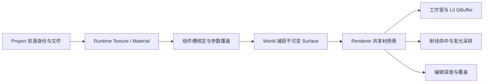

# 标准材质

状态：2026-10-11，标准材质首批已实现并通过 Dev/Release 端到端验收。实际通过记录见 [Renderer 验收](acceptance.md)，编辑与持久格式见[工程工作流](../editor/projects.md)。

## 数据与入口

材质是可共享的表面定义。网格保存命名材质槽及默认表面；StaticMeshComponent 按槽绑定资源。Texture / Material 业务身份与强引用沿现有 Runtime，持久来源沿 Project 的资源身份。GPU 索引只在对应渲染执行域有效，不写入场景文件。

业务资源可变，帧内 `Surface` / `Image` 不可变。它们只拥有参数与像素，不持有 Runtime 对象。Project 资产身份、Runtime 对象身份与 GPU 表位置各自限定作用域；没有另一套 Material ID 业务世界。MatCap / Smooth / Flat / Scene Lit、Edit / Play 与材质资产彼此独立。

未绑定资产的旧组件继续以网格默认材质乘实例基础色，并沿旧标量参数解析到同一表面表。部分绘制槽已绑定时，组件默认参数标注 `(Unbound)`，只作用于未绑定槽；实际绘制槽全部绑定后隐藏默认参数，清除绑定会恢复。显式绑定后的参数来自资源与覆盖，不再暴露写入后不生效的参数入口。共享材质编辑、撤销和重做都要求 World 已停止且未关闭；拒绝操作不改变资产、历史游标或文档版本。

实例继承首批限定为一层，并以显式位记录 11 组标量/颜色参数覆盖；相等的数值也可以是明确覆盖，不能通过比较数值猜测意图。贴图引用与采样设置继承共享材质，本批不提供实例贴图覆盖。复制 Actor 时，场景拥有的内联材质与参数实例各自复制，父资产和 Texture 继续共享。共享材质修改传播到所有未覆盖字段；关闭某项覆盖重新继承父值。原生或源码调用需要通过材质写入/覆盖接口建立这一意图，直接写实例参数字段不会自动建立新的覆盖位。

## 编辑器使用

在 Project 或 Asset Browser 菜单中使用 **Import Texture…** 导入图片、**New Material…** 创建 `.material` 资产。选择材质资产后在 Parameters 编辑参数、六个贴图输入与各自的 UV/采样设置。选中网格组件，在 `Material · 槽名` 选择资产；`Edit Shared Material` 编辑共享定义。

`Material Overrides · 槽名` 的复选框控制参数组是否覆盖。未勾选字段继续继承并显示为只读；勾选后可编辑，取消勾选恢复共享值。共享资产与实例使用各自的文档历史，Ctrl+S 沿当前文档保存。Save Scene / Save Scene As 只写场景，材质草稿继续保留；共享资产需要在其文档中保存或使用 Save All。切换场景、工程或关闭编辑器时，未保存的材质资产单独提示。颜色贴图在 Scene Lit / Smooth / Flat 中可见；MatCap 保留自身预览配色。

Control 使用相同的资源、编辑和保存入口，`material.inspect` 可按资产或实例对象读取解析值，见 [Editor Control](../editor/control.md)。外部文件改写不会自动替换已打开会话中的贴图；重开工程读取新版本。直接更换材质的贴图绑定会在当前场景立即生效。

## 标准表面

| 输入 | 参数与贴图语义 |
|---|---|
| 基础色 | 线性 RGB 因子乘 sRGB 颜色图；图的 alpha 保持线性 |
| 粗糙度 | 0～1 因子乘线性图指定通道 |
| 金属度 | 0～1 因子乘线性图指定通道；可与粗糙度共用同一张打包图 |
| 法线 | 线性 RGB 切线空间图；强度 0～16，Y 符号 +1/-1 |
| 自发光 | 线性 HDR RGB 因子乘 sRGB LDR 图；不是曝光后的亮度 |
| 透明度 | 独立线性图的指定通道，与基础 alpha 相乘后做 Mask |

每个输入具有独立 UV 缩放、旋转（弧度）、偏移和 Repeat / Clamp / Mirror 寻址。标量图可以选择 R/G/B/A。图片为左上原点的不可变 RGBA8，单边最多 8192；PNG/JPEG/BMP 等沿 WIC 解码，不宣称支持 HDR 图文件。缺图以中性输入处理，法线图缺失保留网格法线。Opaque 忽略 alpha；Mask 的覆盖公式为 `base_alpha × color_texture.a × opacity_texture[channel] >= cutoff`，默认阈值 0.5。当前不支持半透明混合、折射或透明排序。

内置方块、平面和球提供 UV。OBJ 保留 UV（导入时转换 V 轴）和原始面边界；MTL 的 Kd、d/Tr、map_Kd、map_d 转成同一默认表面，其他 MTL 参数仍不作为标准 PBR 导入。切线在 Mesh 发布时由锁定的 [MikkTSpace](../../../third_party/mikktspace/README.md) 生成，保留作者法线和 lowpoly 硬边；退化 UV 使用稳定的正交回退。非均匀缩放、镜像及法线图 UV 旋转通过同一切线帧处理。

## 光照、覆盖与历史

工作室、Lit、射线和编辑深度都消费共享材质表。光线命中以重心坐标恢复 UV，并以距离、UV 密度估计贴图 LOD；发光采样在实际采样点读取纹理与覆盖。MatCap 保留自身颜色和几何法线语义，但遵循 Mask。点拾取读取相同表面，以与射线覆盖相同的 base-mip 双线性 alpha 判断透明孔洞；屏幕导数仅用于光栅过滤，框选保持几何范围语义。

着色法线与几何法线分开：法线图参与 BRDF、反射方向和辐照度方向；射线起点偏移、闭合分类、支持平面和历史深度梯度使用几何法线。GBuffer 与历史另外保存 RG16_FLOAT 八面体几何法线。D32_FLOAT 当前深度、R32_FLOAT 前帧深度和 RG32_FLOAT Hi-Z 未降精度。法线 mip 的长度损失向粗糙度加入有界方差，以减轻远处镜面闪点；这是过滤近似。

双面显示、双面发光、几何闭合分别定义：默认双面保留既有场景；单面发光的可见 emission 与 mesh NEE 遵循相同的作者朝向，含镜像变换。阴影射线仍把表面视为遮挡。Mask 面使其所在的连通闭合分量失去“背面即内部”的判据，不影响同一模型中其他独立的完整壳体。

发光三角分布使用面积和纹理线性平均辐射估计权重，混入 5% 均匀概率；着色采样仍读取实际纹理，使用上传分布的实际 PDF。黑色或裁弃的样本是零贡献，不能从样本分母删除。离屏纹理发光继续照亮表面；当前 SSSR 的离屏镜面限制见 [Scene Lit](scene-lit.md)。

材质或图片版本变化参与历史兼容性判断；发光变化同步更新采样分布和照明响应。Opaque/Mask 变化更新 BLAS 透明性，普通参数和图片替换不重建网格。无 Mask 的几何保留硬件不透明查询路径。

## 所有权与成本

默认无绑定材质的稳定捕获直接命中组件缓存，不进行引用字段解析；RT 不透明性聚合复用几何缓存，并在所有共享实例上取交集，不逐帧分配临时哈希表。稳定材质捕获复用 GPU 表和纹理；相机、物体或灯光移动本身不会重新上传材质内容。表内等价表面去重，纹理按不可变 Image owner 与颜色空间缓存，同一图的多个线性标量输入共用上传；同一图同时作为 sRGB 和线性数据使用时具有独立视图资源。所有上传、mip、采样器、加速结构和退休都经既有 RHI/gfx。

资源替换先完成解析和验证，再发布内容。持久材质只能引用具有持久来源的 Texture，非法绑定不得污染旧参数、引用或已发布表面。创建材质先规范化路径并验证仍在 Content 内，重复创建不覆盖已有文件与资源身份。旧帧保留旧 CPU 图像，GPU 使用期由 RHI 延迟退休保证。所有者参与缓存键，防止地址复用命中新旧资源。空场景释放未使用的材质图片和场景引用，关闭保持幂等。性能收益须以真实场景测量为准，此处不把减少重复工作等同于已测得帧率提升。

## 范围

首批覆盖标准表面、共享资源、显式参数覆盖、撤销和保存往返。节点图、任意着色器、分层材质、透明折射、虚拟纹理、压缩纹理资产管线和 HDRI 不在本批范围。Mask 使用当前 mip 与阈值，没有覆盖率保持的 alpha mip 或随机透明度。
