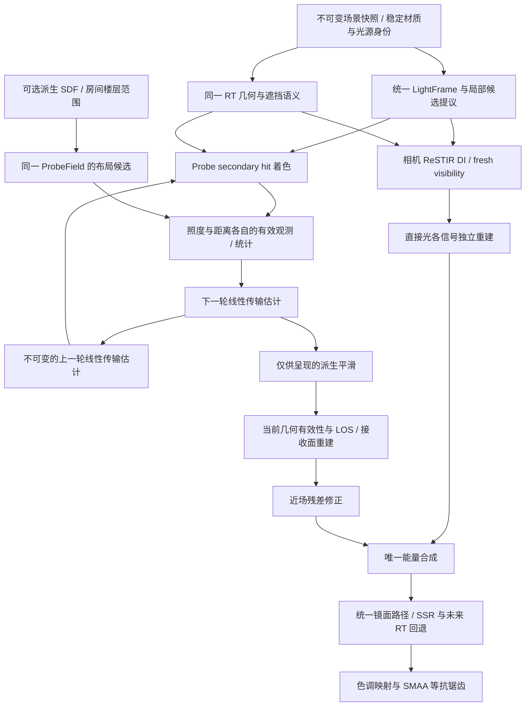

# DDGI 稳定性与光照管线长期方案 — 2026-10-15

状态：已落地运输/呈现分离、两个宿主的 accepted 渲染时钟，并推进第二批的探针采样顺序、独立有效响应计数与 raw-hit 诊断。第一批证据见第 10 节，第二批见第 11 节；局部光源提议、自适应调度和 SDF 仍是后续条件方案。本文第 2 节解释研究基线，当前实现以 [Scene Lit](../modules/renderer/scene-lit.md) 为准。没有保存或改动用户原 Scene。

研究基线为 `3932b31` 的 Renderer。研究期间主目录推进到 `9263010`；已核对中间提交没有修改 `src/renderer` 或 `src/rendering`。当前运行中的编辑器及上轮捕获仍属于原 Release 二进制，不能把新主线 UI 提交视为已在运行实例中生效。

## 1. 决策

保留 **硬件 RT + ReSTIR DI + 世界空间 DDGI + 近场间接光修正 + 反射信号独立重建** 的主线。下一阶段补齐三类基础合同：采样证据与变化响应、几何支持与距离统计、同一光源体系的局部重要性采样。SDF 是可选的派生几何设施，先用于布点和 clearance；它不是本次闪亮的前置修复，也不直接取代当前 RT 遮挡。

明确保留：FP32 深度与探针线性照度；唯一 LightFrame/材质恢复/可见性入口；唯一 ProbeField/共享 pool/稳定世界 cell 身份；游戏 Play 与渲染模式解耦；场景没有 Sky Light 时没有隐藏环境补光。需要调整 RHI 的能力仍由 RHI 负责人完成，不新增 Renderer 原始图形 API 出口。

实施顺序是：**先判定闪动来自照度还是插值权重 → 修对应输入 → 分离运输估计与呈现滤波 → 完善变化响应和预算分配 → 按实际覆盖缺口演进布局**。区域光源提议通常很有价值，但不是未经诊断就必须先上的答案。

## 2. 已有证据能说明什么

用户现场为 RX 6800 XT、Dungeons、约 3599 个实体和 96 个解析光源。当前一个跟随体积为 `12×8×12=1152` 探针，偏移 `(-32,-24,-32)..(32,16,32)` 米；实际间距约 `(5.818,5.714,5.818)` 米。照明射线为 128/探针，反馈 .85，最终间接光增益 5，SMAA、GTAO 开启，SSIL 关闭。

上轮通过 Control 临时对照观察到：

| 对照 | 观察 | 结论边界 |
|---|---|---|
| 1024 updates/frame，静止相机 | 墙面亮度在时间上波动；捕获的相机、深度、布局相同，历史/探针重置为 0 | 不能解释成相机滚动或整场清历史 |
| 改为 64 updates/frame | 短时间观感较平缓，用户反馈光源响应变慢 | 不证明单次采样更准确，也不证明稳态方差下降 |
| 临时关闭 DDGI | 所观察后墙区域近乎稳定 | 该区域优先查 DDGI；其他灯附近仍有直接光/高光波动 |
| 关闭 SSSR，或反馈改为 0 | 后墙仍有波动 | 不能将其仅归因于 SSSR 或多跳反馈发散 |
| gain=5 | 放大最终可见差异 | gain 仅在合成时应用，不是反馈增益 5 |

捕获位于本机 `out/dungeons-launch-20261015/flash-{budget,long,isolation,feedback}-{result,analysis}.json`，其中 result 保存图像目录、相机、配置及帧标识。不同对照没有固定成相同随机轨迹，采样帧数、时段也不同；8-bit 色调映射后的跨度只描述观感，不能充当线性方差或改善倍率。全部临时覆盖结束后，Undo 保持 128、相机和基础设置未改变。

### 2.1 研究基线的预算为什么影响响应

研究基线的 [scene_lit.cpp](../../src/renderer/scene_lit.cpp) 的 `probe_history` 与 [lit_ddgi.hlsl](../../src/renderer/shaders/lit_ddgi.hlsl) 形成两层低通：

```text
一次有效访问：T_k = (1-a) T_(k-1) + a X_k
每个渲染帧： D_t = (1-B/N) D_(t-1) + (B/N) T_(t-1)
```

`a=.07` 为静态状态，已知场景变化时暂为 `.2`；`B` 是每帧更新数，`N` 是总探针数。D 同时被显示查询和下一轮 diffuse feedback 使用。因此 B 改变了采样频率、显示时间带宽和多跳传播速度。

| N=1152 的简化量 | B=1024 | B=64 |
|---|---:|---:|
| 稳定轮巡的平均访问间隔 | 1.125 帧 | 18 帧 |
| 每帧显示新目标权重 | .889 | .0556 |
| 30 FPS 下静态 target 的 e-fold 时间 | 约 .517 秒 | 约 8.27 秒 |

这是忽略反馈、支持变化和初始化的线性模型，不是实际场景收敛时间。固定 `.07` EMA 在独立同方差 batch 的理想条件下，等效约 27.6 次独立观测，长期仍有噪声平台；减少每秒访问主要把同一随机过程放慢。更多运行时间不自动让这种固定历史权重趋于零方差。

不能只改成 `a=1-exp(-Δvisit/τ)`：在稀疏更新或长暂停后，它会把一个仍然嘈杂的 batch 赋予很高权重。时间过去没有产生更多观测。响应时间和统计精度必须同时约束。

### 2.2 还存在独立的距离权重通道

[lit_ddgi.hlsl](../../src/renderer/shaders/lit_ddgi.hlsl) 中距离矩由旋转照明射线按 `cosine^32` 累积，照度则按 cosine 累积；[lit_ddgi_common.hlsl](../../src/renderer/shaders/lit_ddgi_common.hlsl) 再用距离矩、朝向、空间权重、精确 LOS 组成权重并归一化：

```text
Y = Σ(w_i E_i) / Σw_i
δY ≈ Σ[δw_i (E_i-Y)] / Σw_i
```

少数探针主导、权重和很小或邻居亮度差大时，距离统计的变化也可能产生闪亮。精确 LOS 只裁决遮挡，不能消除剩余插值权重的噪声。

两处需要优先观测的实现事实：

- Copy 先生成平滑照度，Update 随后写新距离矩，接收面组合了不同统计年龄的数据；这不是已证实的 GPU race。
- 距离预热借用了 `previous_irradiance.w`。照度方向有观测时，距离的窄角向核未必具有同等有效支持；两类统计不应共用成熟度解释。

独立均匀球面样本的理想估算中，128 条射线对 cosine 核的有效权重样本量约 48，对 cosine^32 约 3.8。实际旋转球面序列存在相关性，不能把该估算当实测缺陷；它说明“同为 128 rays”不代表两类统计同样可靠。

### 2.3 Probe hit 的输入与相机直接光不同

相机 ReSTIR 复用历史与两个空间邻居；probe secondary hit 每次执行 fresh RIS，没有这份复用。两者虽使用同一光源目录和着色器，输入方差可以差很多。

当前全局提议为约 95% 光功率与 5% 均匀分布的 alias，保留了完整支持；它未必擅长多房间、隔墙强灯与局部弱灯。近距离面积发光体、纹理发光小区域、低 roughness 的 secondary specular 也会产生合法但高方差的贡献。目前没有证据证明 PDF 出错，不能把所有亮峰当非法样本裁掉。

## 3. 工业实现如何借鉴

| 参考 | 适合借鉴的机制 | 本项目取舍 |
|---|---|---|
| RTXGI DDGI | 探针历史、几何与照明射线分工、重定位、滚动、variability 诊断 | 借鉴其成熟的状态管理；不直接恢复 gamma/brightness 裁制进权威线性能量，也不把 variability 当真实方差或 ESS。官方资料见 [生产论文](https://arxiv.org/html/2009.10796v3)、[ProbeBlendingCS](https://github.com/NVIDIAGameWorks/RTXGI-DDGI/blob/main/rtxgi-sdk/shaders/ddgi/ProbeBlendingCS.hlsl)、[Volume 文档](https://github.com/NVIDIAGameWorks/RTXGI-DDGI/blob/main/docs/DDGIVolume.md)。 |
| RTXDI / ReGIR | 世界空间预选候选，服务无法使用屏幕历史的 secondary/probe 着色 | 先扩现有共享 proposal，不把屏幕 reservoir 直接移植成 probe history。官方明确包含 RTXGI probe shading 用例。[Integration](https://github.com/NVIDIA-RTX/RTXDI/blob/main/Doc/Integration.md)、[Noise and Bias](https://github.com/NVIDIA-RTX/RTXDI/blob/main/Doc/NoiseAndBias.md)。 |
| AMD GI-1.0 | 可见表面的稠密 screen probes 与 secondary radiance cache 分工 | 借鉴把预算用于有用接收面及命中着色复用；新增世界辐亮度缓存须证明复用率与成本，当前不能为解决闪亮再加一套 GI 真值。[原始技术报告](https://gpuopen.com/download/GPUOpen2022_GI1_0.pdf)。 |
| AMD Brixelizer GI | 稀疏 SDF、screen probes、世界照度/辐亮度缓存组合 | 它的 screen-fed radiance cache 明确存在屏外表面和变化更新限制，不适合直接替换本项目默认 HWRT 的离屏传播。也不能把原厂演示耗时套到 6800 XT 地牢。[官方技术说明](https://gpuopen.com/manuals/fidelityfx_sdk/techniques/brixelizer-gi/)、[GDC 2024 的 Limitations](https://gpuopen.com/download/GDC2024_GI_with_AMD_FidelityFX_Brixelizer.pdf)。 |
| Lumen | 几何求交与表面材质/照明缓存分工；硬件与软件路径有明确职责 | SDF、Global DF、Surface Cache 是不同设施。已有 HWRT 不意味着必须同时承担整套 SDF/cards 成本。[Technical Details](https://dev.epicgames.com/documentation/en-us/unreal-engine/lumen-technical-details-in-unreal-engine)、[官方技术演讲](https://advances.realtimerendering.com/s2022/SIGGRAPH2022-Advances-Lumen-Wright%20et%20al.pdf)。 |
| Unity APV | 局部规则、全局稀疏的 brick 布局，局部密度与支持诊断 | 它是烘焙探针方案；借布局与寻址，不把它当动态 DDGI 替换。offset/dilation 同样有穿墙和接缝边界。[APV 概念](https://docs.unity3d.com/6/Documentation/Manual/urp/probevolumes-concept.html)、[漏光限制](https://docs.unity3d.com/6/Documentation/Manual/urp/probevolumes-troubleshoot-light-leaks.html)。 |
| NRD / EA GIBS | 信号各自降噪，预算、缓存及变化管理服务真实动态场景 | NRD 的屏幕输入合同不能修复 probe 内部估计；GIBS 的 surfel 体系可借经验，不应与 DDGI 无职责区分地叠加。[NRD](https://github.com/NVIDIA-RTX/NRD)、[EA Shipping Dynamic GI](https://advances.realtimerendering.com/s2024/content/EA-GIBS2/Apers_Advances-s2024_Shipping-Dynamic-GI.pdf)。 |

这些实现对偏差、内容约束和性能有不同选择。工业成熟意味着取舍明确、生命周期完整、失败可诊断，并不意味着把所有算法同时加入。

## 4. 建议的统一管线



### 4.1 一个传输估计，呈现滤波不再反向改变运输

长期推荐复用当前双缓冲 irradiance 作为权威 transport estimate，复用现有 single target atlas 为 presentation 派生缓存。无需增加第四张照度 atlas；这是一项实质算法迁移，需要统一重命名/绑定/消费者并退役旧语义，不能只改变量名。

1. Copy 将 immutable `transport_previous` 保留到 next，未访问探针也有确定内容；同时可将 presentation 按明确的活跃渲染时间向已发布 transport 平滑。
2. 全部 secondary feedback 只读 `transport_previous`；每个被选 probe 的 Update 独占写 next，保持快照式更新。
3. Resolve 使用 presentation，但必须按本帧几何状态与世界 cell 身份裁决贡献。重定位、判定 inside、slot 复用、场域替换立即撤销旧光，不能平滑保留穿墙光。
4. presentation 不产生样本、置信度或变化事件，不作为反馈和自适应调度依据。真实零观测可以平滑趋零；无观测不能当黑色；几何失效必须即时拒绝。

现有 Copy→Trace→Update→Resolve 顺序意味着新 transport 可以下一帧才进入呈现，这与原路径的延迟级别相近。距离权重的统计响应仍须单独定义；分离缓存并不会自动解决不同年龄的权重/照度组合。

去掉第二层反馈阻尼会改变噪声频谱和传播速度。在固定支持的理想条件下稳态固定点应保持，但不能据此保证动态无过冲。开灯、关灯、近白封闭房间和高反馈必须单独验收。以旧权重 .93、反馈 .85 的简化最坏模态估算，误差每次访问仍可能乘 `.93+.07×.85=.9895`；四轮快速响应不是尾巴已经消失的证据。

### 4.2 统计精度、陈旧程度和真实变化分别表达

沿同一 ProbeField/既有变更链扩展最小状态：有效方向观测、当前变化代次、最后有效采样时间、照度不确定度、距离支持成熟度。当前 `irradiance.w` 的访问计数不能直接改名为 confidence，也不能继续代表距离统计。

可评估的少状态方案是线性均值、亮度 M2、权重和 W、权重平方和 W2；加权有效样本量为 `W²/W2`。对于带相关性、共同旋转方向、RIS 和递归反馈的样本，它只是需要校准的置信代理，不是严格独立样本数。只存 mean+variance+count 不能在不等权衰减下准确恢复 ESS。

更新权重依据既有统计、已知采样数和权威变化提示决定，不能看到本 batch 特别亮就降低其权重，或把随机亮峰当场景变化切换快速响应。静态进入长积累前还需确认反馈解已经稳定，不能把“用户没有操作”当作运输分布已经静止。

保留旧值可避免切换时闪黑，但旧代次先验不能算成新代次已经观测的证据。响应结束同时检查有效覆盖与残差，不能仅经过固定秒数，也不能仅走四轮就宣布收敛。低预算若缺少足够观测，应报告无法达到响应目标，而不是提高单个噪声 batch 权重伪装快速。

统计内存需单独预算。例如最大 4096 探针、每探针 64 texel 时，额外两个 FP32 统计量为 2 MiB 紧排数据；时间、代次、距离有效观测以及实际 atlas 对齐另计。这是设计估算，不是已分配内存或整项成本。

### 4.3 先识别权重噪声，再选择几何统计修正

临时诊断需要能固定照度而继续更新距离权重，以及固定距离统计而继续更新照度。只作为既有验收入口的受控诊断，不扩成新的作者渲染模式。

若距离通道主导：优先完善独立方向有效支持/成熟度，核对不同年龄数据的组合、很小 weight_sum 时的敏感性和 probe 间亮度差；研究更稳定的几何方向覆盖。不能简单删除距离权重、取消 LOS 或提高最小可见性来换亮度。若几何保持不变，可以减少成熟距离统计的重采样；但变化失效及保底重新检查必须完整。

若照度输入长尾主导：先检查贡献的 PMF、源类型、diffuse/specular、距离、roughness，再改善采样分布。稳健的方案应尽量让稀有重要贡献更经常被采到，而不是将其裁掉。

### 4.4 世界空间光源提议服务相机和探针

保留现有统一光源 ID、sample domain、着色和可见性，仅扩展 proposal。当前 96 灯多房间场景可先比较保守的 region/cell 候选：按既有光源范围及几何界限组织，cell 内使用功率/距离启发式，并混合保有完整支持的全局提议。所有选择返回实际 mixture PMF；cell 边界、域外命中和表更新必须有确定回退。

有硬支持范围才能作无偏剔除；未知遮挡、无限影响的发光体和仅凭上帧不可见不能直接删源。当前没有 256 盏灯限制，256 是每探针照明射线数上限；未来扩展的主要问题是候选质量和管理成本。

空间提议缓存与照度历史各有职责。若采用随机预选而非确定性列表，必须计入预选概率/权重和版本，不能只存“最好灯”再当精确概率采样。数千发光三角形、cell 列表过大或更新成本显著后，再比较层级 light tree；不同时建立 grid 和 tree 两套业务光源入口。[RTXDI ReGIR](https://github.com/NVIDIA-RTX/RTXDI/blob/main/Doc/Integration.md)、[作者的 Real-Time Stochastic Lightcuts](https://www.cemyuksel.com/research/stochasticlightcuts/realtime_stochastic_lightcuts.pdf) 支持这些提议与成本取舍，不提供本机提速承诺。

近距离面积灯或低 roughness 的特定长尾，可进一步评估 solid-angle proposal、BSDF/VNDF 采样和 MIS。secondary specular 是物理有效的入射能量，不能因为输出叫 irradiance 就全部删除。首先定位主导路径，避免一次加入所有采样技术。

### 4.5 调度扩展现有机制，保护离屏传播

复用 `ProbeField::plan` 的同帧去重、初始化优先和全局轮巡。新增优先级只区分：新/失效支持、真实变更、尚未收敛或高不确定度、成熟探针。保留离屏及远处探针的服务机会；不能只更新屏幕可见区域。

变化提示首先复用场景快照中已有的材质、光源、几何差异。局部范围用于优先安排，不能直接解释成“范围外绝不受影响”：太阳、Sky Light、遮挡投影和多跳反弹可以影响远处。持续动态物体不应让全部静态探针无限续期在快速响应状态，也不能让远处新影响永远不更新。

小规模先用有界分桶与轮巡，统计异步低频返回，避免每帧 CPU 等 GPU 和全局排序。成熟探针先降频并保留哨兵采样；在变化唤醒、能量和置信代理未经验证前不采用全局冻结。

## 5. 布局与 SDF 的相辅关系

当前空间问题与时序问题分开验收。5.8 m 间距对狭窄、多层地牢不保证足够可见邻居；当前 `.12×spacing` 的 clearance/统计偏置量级约 .69 m，更应检查实际支持。relocation 只能移动已有探针，不能生成缺失 cell；classification 也不等于回收驻留槽。

先让游戏关注区域/楼层接收范围决定细层，保留较粗的离屏运输支持。编辑器应明确显示相机 target 与实际体积 bounds；不能自动假设高空观察目标就是地面。玩法、程序化关卡或用户可以提供 receiver focus，仍通过同一 Frame/布局入口进入 Renderer。

先用现有四槽做同预算布局对照。只有容量浪费和无支持区域证明四槽不足，才演进为**局部规则、全局稀疏的 probe bricks**：统一 atlas、更新、gather、粗细过渡及流式代次。布局不应让 Renderer 依赖特定地牢房间类；关卡知识只产生布局需求。

| 配套设施 | 能解决什么 | 不能解决什么 / 成本 |
|---|---|---|
| 按需资产 Mesh SDF | 候选 probe 的距离/clearance、静态自由空间规划、relocation 候选 | 不生成光能，不降低 RIS 方差；开放面不天然有可靠 inside；需要烘焙、版本、驻留、精度合同 |
| World/global SDF clipmap | 多消费者共享世界距离查询、粗空间规划 | 合成、动态脏区、滚动与 streaming 是独立系统；低分辨率可能吞掉薄墙/窗洞 |
| Surface/radiance cache | 重用昂贵命中表面着色 | SDF 不包含材质与辐亮度；需要身份/方向性/变化响应，不能当作 SDF 的免费附带能力 |
| 近场 SSIL | 在已有世界场上恢复可见局部的细节和接触层次 | 不修复世界场低频闪亮，也不保证屏外、门后与未观察区域的传播 |

Mesh SDF 的几何合同必须明确：可靠符号仅用于符合资格的封闭输入；开放或有 alpha/mask 的内容标记不确定，不能伪造实体内部。变形、镜像、非均匀缩放、导入版本和 alpha 改动都进入派生数据失效；距离误差不能越过原几何权威。渲染可见性仍以现有 RT 及材质遮挡语义裁决。[Epic Mesh Distance Fields](https://dev.epicgames.com/documentation/en-us/unreal-engine/mesh-distance-fields-in-unreal-engine)、[AMD Brixelizer 的实例与资源更新](https://gpuopen.com/manuals/fidelityfx_sdk/techniques/brixelizer/) 说明此类设施都有独立生命周期和成本。

无需 SDF 即可完成本次稳定性修正、布局诊断和局部体积配置。若只替代 32 条固定几何射线节省有限，却额外引入更大烘焙/更新/驻留成本，就不推进 global SDF。后续若布局、距离查询或其他明确消费者共同证明收益，再扩大设施。

## 6. 整体管线另有两项重要边界

**能量归属不能靠多加一项效果补齐。** 当前 mesh emission 的一跳 diffuse 由 NEE 负责，DDGI 不再直接存该 emission；SSIL 是对 baseline 的近场残差；GTAO 只乘间接漫反射，作者配置与 SSIL 互斥。低层 Frame 原能力边界不因此收窄。

当前相机 mesh-emitter specular NEE 为避免与 SSR 重计而关闭，离屏发光体镜面反射缺失已是已知限制。未来统一 specular transport 的 owner：SSR 作为屏幕命中快路径，miss 由 RT 路径接管，环境只填未覆盖部分；若再并行 mesh specular NEE，需正确 MIS/路径归属，不能全部相加。该增量与本次 DDGI 静态闪亮分开交付。

**SMAA 继续负责几何边缘清晰度。** 直接光、阴影、反射和 DDGI 自己稳定信号；SMAA T2x/TAA 不能作为 probe 噪声的最后补丁。NRD 可在明确的屏幕信号缺口出现后比较，不能直接套在世界空间 probe 上代替统计设计。

## 7. 成本与外部支持

上轮一个短时现场为窗口 2480×1535、视口约 1473×849：Direct mean 12.54 ms，DDGI 4.06 ms（update 1.41、gather 2.65），八个主阶段合计 22.76 ms。它不是完整帧时，也不是原生 1440p 成绩，未含 UI、probe overlay、CPU Present 等。即使把该样本 DDGI 全部拿掉，其他已测阶段仍约 18.70 ms；因此不能承诺仅修 DDGI 就达到 60 FPS。

性能工作同步关注直接光采样/重建与 receiver gather。逐帧降噪、精确 LOS 和候选准备均要计入总账，保留离屏 RT 场景；不能把 raster 视锥剔除直接套在全部遮挡/反射/传播几何上。射线变少不一定等于毫秒减少，尤其要看遍历、wave 尾部、访存和预计算成本。短时 GPU 毫秒也不是功耗测量。

| 负责人 | 最小需求与边界 | 本轮状态 |
|---|---|---|
| Renderer | 线性 E/w 归因、独立统计、传输/呈现绑定、统一调度与 proposal；消费变化快照 | 第一批归因与运输/呈现分离已实施；独立距离/照度统计、调度及 proposal 未实施 |
| 应用与编辑器 | 通过既有 Frame 输入定义与 Play 解耦的渲染时间；accepted 后提交历史；沿现有 World/Control/Performance 展示采样年龄、覆盖与失效原因；统一 DESC 说明参数单位 | 已发送研究对接请求，负责人当前仍在统一参数/Tooltip 工作；没有把新需求写成已同意实现 |
| RHI | 小统计有界异步读回、完成样本关联、资源退休；未来 SDF 的 3D texture/compute 能力 | 负责人已确认受限方案现有能力足够，无需当前扩展 |
| 资产/场景派生缓存拥有者 | 只有选定 SDF 阶段才需导入配置、mesh 版本、符号可信度、发布/失效与驻留 | 条件需求，尚未创建第二套几何系统 |

RHI 负责人核对 `3932b31` 的具体边界：现有 compute→readback、32 槽完成采样环及非等待样本查询可复用；无空闲槽应跳过统计并记录缺样，不等待。记录完成序号、业务帧、probe/volume 版本，避免旧数据对上新布局。现有完成样本并非任意任务的通用 completion ticket；若未来停止渲染后仍需非阻塞取得最后结果，再另提窄能力。

3D texture SRV/UAV、compute、indirect dispatch 和资源退休已有。状态跟踪仍以整张纹理为单位，不允许同一纹理同时以 SRV/UAV 使用不同 mip；按阶段/双资源发布即可。多队列 async compute不是此方案前置条件。若未来需要运行时选择 SDF 格式，再由 RHI 增补 3D SRV/UAV 格式能力查询；当前接口存在不等于 SDF 工作负载已验收。

GPU timestamp 只提供耗时，GPU 完成、成功提交和 Renderer accepted 是不同事件。当前 Frame 没有渲染时间字段，Application 的帧阶段计时只是 CPU 测量；不能把它或 UI frame id 当作估计器时间。暂停不产生观测，大 delta 不应覆盖历史，后台模拟若真实变化应由场景变化链唤醒。

## 8. 下一批里程碑与停止条件

| 批次 | 实际产物 | 完成门槛 |
|---|---|---|
| A：可归因的稳定性 | 现有 Control/验收入口增加有限线性采样；记录选中 receiver 的 E、w、weight_sum、probe 身份/age/有效支持；E/w 分离对照 | 能判定主要注入通道；无新增同步 GPU 等待；不把 CPU scheduled 当 GPU 观测完成 |
| B：修主因及运输合同 | 根据 A 修距离统计或高方差 proposal；复用现有缓存完成唯一传输估计与呈现分离；真变化响应有覆盖保障 | 静态噪声、线性均值、开关灯尾巴和即时几何遮挡同时通过；高预算不靠缩短观察窗口伪装稳定 |
| C：动态游戏和多灯成本 | 场景变更优先级、成熟探针降频、全域保底；共享局部 proposal 按证据启用 | 持续移动对象不让全场永久快速响应；域外灯/遮挡仍能正确影响；计入准备和更新成本 |
| D：空间表达与细节 | 楼层/关注区布局；四槽不足时迁移稀疏 bricks；SDF 按需辅助；单独完善镜面离屏回退 | 支持不足的接收面占比降低，暗部可解释；薄墙与边界不漏光；不保留两套探针/镜面能量入口 |

每批完成一个完整增量，再决定下一批，不同时上线多个难以归因的算法。已有高价值实现如 ROI dispatch、Trace/Update 分离、FP32 target、SSSR 深度复用和共享滤波 guide 不再重复作为“新优化”。

验收沿现有真实端到端入口，不新建单元/mock 工程：

- 同场景、相机、曝光、配置，以配对随机轨迹和多个 seed 记录线性 ROI 均值、时域 RMS、局部 P95/P99 突变与频谱；分别比较相同秒数、相同有效访问数和相同 GPU 成本。
- 灯开/关、移动灯、门与遮挡运动，测 t50/t90、关灯残留、过冲及受影响范围；预算 1/64/256/1024/全量分别报告覆盖下界，不承诺固定成本下同样快。
- 检查 valid zero、无观测、inside/重定位、滚动新片、场域/Play切换、重复帧、resize、DDGI 开关、空场与暂停恢复；几何失效立即拒绝，不能靠平滑保留旧光。
- 低预算稳定必须同时通过均值与响应要求；局部画面变暗或增加漏光不算降噪成功。暗部误差同时使用绝对阈值，避免相对误差除零。
- 性能单独以真实 Dungeons 原生 2560×1440、正常 Release、诊断/捕获关闭测完整帧与 Pass 分布，并保留 CPU/游戏余量。现有直接光 reference 不是全局 GI 真值；必要时用限定场景高样本参考区分采样误差与表示误差。

精确的噪声/响应数值门槛在 A 的同域线性基线后确定。当前不把任意 `.5 s`、`2 ms` 或厂商平台数字写成已达标目标。方向上必须同时降低静态突变、控制均值偏差、缩短真实变化尾巴，并在 16.67 ms 总帧预算中解释代价。

暂不立项：完整 Lumen/cards/GDF 栈、实时 ReSTIR GI/PT 主线、第二套 surfel GI、通用 GPU priority queue、为了本次问题引入多队列调度。它们需要独立、可测量的能力缺口，不作为“工业方案”名称的配套清单。

## 9. 研究记录

四位 Astra 分别研究时序统计、光照传输、空间/SDF、管线成本与反方边界，并对传输/呈现方案作第二轮反审。根节点负责 AMD 两级缓存与 Brixelizer、light tree 资料，以及综合裁决和负责人对齐。各分工草稿保存在本机 `out/ddgi-stability-research-20261015/`；本文是收束后的单份长期研究入口，草稿不成为另一套规范。

Exa 五条研究线的请求计数为 `20+30+25+15+15=105`（`sum(numResults)`）。这是搜索结果请求额度，包含重复来源，不是 105 篇全文阅读。主要论据均回到本文链接的一手文档、源码或作者论文；厂商资料支持算法机制与限制，实施排序、模型推导与预算取舍是本项目工程判断。上轮现场观测、本轮代码研究、尚未实施的候选严格分开。

研究立项时尚未解决：闪亮中照度/距离权重的比例、区域 proposal 的真实收益、运输/呈现分离后的噪声和多跳尾巴、1440p 地牢完整帧时。第 10～11 节记录后续已取得的证据，未测范围不由设计讨论代替。


## 10. 第一批落地与证据

主目录 `9263010` 基线上的未提交实现：没有另建 renderer、光源池或几何权威；没有新增 atlas、降低 FP32 精度或裁掉合法亮样本。反馈改读前一轮不可变运输场，独立 Present pass 使用 `.15s` 帧时间低通；zero delta、几何失效和合法零照度分开。编辑器与 Project Run 共用小型 RenderClock，连续慢帧限幅推进，显示时钟不进入运输样本权重。

新增有界单接收点完成采样，可同时观察最多 32 邻居的 E、w、权威 transport 和支持状态。小场三路 32 样本及真实地牢三路 48 样本均支持优先处理 E 通道：地牢所选后墙点 live 的线性亮度标准差约 `0.000416`，holdE 约 `0.0000172`，holdD 约 `0.000333`。这些是不同随机轨迹、短窗口的归因证据，不是所有区域的方差分解或极端峰值保证。

175 探针、128 rays、全量更新、固定 `1/60s` 的短程修复前后：显示亮度 std 从 `0.113775` 到 `0.061692`；新权威运输 std `0.115054`、均值 `1.573545`，旧显示近似上一轮运输的 std `0.113775`、均值 `1.567971`。这支持显示稳定性改善及未观察到明显运输能量损失，不表示输入采样方差已解决。灯关闭时零时间保持各 probe 显示 RGB 而 transport 继续下降，恢复时间后显示跟随；新黑场即使 delta 为零也立即抛弃旧亮度。

实际执行的 `--scene-lit-stability` 在 Dev/Release、RX 6800 XT、D3D12 debug layer 下通过。证据位于本机 `out/ddgi-stability-20261015/{baseline-small,final-release,final-dev}/ddgi-stability.csv` 及三个阶段 PNG；地牢基线为 `dungeon-before.json`。原用户 Release PID 58852 未保存、未关闭；独立复现包补齐漏导出的 Examples 后通过正式编辑器打开，3599 entities、96 sources、原 Scene SHA256 保持不变。导出缺陷已交应用负责人。

Astra 实现复审发现并修复 Project Run 的固定 delta 遗漏及慢帧持续冻结；GPU 实验还发现 `lerp(a,b,1)` 随 a 改变可能发生浮点尾数漂移，暂停/hold 端点改为明确保留原值。既有运输 EMA 和距离统计仍保留，下一增量需按 raw-hit 类型、提议概率、距离/roughness 和足量长轨迹识别 RIS、方向采样或 secondary specular 的长尾，再决定局部提议或 MIS。不能把当前显示改善宣称为低预算快速收敛、SDF 完整布点或全场无闪亮。


Release 随后在同一个 Renderer 下复用旧 `quality_ddgi` 与 `probe_volume_cases` 并通过：发光面和直接能量归属、墙缝、动态发光体、薄/亚像素挡板、共享预算、滚动负坐标/跨轴/teleport、有效黑色和资源生命周期。静态整墙最大均差 `.154` RGB8/P95=1，移动发光体 `2.3724`/P95=7，遮挡区红通道0。另一次开启 GPU-based validation 的独立多体积轮次因窗口被最小化而中断，不计通过；补跑明确为 D3D12 debug layer。Astra 最终实现窄复审通过，遗留旧预算混合文档已清除。


最后以相同保存副本、相机和布局打开 Release 候选（exe SHA256 `c26ee49c366d5847fe6bfbedfa28b2ac05cc4ef9f733bc4c25201f8f86f201f5`），Control 捕获第128/192接受帧并完成 warmup 后48×3归因：live std约 `.000569`，holdE `.0000266`，holdD `.000623`，有效邻居方向观测均为32。该运行仍存在 E 波动；不能宣称地牢闪亮已根治。它与先前Dev基线的配置和采样跨度不同（Release每段约93接受帧，Dev约47～48），不能计算前后改善倍率。早期 `dungeon-after-release.json` 含冷启动样本，不作稳定性结论；正式后测为 `dungeon-after-settled.json` / `dungeon-after-analysis.json`。画面见 `final-editor-capture.json` 指向的 sample-2.png；两次捕获间没有额外历史重置，进入Lit的首个重置保留在累计值中。独立候选已退出，当时原PID58852仍在运行。


## 11. 第二批：采样顺序与有效响应

基线是第一批结果。保留统一 LightFrame / ProbeField / RHI 链路、FP32 运输/距离精度和全部合法贡献；未添加第二套 GI、灯光列表或降噪权威。

- 将 LightFrame 的上传 `changed` 与真实 `radiance_changed` 分开。稳定身份下纯重排、材质索引重编号和 previous 映射推进不升照明代次；还移除 acceleration 中“对象排列改变→emitter_changed”的旧关联。
- 每方向 texel 持有代次/有效观测计数，前4次新样本权重 .4、后8次 .2，然后回到 .07。旧4次更新后仍有40.96%旧先验；新前4次为12.96%、12次为2.17%。这是单次直接阶跃残留计算，不是含反馈的收敛保证。无观测、hold、未调度不消耗有效进度；零光照是有效观测。初始化、滚动、inside、relocation和wrap均沿既有生命周期处理。
- 保留每批 Fibonacci 球面方向，以各探针真实有效访问推进 R3 整数相位，生成 SO(3) 旋转；访问回绕换独立相位。最多增加2.03 MiB状态。R3参数参考 [Martin Roberts 本人给出的递推构造](https://math.stackexchange.com/questions/2403221/exceptional-lattices-and-discrepancy/2848453)，均匀旋转仍用原有三均匀变量到四元数的映射。本项目保留它的依据是实际对照，不宣称高维最优性或对任意场景的方差保证。
- 单接收点 inspection 增加响应进度、主导邻居实际命中的局部/方向光 diffuse/specular、反馈、PMF、weight及roughness。诊断 Update 共用正常着色函数，以编译期 specialization 移除正常路径记录；32槽异步读回不等待GPU。未调度的选择探针返回空ray集合。

采样裁决先做真实地牢分项：probe833的96帧中，8→32局部候选把 local diffuse std 从约2.96e-4降至1.71e-4，但太阳项std仍约9.6e-4。此证据只代表该probe；接收点的较大权重来自probe845，不能将单probe归因外推整个墙面。长窗还观察到局部点光的稀有峰值，因此没有宣布RIS长尾消失。

二维 FastOwen Sobol球面候选依据 [PBRT的Sobol随机化与分层说明](https://pbr-book.org/4ed/Sampling_and_Reconstruction/Sobol_Samplers) 做过真实GPU对照：probe833太阳raw std未显著改善，既有移动发光体endpoint验收失败。因此该候选已从产品移除，没有保留选择开关。最终保留原每批Fibonacci覆盖，只演进跨访问顺序。现有cosine-normalized随机分母卷积不等于严格无偏积分；没有借低差异序列宣称无偏，也没有在本批改卷积归一化。

实际响应轨迹：175 probes /128 rays/固定1/60s，同一真实Fixture的异步来源帧采样。关闭所有灯、天光和发光面，物理终点为0；t90需连续至少8个完成样本保持在亮态均值的10%内。运输与显示分别统计：

| 每帧更新 / feedback | 原运输关灯t90 | 新运输关灯t90 | 原显示关灯t90 | 新显示关灯t90 |
|---|---:|---:|---:|---:|
|16 /0|4.23s|.95s|4.42s|1.15s|
|16 /.85|4.92s|1.13s|5.12s|1.35s|
|175 /0|.367s|.100s|.583s|.400s|
|175 /.85|.433s|.117s|.650s|.433s|

B16开灯运输t50从.75s降至.383s（两种feedback均相同），显示t50从.90/.95s降至.583/.650s。开灯目标用同用例亮态均值估计，仍有随机起伏，有限窗口越过阈值不等于永久收敛；关灯的零终点更明确。中间候选“12次均为.2”只改善尾巴、未改善开灯t50，因此最终前4次采用.4。持续移动会让epoch不断变化、延长快速阶段，是必须验收的动态噪声代价，不是免费获得所有场景的收敛保证。

响应A/B保持同一R3采样与射线预算；原证据为 `out/ddgi-sampling-20261015/r3-response-before/ddgi-response.csv`，最终为 `delivery-release/ddgi-response.csv`；中间候选 `response-after` 和 `final-release` 不是最终交付参数。`delivery-response-analysis.json` 保存source-frame统计。真实地牢的照度统计和正常配置性能独立采样，不用带诊断/捕获的计时推算1440p帧率。

最终Dev/Release均用相同 `--scene-lit-stability` 完成响应/hold/来源帧/空场/新场/小射线预算与原有quality/多体积验收。新增hold检查先建立未成熟代次，确认有效计数不前进而实际访问前进；128条射线且同原点/代次累计足够访问后必须成熟到12。1/3/127/128/255/256条射线切换只验证有限值和合法支持，不设小预算固定收敛期限。Release静态整墙max mean=.1624 RGB8、P95=1，持续移动发光体max mean=2.4136、P95=7，薄/亚像素隔板遮挡区红通道0；停止后的原endpoint门槛未改且通过。

三位Astra分别复审变化语义与生命周期、采样数学与pass对应、端到端证据和边界；发现的对象纯重排误触发已修正。光源语义无需RHI扩展；继续只通过既有RHI资源、计算、屏障和异步读回接口。用户原Scene未保存，本轮所有编辑器修改只作用于独立复现工程；相关应用负责人已收到接口/构建协调。


地牢最终 Release 样本：原随机整组旋转与最终逐probe访问R3，在同一保存副本/相机/接收点/B1024/rays128/candidates8下各采512个有效样本。所选后墙receiver线性Y std `.0037543→.00082994`（此窗口约下降78%），P99 `.0518553→.0356172`；均值 `.0345185→.0331322`（约-4.0%）。接收点位置完全不变。来源序列跨度为2642～3222和1321～1978，属于相同条件下不同轨迹，不是同随机种子配对；只支持该点、该窗口的改善，不证明全场质量、严格无偏、峰值永不出现或均值完全保持。部分probe仍有局部点光稀有峰值，未来空间proposal/MIS必须继续以能量和长尾证据裁决。

诊断关闭、捕获任务之外，正常Release各取120个完成GPU样本：

| probe budget | 原DDGI median / P95 | 最终DDGI median / P95 | 最终8主区间和median |
|---|---:|---:|---:|
|64|4.00 /5.01ms|3.35 /4.07ms|20.84ms|
|1024|4.18 /5.07ms|4.16 /4.98ms|21.86ms|

没有观察到明显成本回归；不把单次B64时段差异全部归因于算法提速。客户端1920×1260、实际3D viewport约1126×666，这不是1440p帧率结果。区间和不含UI/Present等，与整机帧率不同。两个版本都保留本批响应/诊断资源，以隔离采样顺序；逻辑SceneLit资源均为1,319,237,424字节，不等于物理VRAM。

最终证据为 `delivery.json`、`delivery-perf.json`、`delivery-analysis.json`、`delivery-capture-1024.json` 与 `delivery.png`；对照是 `paired-reference*.json`。最终正式Release编辑器SHA256为 `6a3e9a4da851ea6b48002908638ff66194c945659db691ec33801fda35082eef`。最终实机数据已交Astra复核；未发现本批交付阻断，均值差、局部亮峰和持续变化响应阶段的限制保留。测试副本退出，不保存Scene；源码未提交推送。
