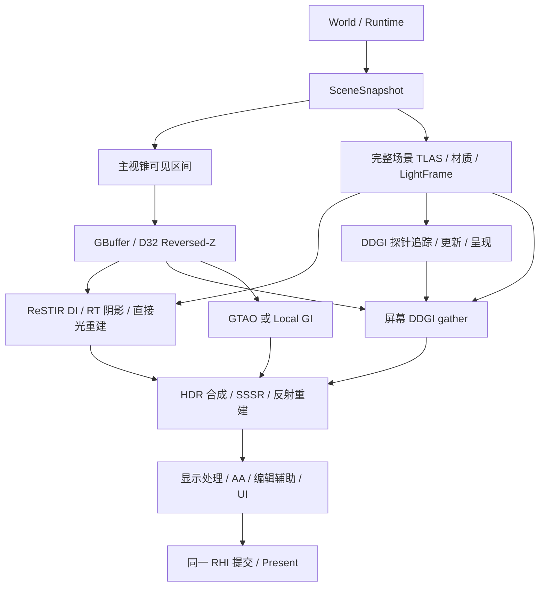

# 渲染管线现状与工业方案比较（2026-10-17）

状态：本报告保存研究时的管线比较与设计判断，依据主目录 `5e5d73c8` 加当时 WIP。用户随后批准基础修复与成本优化，实施及实际验收状态见[执行计划](direct-lighting-execution-plan-20261015.md)和[当前记录](../modules/renderer/acceptance.md#基础链路与精确工作复用2026-10-17)；下文的旧实测不是新版本性能。Flax 独立源码核对见[专项报告](flax-rendering-comparison-20261017.md)。Epic 页面本次标示 UE 5.8，Unity 使用 6.0/6000.0 文档；不同版本和项目设置不混为一套默认。

## 结论

当前引擎已具备较丰富的实时光照功能，以及明确的 World/Renderer/RHI 所有权、材质与历史身份合同。相对于成熟游戏引擎，主要差距是场景与绘制的增量组织、按实际受光需求执行、缓存复用、随机信号的求解/重建预算，以及编辑器调度。此前在缺少主视图物体级剔除时叠加复杂光照，已经产生可验证的基础浪费；同时，Lit 还有独立 GPU 成本，不能仅靠 CPU 修复达到目标。

Flax 值得作为规模相近、源码可查的工程参考；UE 和 Unity 适合参考成本控制机制。没有相同场景、硬件、内部分辨率、光型和阴影质量的对照，不能给它们排序 FPS，也不能把 Flax 默认关闭 GI 的配置与我们的完整 Lit 当作等价负载。

## 当前实际链路

下面是数据依赖示意，不表示这些 pass 已并行执行。

| 领域 | 当前能力与成熟度 |
|---|---|
| 场景与材质 | 单一 World 快照；共享不可变 Mesh/Surface；PBR 金属度/粗糙度、贴图、Opaque/Mask、发光；原始对象与帧历史身份分离 |
| 可见性与提交 | 新增保守主视锥剔除、保序连续实例区间；完整 RT/发光/阴影域保留。尚无主视图物体遮挡剔除、LOD 或整体 GPU-driven 提交。既有 SSSR 的层级深度和间接 dispatch 不等于这些功能 |
| 直接光 | 默认原生 ReSTIR DI；点光、矩形光和发光三角形共享局部源池，方向光独立；RT 可见性。精确列表与缓存阴影仍是候选，尚未迁移默认 |
| GI | DDGI 多体积/跟随、分类与重定位、反馈、运输/呈现分离、探针调试；屏幕八邻 gather 保留实际段遮挡。Local GI 是有界近场 SSIL 残差，不是已经完成的较远 SSGI |
| 图像稳定 | 直接光、DDGI、GTAO、SSSR 各自处理时域/空间稳定；最终 AA 支持 Off/TAA/SMAA/T2x，默认 SMAA。选 SMAA 不会自动关闭光照历史 |
| 精度与资源 | D32 Reversed-Z、独立前帧 R32 深度；显式 pass/resource owner、缓存与延迟退休。部分目标和后处理仍按整窗口分配/调度，尚非统一的 viewport 成本模型 |
| 测量 | 当前 CPU 提交与异步已完成 GPU 帧分开；父/子 pass 耗时不重复相加；正式窗口实际像素覆盖已校准。正常停靠布局与最新剔除的 GPU 结果仍待补测 |

实现依据：[Scene Lit 当前合同](../modules/renderer/scene-lit.md)、[Renderer 合同](../modules/renderer/contract.md)、[SceneLit pass owner](../../src/renderer/scene_lit.cpp)、[主视图剔除](../../src/renderer/scene_visibility.hpp)。

## 成本证据说明了什么

以下 GPU 数字来自 2026-10-16 已完成的 RX 6800 XT、原生 2560×1440 地牢视口，早于最新 CPU/视锥剔除增量；不是新版本 FPS。场景、相机及有效/污染样本的边界见[验收记录](../modules/renderer/acceptance.md)。

| 观测 | 数值 | 判断 |
|---|---:|---|
| 默认 Lit | 约 32～33 接受帧/秒，GPU 约 30 ms | 明显未达到 90 FPS |
| 直接光总项 | 约 13.1 ms，含约 6.7 ms 重建 | 选灯和追踪之外，重建本身已过重；不能只换阴影求解器 |
| DDGI 接收面 gather | 约 8.1 ms，约 2,768 万 LOS/帧 | 接收面查询接近每像素八邻上限，是独立大头 |
| DDGI 探针更新 | 约 0.7 ms | 降低 updates/frame 并不能直接消除屏幕 gather 成本 |
| 当前相机局部解析灯支持 | 有效接收像素最多 3 盏 | 只对这个场景/相机成立；全场灯数多不代表每个像素需要复杂的大规模随机选灯 |
| 新增主视锥 CPU 统计 | 3381 实例中保留 668，2652 相邻批次变为 557 可见区间 | 大量主视图提交可省；还没有 GPU 画面和性能验收，不能把数量比例换算成 FPS |

90 FPS 约为 11.11 ms/帧。同一旧基线里，直接光重建与 DDGI gather 合计约 14.8 ms，已超过这一预算。它们属于不同 GPU 子阶段，可相加；直接光总项和其重建子项不能再重复相加。CPU 与 GPU 时间也不能简单相加推出吞吐。

最近真实工程 CPU 测量中，场景快照中位数 3.984→3.062 ms，最大化 Workspace 描述 1.749→0.232 ms。正常停靠描述 11.578→7.671 ms 的测量没有 accepted UI 帧、UI prepare 或 Present，只能作同条件归因；不能用独立调用耗时冒充正式完整帧。

本次研究期间，[编辑器跨模块审查](editor-cross-module-audit-20261017.md)已完成：确认可恢复渲染错误忙重试、稀疏 World 的过量空间表预留、树行选择查询的 N×S 成本，以及结构变更最坏二次方搬移等 P2 问题。它们有源码依据，但本轮尚未修复或测得具体 FPS 影响。既有布局、文字与 coverage 缓存确实存在，不应把当前实现描述为每帧重测所有文字。后续调度也须分离渲染到期、服务唤醒与 Play 执行需求；不能简单降低整个 host loop 频率而改变模拟行为。

## Flax：值得借鉴的组织方式与边界

专项基于固定源码 `0cbc4be11fb55201d0f934ab0c312ca2fca5b68a`。关键区别如下，详细行号和来源由[专项报告](flax-rendering-comparison-20261017.md)维护。

| 方面 | Flax 已核实实现 | 对我们的启示 |
|---|---|---|
| 普通直接光 | 点/聚光 light volume、方向光全屏的逐灯 deferred 主路径 | 局部少灯时，直接计算和限制受光区域有实际价值；不能把所有像素都当作高复杂度随机积分 |
| DDGI trace | Global SDF 相交，再从 Global Surface Atlas 读取表面辐射 | 将几何追踪表示、表面着色缓存与探针照明分成不同职责，可复用昂贵计算 |
| DDGI gather | 每级八邻探针的距离矩、法线与三线性权重；跨级混合可能查询两级 | 把每像素读缓存作为常规成本，精确追踪放到有预算的更新/修正位置 |
| 场景组织 | 主视锥、LOD、实例批处理；可选遮挡；CPU 收集/构建/排序使用任务系统 | 先避免不必要工作，再并行剩余工作。其遮挡结果会读回 CPU，不应宣传成全 GPU-driven |
| 功能等价性 | 所查主入口未发现原生 Rectangle 或发光三角形 NEE；发光进入 Surface Atlas/DDGI | Flax 的发光 GI 不能直接替代我们的显式发光直接光与矩形灯语义 |
| 默认与限制 | GI 默认 None、AA 默认 TAA；遮挡非默认必开；SDF 与低分辨率 GI 有薄几何/小发光体限制 | 不能凭默认演示或功能名称推断同质量更快、更稳定 |

这些结论对应[Flax 源码](https://github.com/FlaxEngine/FlaxEngine/tree/0cbc4be11fb55201d0f934ab0c312ca2fca5b68a/Source/Engine/Renderer)及其[官方图形文档](https://docs.flaxengine.com/manual/graphics/index.html)，不推断未经测试的 Flax 帧率。

Flax 的价值在于一组互相配合的缓存、质量层级和有限工作预算，不是简单把硬件 RT 替换成 SDF。SDF 负责空间查询，Surface Atlas 负责表面辐射复用，DDGI 负责低频间接照明存储；三者解决不同问题。

## UE、Unity 与 RTXGI 的直接参照

**DDGI 的通常接收成本。** NVIDIA RTXGI-DDGI 固定提交 `f33e496ca31b3f0eec1c4e2cbaa8bb620e337fa6` 的 `DDGIGetVolumeIrradiance` 读取八邻探针，使用距离一二阶矩计算可见性权重；该 gather 函数不执行逐像素几何射线。我们的额外精确 LOS 是为薄墙和漏光采取的质量措施，并非 DDGI 的固定必需成本。它应作为当前质量基线，后续研究有界的缓存/局部修正，而不是直接删掉后宣布优化成功。[NVIDIA shader](https://github.com/NVIDIAGameWorks/RTXGI-DDGI/blob/f33e496ca31b3f0eec1c4e2cbaa8bb620e337fa6/rtxgi-sdk/shaders/ddgi/Irradiance.hlsl)

**UE 的 GI 成本组织。** Lumen 通过 Surface Cache 复用命中点表面光照，更新跨帧分摊；屏幕追踪与更完整的追踪表示互补。官方 High/Epic 的 GI+反射预算约 4/8 ms，对应 1080p 内部分辨率及特定主机目标，4K 输出依赖 TSR。该数字可用于理解预算机制，不能作为 RX 6800 XT 上原生 1440p 对照数据；SDF 模式也有薄墙和表示误差限制。[技术说明](https://dev.epicgames.com/documentation/en-us/unreal-engine/lumen-technical-details-in-unreal-engine)、[性能指南](https://dev.epicgames.com/documentation/en-us/unreal-engine/lumen-performance-guide-for-unreal-engine)

**随机直接光不是普遍错误。** 可选 MegaLights 使用重要性采样、有限光线预算和降噪，其质量仍受局部灯光复杂度与场景表示影响；这不等于它与我们的 ReSTIR 是同一种实现，也不保证成本完全不受场景影响。对当前最多三个局部解析源的固定接收区域，优先分离确定性直接贡献更有依据；密集发光几何和有限面积软阴影仍可能需要随机积分。[MegaLights 官方说明](https://dev.epicgames.com/documentation/en-us/unreal-engine/megalights-in-unreal-engine)

**VSM 的关键是按需缓存。** UE VSM 用 128×128 页组织高分辨率阴影，只生成需求页并缓存；灯光、投影者变化会使页失效。阴影深度生成与屏幕投影/软阴影过滤是两类成本。我们的缓存阴影候选曾在全暖、零重绘时仍较慢，说明直接换成更大的虚拟化系统不足以解决当前问题。[VSM 官方说明](https://dev.epicgames.com/documentation/en-us/unreal-engine/virtual-shadow-maps-in-unreal-engine)

**Unity 的提交与依赖组织。** Unity 6 URP 提供可选 GPU Resident Drawer，以批处理和实例化减少 CPU draw；GPU occlusion 使用当前/前帧深度保守筛选。Render Graph 将 pass 读写与资源生命周期显式化，从而省略无消费者 pass、复用临时资源。这些是可借鉴的机制，不意味着本项目必须先引入一整套通用 Render Graph 才能提速。[GPU Resident Drawer](https://docs.unity3d.com/6000.0/Documentation/Manual/urp/gpu-resident-drawer.html)、[遮挡剔除](https://docs.unity3d.com/6000.0/Documentation/Manual/urp/gpu-culling.html)、[Render Graph](https://docs.unity3d.com/6000.0/Documentation/Manual/urp/render-graph-introduction.html)

## 建议的演进顺序

1. **先完成基础链验收。** 验证新主视锥剔除画面、相机运动/重新入镜、离屏发光与阴影；测正常停靠和独立运行，分别定位 CPU/GPU。完成布局/World/RHI/宿主节奏的现有审查。主视图可见集不能代替 RT 与 GI 的完整影响域。
2. **按信号重组直接光。** 保留共享 LightFrame；先使确定性的少量解析贡献脱离通用随机重建，再针对软阴影、矩形与发光几何保留必要采样和重建。缓存阴影与 RT 按实测选择；不因已实现 atlas 就强制切换默认，也不把零半径灯的结果推广到所有软光源。
3. **把 DDGI 接收成本作为独立项目。** 目标是让大多数接收面从可复用信息完成查询，把几何精确修正限制在证据表明需要的区域/更新中。候选包括更可靠的距离/方向表示、置信度驱动的修正、低频照明采样与边缘感知重建；保留当前精确路径作固定验收基线。具体方案须同时通过薄墙、移动遮挡、开关灯、屏幕外发光和相机变化，不能用漏光换速度。
4. **按消费者裁剪 pass 和资源。** 区分几何、光照信号和输出分辨率；检查全窗口目标、无效 clear、重建和拷贝，以测量决定融合/复用。D32 和前帧 FP32 深度保持；低频照明可以另设采样预算，不必牺牲主几何和最终画面的清晰度。
5. **SDF/表面缓存作为有门槛的支持设施。** 先用当前硬件 RT 提供正确性参考；评估 mesh SDF 导入/更新、静动态管理、内存、Mask/薄几何表示和 Surface Atlas 的表面覆盖/失效成本。只有整体预算与质量获益时接入。保留此前约定的“改良 DDGI＋可靠 SSGI”和“表面探针＋世界缓存”同总预算比较，不在本次研究中提前宣布胜出路线。

需要的协作继续走既有所有者：World/Runtime 管统一变更和身份；Application 管宿主调度；Renderer 管场景表示、pass 和缓存；RHI 管低层批处理、资源与提交能力。增量提取不能仅凭 Session revision 跳过直接 Runtime 修改。更复杂的遮挡、间接绘制或多队列功能需由实际瓶颈推动，不绕过 RHI。

## 公平对照的门槛

- 相同硬件、同相机/可见几何和材质；分别记录 Editor 与独立运行。明确内部/输出分辨率、AA、VSync、冷启动与预热状态，采样不含 shader 编译与截图同步。
- 校准灯光单位、光型、发光贡献、软阴影和 GI 实际启用状态。Flax 发光只经 GI 的主路径与本项目 mesh NEE 不能仅复制 intensity 就认为能量一致。
- 报告实际局部灯重叠、像素覆盖、可见/提交实例、光线数、重建次数、资源字节和 CPU/GPU 分项；不只比较总灯数或 FPS。
- 动态质量覆盖相机移动、灯光/物体移动、开关灯、薄墙、屏幕外发光和缓存失效。相同总预算下同时比较收敛、漏光、噪声、拖影和细节。
- 本轮无外部引擎实机对照，不预估 Flax、UE 或 Unity 在该地牢会达到多少 FPS。Flax 是源码公开且有自定义许可的项目；设计研究与源码复用是不同事项，具体许可链接见专项报告。

调研方法：本线程的 Exa 调用出现连接错误，后续直接核对上述官方文档和固定源码；Flax 子研究的 Exa 检索成功，再以固定提交核对实现。没有把检索命中数当作已验证的性能证据。
