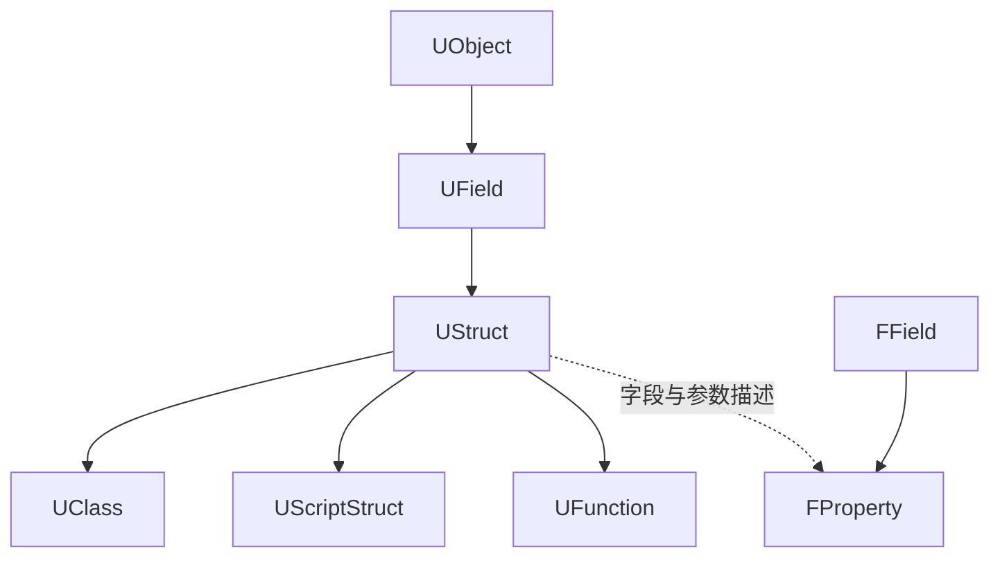

# 类型与对象运行时

状态：成组类型发布、定型引用、外部根、非移动分步 GC、标量及含引用记录的值操作、同步/协程源码执行和单入口兼容方法体发布已实现。UE 部分依据官方 5.8 API，本项目部分依据当前源码。能力范围及验收入口见 [README](../README.md)，语言层语义见 [语言契约](language-contract.md)，模块分工与所有权见[执行结构说明](runtime-structure.md)。

## 当前落点

| 状态 | 内容 |
| --- | --- |
| 已实现 | 统一成组类型发布、原生与描述型对象/记录、定型引用读写、受保护创建、外部对象根和外部值根、观察取得、隐藏字段与嵌套引用遍历；非移动分步 GC；共享函数签名、同步/协程 JIT 执行、协作安全点、兼容方法体发布及旧版本保活 |
| 尚未实现 | 引擎 Tick 调度、完整语言、任意值执行栈、跨方法热更新与对象布局迁移 |
| 已完成检查点 | [对象引用最小闭环](#对象引用最小闭环)：受根保护的混合引用环保活，撤根后分步回收，死亡提交后不能复活 |
| 后续按需设计 | stage 的参与线程、并发/分代、堆布局；CDPT、LXR、Nofl 属于[研究候选](research/gc-game-engine-options.md)，不自动成为实现任务 |

本文维护运行时协议；业务可观察语义以语言契约为准，能力范围和构建入口见 README。模块归属、执行链及结构性技术债集中在[执行结构说明](runtime-structure.md)，研究笔记保留阶段证据和候选，不作为另一份当前契约。

## UE 的结构与职责

以下实线表示继承，虚线表示使用属性描述：



这张图是描述结构的关系，不是业务对象的包含关系或每次函数调用的路径。[UStruct](https://dev.epicgames.com/documentation/en-us/unreal-engine/API/Runtime/CoreUObject/UStruct)、[FProperty](https://dev.epicgames.com/documentation/en-us/unreal-engine/API/Runtime/CoreUObject/FProperty)

| 结构 | 职责 |
| --- | --- |
| `UObject` | 对象实例的公共基础；实例关联描述其类型的 `UClass` |
| `UClass` | 描述 UObject 类；它自身也是反射对象，不是某个业务实例 |
| `UScriptStruct` | 描述值结构，并提供对实际结构值的操作 |
| `FProperty` | 描述字段或参数槽位的类型、位置与值操作，不是字段值本身 |
| `UFunction` | 描述函数的参数、返回值等信息，并关联执行入口 |

类型描述与实例的区别见 [UObject](https://dev.epicgames.com/documentation/en-us/unreal-engine/API/Runtime/CoreUObject/UObject)、[UClass](https://dev.epicgames.com/documentation/en-us/unreal-engine/API/Runtime/CoreUObject/UClass)、[UScriptStruct](https://dev.epicgames.com/documentation/en-us/unreal-engine/API/Runtime/CoreUObject/UScriptStruct)。三个需要注意的细节：

- **`UStruct` 是含字段的反射描述基类。** 它同时服务类、值结构和函数；不能把它理解为一个用户 struct 的数据实例，也不能用 `UClass` 概括所有值类型。
- **`FProperty` 不只是名称和偏移。** 具体属性种类提供 `InitializeValue`、`CopyCompleteValue`、`DestroyValue`、`ContainerPtrToValuePtr` 等操作，能够按值的性质处理存储；它继承 `FField`，不是一个 `UObject`。[FProperty API](https://dev.epicgames.com/documentation/en-us/unreal-engine/API/Runtime/CoreUObject/FProperty)
- **`UFunction` 复用字段描述表达参数和返回值。** 其 `NumParms`、`ParmsSize`、`ReturnValueOffset`、`GetReturnProperty()` 对应调用数据描述，`FNativeFuncPtr` 对应原生入口。共用描述方式不意味着原生 ABI 与反射调用的数据布局相同。[UFunction API](https://dev.epicgames.com/documentation/en-us/unreal-engine/API/Runtime/CoreUObject/UFunction)

类型描述如何连接原生实现与蓝图执行器，沿用 [上一轮执行路径核查](research/uobject-execution-model.md)。本轮未验证各属性子类、调用方式或 GC 配置的完整行为。

## 本项目已有的对应结构

| 职责 | 当前实现 | 当前边界 |
| --- | --- | --- |
| 发布类型定义 | 一组 `TypeDefinition` → `Runtime::register_types` → `Impl::Type` | 解析全部依赖、验证并完成布局后整体发布；首次成功创建对象后封闭注册 |
| 查询类型信息 | `TypeInfo`、`TypeId` | 标量、记录、对象共用类型表；没有继承或定义版本切换 |
| 标识对象实例 | `ObjectId`、`Impl::Slot`、实例存储 | 运行时上下文与代际校验；显式销毁或 GC 提交死亡后拒绝访问，GC 不搬迁存活对象 |
| 描述和定位字段 | `FieldInfo::value`、`ValueDescription`、`FieldStorage` | 内联值与 `ReferenceSlot` 均可操作；隐藏字段不暴露公共字段标识，但参与值能力和引用遍历 |
| 操作值的生命周期与内容 | `initialize_value`、`copy_construct_value`、`assign_value`、`destroy_value` | 调用方提供存储；标量和含引用记录共用四个入口，引用复制保持目标身份 |
| 描述和执行函数 | `SignatureDefinition`、`FunctionSignature`、`MethodInfo`、`Invoker`、`CallContext` | 原生与源码共用接收者/参数/结果描述及解析；当前为标量值参数和 `void/float/uint` 结果，执行实现仍分开 |
| 执行准入与根槽 | `ExecutionScope`、`ExecutionFrame` | 活动调用计数、借用/遍历禁入与稳定根槽；挂起保留存储，但不保持活动执行作用域 |
| 协程帧拥有者 | `Coroutine`、`CoroutineFrame` | 同线程状态、恢复、合作取消和结果；具体编译帧负责根、存储和代码版本的释放 |
| 发布原生类型 | `NativeRegistration<T>` | `build()` 产出同一个 `TypeDefinition`，推导字段、参数、返回及原生接收者 const 信息，类型依赖延迟到发布时解析；无独立注册表 |
| 表达对象引用 | `ObjectReference`、`ReferenceSlot` | 前者是定型传递值，后者是紧凑字段存储；二者不自动创建外部根 |
| 登记外部持有 | `ObjectRoot`、`ValueRoot` | 对象根支持复制/移动，值根可移动且借用调用方存储；撤根不等于销毁 |
| 枚举引用边 | `visit_roots`、`visit_references` | 区分持有/观察，递归内联记录而不递归对象图；GC 使用同一字段定义派生的持有边追踪计划 |
| 分步回收对象 | `begin_collection`、`collect_step`、`CollectionProgress` | 宿主显式安全点推进根处理、标记和清扫；统一死亡提交，析构按步执行，时间预算为软上限 |

源码依据：[公开定义](../src/runtime/runtime.hpp)、[注册与运行时实现](../src/runtime/runtime.cpp)、[原生定义生产者](../src/runtime/native.hpp)。

`TypeDefinition` 是发布输入，`TypeInfo` 是发布后元数据的查询面；它们指向同一类型身份，不能因结构体不同就判定为两套类型世界。`Runtime::call` 仍只执行原生 `Invoker`；源码编译与 JIT 经独立执行作用域使用同一 Runtime，不把机器码地址塞进原生借用通路。仅 JIT 的决定见[编译与执行契约](language-contract.md#编译与执行)。

## 共享函数签名与结果

`SignatureDefinition` 使用既有 `TypeReference` / `ValueDefinition` 表达参数、可选结果和可选接收者；`Runtime::resolve_signature` 返回拥有其描述数组的 `FunctionSignature`。它只解析已发布类型，不登记函数、不拥有 Runtime 或代码，在类型注册封闭后仍可查询。成组方法发布复用同一私有验证实现，并在事务内处理暂存类型；成员接收者默认取所属对象类型，显式提供者必须匹配，不让临时身份逃逸。空结果表示 `void`，不是伪造的类型 ID 或零标量。

原生成员的权威签名归 `MethodInfo::signature`，源码入口的权威签名归既有程序所有者的不可变声明。AST 分类、LLVM 类型和私有 DLL 参数描述是经核对的转换表示，不是另立业务类型身份或独立手填的声明。没有新增全局函数注册表、通用装箱调用帧或另一套公开 prepared 句柄。

`NativeRegistration::method` 从实际成员指针推导 `void/float/uint32_t` 结果及接收者 const 信息，目标仍是模板常量。`read_only` 记录接收者访问要求，不代表纯函数、整个对象图不可变或已实现语言借用参数。参数仍仅支持两种标量按值传递；记录、引用参数/结果及其他形式在解析或推导时拒绝，不能退化成裸指针或值传递。

`Runtime::call(object, method, arguments, Scalar* output = nullptr)` 保留 `Result<void>` 错误通道；非 void 方法缺少输出存储时在进入用户代码前返回 `invalid_storage`。Invoker 只把业务值写入初始为空的 `CallContext::result`。运行时先保留调用错误，再核对成功值与声明，最后提交 output；缺值、错类型或 void 方法伪造结果均失败。void 不修改可选的 output，任意失败保留调用方原值，但不回滚已经发生的业务修改。原生异常、生命周期借用和准入保护保持原规则。

原生/描述型对象已通过相同的标量结果、const 元数据、嵌套调用、错误首因和结果不提交验收。源码可以使用原生标量结果参与计算，也可作为语句丢弃成功值；丢弃不吞掉错误。嵌套实参先按顺序求值并保留 SSA 值，再写共享外层调用缓冲，后续调用不能覆盖先前实参或结果。错类型/漏写的原生 ABI 结果在生成清理后失败，不复用上次调用的值。

成功的 ABI 回调若漏写结果或返回错误标量种类，生成代码在检测点记录独立失败原因，共享清理结束后由 DLL 出口报告明确的结果契约违约诊断；宿主沿原调用入口接收该诊断。原因仅属于本次调用，不与回调的非零状态码共用编码，服务状态仍逐值透传，已有宿主错误首因优先。公开调用 ABI 和服务表不变，失败不提交结果，后续成功调用不继承旧诊断。

## 对精简 kit 的设计判断

**保留已有的统一注册与对象身份机制。** 当前已有类型描述、实例存储和执行入口的分工；下一步沿这条链补齐能力，不因 UE 使用了某个继承层级就新增对应基类。类型元数据自身是否成为业务对象，也不是统一类型身份的前提。

**沿现有值操作机制扩展字段能力。** `FieldDefinition::value` 描述目标类型与值形式；对象仍不能内联，但引用字段和含引用记录已可操作。原生引用成员使用 `ReferenceSlot`，通过 `field` 或 `hidden_field` 报告；`NativeLayout` 继续由 C++ 构造、析构和复制其实际子对象，运行时不重复执行原生字段生命周期。

已确认的字段契约见下文。原生注册和未来语言编译器都要提供足以履行生命周期规则的信息，不能仅依赖编辑器公开的字段列表。

**按需求扩大执行能力。** 共享签名和原生/源码标量结果已贯通；一般记录与引用参数/结果仍需真实用例驱动复制、借用、构造、根交接与清理，不把当前原生回调或私有标量桥接冻结为永久语言 ABI。继承、默认对象、序列化与包加载按实际用例逐项加入，不设计解释字节码集。

## 字段契约

状态：`ValueDefinition`、`ValueDescription` 与 `ValueForm`、成组类型发布、引用实例和外部根均已实现。引用存储与根登记已接通，GC 回收及跨步进的修改保护留给下一检查点。

### 类型与值的使用方式

同一个对象类型可以被持有引用或观察引用指向，字段分别描述目标类型和保存方式。字段与函数参数/结果元数据复用以下值描述；当前函数执行只支持内联标量参数和可选标量结果，值形式不等同于传参借用方式：

```cpp
enum class ValueForm { inline_value, strong_reference, weak_reference };

struct ValueDescription {
    TypeId type;
    ValueForm form{ValueForm::inline_value};
};
```

第一版的合法组合：标量和记录使用 `inline_value`，对象类型使用两种引用形式。这里的引用仅指对象引用，值的借用和传参方式另定。引用字段存储引用值，其大小不等于目标对象实例的大小；布局由值描述及对应的存储规则决定。

字段负责名称、所属类型、值描述及定位信息。值描述存于共享元数据，不要求未来每个字段值附带运行时类型标签。描述型字段保留计算偏移，原生字段保留成员地址适配。参数复用值描述，但参数布局和调用 ABI 不因此变成字段布局。

### 已实现的成组类型发布

`TypeReference` 是定义输入中的类型选择器，可以持有本运行时已发布的 `TypeId`、完整声明名称，或由 `TypeReference::native<T>()` 生成的 C++ 表示标记。名称按精确字符串匹配同批和已发布定义，不做短名回退或语言作用域解析。`ValueDefinition` 组合该选择器与 `ValueForm`；发布后的 `ValueDescription` 只保留已解析的 `TypeId` 与值形式，不创建第二套业务类型身份。

```cpp
std::vector<TypeDefinition> definitions(2);
definitions[0].name = "sample.A";
definitions[0].fields = {
    {"next", {TypeReference{"sample.B"}, ValueForm::strong_reference}}
};
definitions[1].name = "sample.B";
definitions[1].fields = {
    {"previous", {TypeReference{"sample.A"}, ValueForm::weak_reference}}
};
auto published = runtime.register_types(std::move(definitions));
```

`register_types` 返回按输入顺序排列的类型标识；空批次拒绝。先在事务内解析全部类型身份，校验字段、方法与原生表示，再按内联依赖完成布局和能力汇总。只有内联边参与布局环检查，持有/观察引用边不递归展开目标实例。所有可能分配存储的准备工作完成后才提交；失败不公开临时身份、名称或 C++ 表示映射，已发布的元数据保持有效。单条 `register_type` 复用同一个事务入口。

`NativeRegistration<T>::build()` 消费定义生产者并交出 `TypeDefinition`，可与描述型定义一起提交；默认 `field` 通过 C++ 表示延迟解析，支持同批尚未发布的原生记录。显式 `field<成员指针>(名称, ValueDefinition)` 可指定同批目标和值形式，发布时仍校验成员的实际 C++ 表示。原生构造和用户方法不在发布过程中执行。

引用字段按 `ReferenceSlot` 的尺寸和对齐布局，原生引用字段也必须提供相同的 C++ 表示，不再接受裸 `ObjectId` 成员作为引用槽。`TypeInfo::contains_references` 从所有已声明字段及内联依赖传播，包括 `hidden_field`；它现在用于引用遍历，不再禁止实例化或统一关闭复制能力。原生代码仍须完整报告引用，运行时不会从任意 C++ 裸指针推断持有关系。

### 已实现的定型引用与外部根

| 表示 | 职责 | 不承担的职责 |
| --- | --- | --- |
| `ObjectId` | 保存运行时内的对象身份与代际 | 不证明静态类型，不登记持有 |
| `ReferenceSlot` | 保存字段中的目标身份，默认空；目标类型与形式在共享元数据中 | 不逐字段注册外部根，不给每个字段附加类型标签 |
| `ObjectReference` | 在接口间传递目标类型、持有/观察形式和身份；允许复制失效身份 | 单独保存在 C++ 变量中不会自动登记外部持有 |
| `ObjectRoot` | RAII 外部对象根；复制增加独立登记，移动转移登记 | 不阻止显式销毁，不延长 Runtime 本身的生命 |
| `ValueRoot` | 在明确存续期内借用并登记调用方的活值存储，支持移动 | 不拥有存储，不自动析构该值 |

`create(TypeId)` 现在返回 `Result<ObjectRoot>`，不再返回裸身份。对象与首个根在交付前一起完成发布；创建失败不遗留本次创建的对象或根，原生回调对其他对象的外部副作用仍不自动回滚。`hold(ObjectId)` 检查活对象并建立定型根；`hold(ObjectReference)` 只接收持有形式，允许保留已经失效的身份而不复活目标。

`observe` 将定型引用转换为观察形式，不建立根。`try_acquire` 只接收观察形式，返回 `Result<std::optional<ObjectRoot>>`：空或失效目标产生空结果，活目标交付已经登记的根；错误类型或跨运行时引用报告错误。弱引用不能直接写入持有字段，须先成功取得根。持有引用可写入同类型观察字段，或先通过 `observe` 转换。普通空/失效取得不抛异常；根登记分配失败仍遵守现有内存耗尽边界。

`read_reference/write_reference` 支持对象字段路径和调用方的记录存储。路径只穿过内联记录，不隐式解引用对象；已有定型引用的同形式复制不要求目标仍然存活。可信原生代码可用 `ValueDescription + ReferenceSlot` 重载访问未公开成员，但必须提供该槽真实的声明描述并保持宿主存储有效。引用槽不能通过任意原生赋值绕过 Runtime；整条原生记录复制通过四个值操作入口执行。

`root_value(TypeId, storage)` 登记已经构造且容量、对齐正确的标量或记录存储；只使用类型大小对应的字节。调用方须保持存储地址及活值状态有效，撤销全部重叠登记后才能重建或销毁该值。赋值允许在登记期间更新内容，根始终指向同一份存储。此接口仍是可信原生接口，不验证任意字节是否真的处于构造状态，也不接管运行时对象内部存储的所有权。

存储重叠检查只遍历紧凑的活跃 `ValueRoot` 索引，复杂度随当前活跃值根数量变化，不随对象根数量或历史根登记峰值增长。撤根使用末项交换移除并更新反向位置，不移动借用的值存储，不改变根句柄身份。GC 的根阶段仍按既定工作单位扫描登记项；该优化不改变其计量规则。

根句柄持有独立的根登记表，Runtime 结束时使该表失效并照常销毁对象；迟于 Runtime 释放根句柄不会访问已销毁的 Runtime。这里的内部共享所有权只保护登记表，不是用 `shared_ptr` 管理业务对象。`ObjectRoot::registered()` 仅表示登记所属 Runtime 仍存在，不能替代目标有效性检查：对象可能已被显式销毁，失效身份也可以继续登记。根撤销不立即销毁目标；宿主继续推进收集后，不再可达的对象才进入回收。

`visit_roots` 枚举外部入口；`visit_references` 枚举单个对象或外部值中的引用，递归内联记录而不继续遍历所指对象。访问者收到非空的持有和观察引用，也可能收到已失效身份；收集器应据形式与代际判断后续处理。`hidden_field` 只控制公共反射字段的暴露，不是语言访问权限机制；它仍参与引用遍历。

遍历期间拒绝 Runtime 的对象/值/字段修改、方法执行和新增根，访问者抛出的异常转换为 `invocation_failed`，正常返回后解除保护。C++ 根复制会新增登记，因此不能在访问者中执行；Root 的撤销不销毁目标，允许解除登记，但访问者必须始终保持借用的值存储有效，不能绕过接口释放或改写该存储。普通方法回调中的合法引用写入、根登记和观察取得仍可执行。

### 值操作

| 操作 | 必须表达的行为 |
| --- | --- |
| 初始化 | 在未构造的存储中建立合法值；不预定所有类型都能默认构造 |
| 复制构造 | 在未构造的存储中建立一个值副本 |
| 赋值 | 替换已构造值，维护原值与新值的引用关系；不隐式克隆目标对象 |
| 销毁 | 结束该值的生命周期及持有关系；销毁引用值不等于显式销毁目标对象 |
| 枚举对象引用 | 给引用管理提供该值包含的对象关系及其持有/观察性质 |

这些是行为契约，不要求逐字段存储一套函数指针或每次操作动态分派。操作可按类型与值形式共享，平凡值保留直接处理路径。复制失效句柄仍遵守已确认的值语义，不能借复制将其重新解析成另一个对象。

原生对象仍由其 C++ 构造和析构负责自身字段，描述型对象由运行时执行字段操作，避免对同一字段重复构造或释放。原生对象中的托管引用仍须提供完整的引用信息，即使字段不对编辑器公开。原生裸指针本身不足以说明是否保活目标。

### 已实现的值操作入口

当前接口服务引擎内部和可信原生调用方，操作标量及记录，包括含持有/观察引用的记录。调用方提供存储，运行时不为值分配存储或创建对象身份；需要作为外部持有入口的活值另外登记 `ValueRoot`：

```cpp
Result<void> initialize_value(TypeId, std::span<std::byte> destination);
Result<void> copy_construct_value(TypeId, std::span<std::byte> destination,
                                  std::span<const std::byte> source);
Result<void> assign_value(TypeId, std::span<std::byte> destination,
                         std::span<const std::byte> source);
Result<void> destroy_value(TypeId, std::span<std::byte> storage);
```

运行时在修改前检查类型、容量、对齐、操作能力及重叠范围。每个缓冲区只使用 `TypeInfo::size` 字节；复制构造禁止重叠，支持赋值的类型允许原址自赋值并直接成功，部分重叠则拒绝。调用方保证源值已构造、目标处于操作要求的构造状态、实际 C++ 表示正确，以及存储有效；这些条件无法仅凭字节视图验证。调用方须在所属运行时结束前销毁值，运行时不会自动清理外部值。已登记的外部值禁止重建和销毁，须先撤销其根登记；复制引用值不自动新增根或克隆对象。

`TypeInfo::copy_constructible` 与 `copy_assignable` 分别表达两种能力。原生记录依据其 C++ 操作生成适配，描述型记录在发布时汇总全部内联依赖的能力，引用槽本身支持身份复制。缺少能力时，整个操作在开始前拒绝，不以字节复制替代其语义。当前已注册值均可默认构造和无异常销毁，这不是未来所有类型的永久要求。

已确认并实现的失败保证：初始化/复制构造失败时，描述型记录逆序清理已经构造的部分，原生构造由 C++ 自行展开；失败目标不留下活值，无需再次销毁。赋值失败时保持基本不变量和可销毁状态，允许部分字段已改变，不自动备份或回滚。原生操作必须履行这一约束；外部副作用不由运行时撤销。

构造失败报告 `construction_failed`，赋值失败报告 `assignment_failed`，存储检查失败报告 `invalid_storage`，缺少复制能力报告 `unsupported_operation`。原生操作仍处于现有回调保护范围内，不能创建、销毁运行时对象或注册类型。值操作本身不关闭后续类型注册。

描述型构造、复制、赋值、销毁及同步引用遍历使用显式可复用工作栈，不再以 C++ 调用栈承载内联布局深度。发布前按执行计划预留最大遍历深度；回调重入的公开值操作在修改前预留新增深度，并以独立栈区间隔离。原生回调可能扩容工作栈，因此循环不跨回调保留栈元素引用。构造失败复用已有容量逆序清理已完成部分，原生子对象仍由其 C++ 操作负责，不重复展开。

发布时派生需要析构的字段计划：内建平凡叶及只含平凡值的描述型子树无需逐字段调用空析构；任何显式注册的原生析构仍在原地址、原顺序执行一次，不能以“不含引用”代替平凡性判断。持有引用追踪与析构计划相互独立。

无填充、仅由同一种内建 `f32` 或 `u32` 组成的描述型布局可执行标量块快路。初始化以字节偏移逐个建立正确标量类型，允许编译器合并写入；复制构造和非重叠赋值只复制 `TypeInfo::size` 字节。任意自定义原生类型、引用、空记录和异质子树均不采用此快路；自赋值、能力预检与部分重叠拒绝保持不变。实现依据与测量边界见[定向研究记录](research/runtime-source-reference.md#平凡操作与深层遍历的实现依据)。

## 已实现的分步回收

首版采用单线程、非移动的增量标记—清扫，继续复用统一类型表、对象代际身份、`ObjectRoot`/`ValueRoot` 和引用写入入口，不建立另一套对象堆或持有体系。宿主只在当前运行时线程的安全点推进；回调期间拒绝启动或推进 GC。引擎阶段与 GC 阶段的区别见 [CONTEXT](../CONTEXT.md#引用追踪与执行协调)，单线程轮询不授权其他线程同时改动对象图。

### 入口与阶段

| 入口/阶段 | 行为 |
| --- | --- |
| `begin_collection()` | 只允许从 `idle` 开始；先预留嵌套记录游标容量，再开启新标记轮次。容量准备失败不启动收集；轮次号耗尽报告 `capacity_exceeded`，不回绕旧标记 |
| `roots` | 分步检查开始时已有的根登记项，持有对象进入标记队列，含持有引用的外部值进入值追踪队列；期间新增根即时补记 |
| `mark` | 按类型派生的持有字段计划推进，隐藏字段与嵌套记录同样参与；观察字段不保活。嵌套记录游标跨步保存，不要求一个大对象在单步内扫完 |
| 标记结束 | 队列及当前游标均完成后，一次提交整轮死亡判定；不另做全堆失效扫描。未标记对象立即不再有效，但析构可以尚未执行 |
| `sweep` | 按槽位分步析构并释放已判死对象，更新代际后复用空槽；清扫期间新对象视为本轮存活，不被本轮再次回收 |
| `collect_step(CollectionBudget)` | 执行限定工作后返回 `CollectionProgress`；阶段回到 `idle` 表示本轮完成，空闲时调用返回零工作，不自动开始下一轮 |
| 状态查询 | `collection_phase()` 报告阶段；`live_objects()` 排除已判死对象；`pending_reclamation()` 只计已判死但尚未释放的对象 |

分配、普通值操作、撤销根都不隐式开始或推进收集。宿主决定何时调用 `begin_collection`，之后在各安全点重复 `collect_step` 直至空闲；尚未实现 Tick 调度器、后台线程或分配压力触发策略。

### 跨步进修改与生命周期

- 标记期间新增/复制对象根、成功观察取得以及新对象发布都对活目标补标，并把尚未追踪的对象加入队列。创建结果和观察取得结果在返回前已登记根。
- 三种引用写入路径——对象字段、外部值字段、可信原生槽——共用写入保护；持有边的新目标补标，观察边不补标。目标已经扫过也不会漏掉后来写入的持有边。
- 值初始化/复制构造成功后，以及赋值成功或部分失败后，追踪结果值中的持有边。原生部分更新沿用既有基本失败保证，不能因返回错误而漏掉已经写入的引用。
- 写入保护是保守的：已经标记的对象即使在本轮内撤根或删边，也可能保留到下一轮；对未登记外部值的本轮引用写入/复制也会补标，但不会把该值变成永久根。
- 新登记的外部值进入追踪队列；撤销值根移除排队项，并取消正在借用该登记存储的游标。若撤销发生在原生字段定位回调中，回调返回后先检查取消状态，不读取其返回的引用槽，也不重新压入内联子游标。调用方仍须先撤销全部重叠登记，且等当前同步借用返回后，再销毁或释放存储；普通访问者对借用存储的保护约定不变。
- 显式销毁取消该对象的排队标记或活动游标，释放存储并更新代际；它仍可使持有引用失效。Runtime 在任一收集阶段退出都会释放剩余对象，脱离运行时的根句柄仍可安全复制、移动和释放。

死亡提交后，`try_acquire` 对已判死目标返回空；对象访问、调用和 `hold(ObjectId)` 拒绝该身份。`hold(ObjectReference)` 仍可复制定型的失效持有身份，但不能使目标复活。引用不会因为 GC 自动清空；槽位复用不能把旧引用绑定到新对象。原生析构看到的同轮已判死对象均已失效，不允许因内存尚未释放而访问它们，也不允许重入收集。

### 工作量与时间预算

`CollectionBudget::max_work` 必须为正；`max_time` 为零表示关闭时间限制，负数拒绝。`CollectionProgress` 返回本步阶段、`work_done`、`reclaimed`、`pending_reclamation` 和实际 `elapsed`。

一个工作单位是一次根登记项检查、一次队列取项、一个持有字段/内联记录进入或退出、一次清扫槽位检查，或一次阶段转换。空登记项和空槽也消耗工作量；检查到死亡槽位时，其完整析构和释放属于该单位。标记队列使用现有槽位/根登记项的链接，嵌套游标在开始前预留容量；收集步不为这些追踪结构逐项分配。

时间限制只在工作单位之间检查；非空闲步骤至少执行一个单位，所以是软上限，单个长原生析构不可中断。开始时的容量准备、业务执行中的引用写入保护、整值复制/赋值及其追踪不属于某次 `collect_step` 的预算。不能由工作单位数量推导固定毫秒数，也不承诺任意分配速度下都能在固定帧预算内完成回收；当前未测量真实游戏负载的吞吐或尾延迟。

## 对象引用最小闭环

状态：成组定义发布、定型引用、外部根、观察取得、引用读写/遍历与分步 GC 均已通过开发/发布配置的端到端验收。原生与描述型对象使用同一张可追踪引用图；语言编译器和 JIT 未加入本次交付。

验收终点已经落实：

- `外部根 → A ↔ B` 同时包含原生与描述型对象；根存在时收集后保活，存活对象地址不变，撤根后回收整个不可达环。
- 隐藏原生持有字段和嵌套记录参与保活，观察边不保活；死亡提交早于析构，观察取得失败，旧身份与槽位复用保持隔离。
- 两次步进之间修改字段、新增/复制根、观察取得或创建对象，不误回收新受持有的目标；清扫期间的新对象继续存活。
- 外部值改写、晚登记根、复制构造以及原生赋值部分失败都维持标记保护；未登记的值和本轮保守标记不会成为永久根。
- 暂停游标下的显式销毁、值根撤销、排队存储释放、登记项复用及任意收集阶段的 Runtime 退出均完成清理；预算错误及回调重入被拒绝。

对象引用检查点之后，已以真实机器生产推进贯通受控 JIT、同一 Runtime 与对象执行根，见下面的执行协议。执行中的局部持有由生成代码和宿主共同报告，不把每个标量临时值包装成根。代码更新与对象结构迁移仍分开设计；继承、序列化、完整编辑器、专用堆和高级并发 GC 不自动加入后续任务。参考依据见[源码清单](research/runtime-source-reference.md)；CDPT、LXR、Nofl 仍仅为[机制候选](research/gc-game-engine-options.md)，不是待移植清单。

## JIT-only 接入准备

状态：仅 JIT、编译完成后执行已经确认。Windows 平台、最小源码业务调用、单绑定类型源码引用局部及单入口兼容方法体发布均通过开发/发布配置，范围和命令见 [README](../README.md#jit-业务执行闭环)。共享对象运行时、执行引用槽、安全点及窄范围发布/退休已经贯通；通用值帧、通用方法分派与布局迁移未实现。以下先描述已实现协议，再列仍待语言层落实的契约。

### 已实现的最小业务执行协议

核心执行协议位于 [execution.hpp](../src/runtime/execution.hpp) / [execution.cpp](../src/runtime/execution.cpp)，不依赖 LLVM。正式 [source::Program](../src/source/program.hpp) 管理源码调用与发布，[内部桥接](../src/source/detail/bridge.cpp)连接共享 Runtime，[源码前端](../src/language/source.hpp)产出定型 AST，[LLVM 后端](../src/jit/source_backend.cpp)编译并拥有机器码。端到端验收作为这些模块的消费者；支持范围见[最小源码子集](language-contract.md#已实现的最小源码子集)。

1. **准入与身份**：宿主在登记新根和业务副作用之前取得 `ExecutionScope::enter(runtime)`，覆盖入场准备、生成执行和帧清理。准入检查关停、原生借用和只读遍历，不要求 GC 周期已结束；活动调用另由 Runtime 计数，供发布检查拒绝未静止状态。原始代码入口完整核对 Runtime、参数、成员目录和布局；已验证发布版本复用不可变准备，但仍逐次检查实际参数及需要/提供的接收者活身份与类型。不能以根登记成功替代存活校验，不能在热路径省略代际或代码保活。
2. **帧与存储**：`ExecutionFrame` 借用调用方已构造、地址稳定且独占使用的 `ObjectRoot` 槽，拥有槽中根登记；Runtime、槽存储和上下文必须保持到执行帧清理完毕。Frame 不复制、不移动，自身不分配堆，槽编号不是对象身份。编译产物报告强/弱槽及实际 AST 原生调用最大实参数；每个版本保留自己的需求，每次 Invocation 独占存储，同次调用内复用缓冲。不再扫描整个目录选最大参数数，未使用的九参数方法不会迫使当前入口扩展参数缓冲。生成帧只预留接收者槽，纯标量入口不登记它；机器快照由验收消费者独立持根。尚无通用记录值帧或共享 scratch 池。
3. **更新与交接**：`hold(ObjectId)` 仍验证入场活对象；新增 `hold(ObjectReference)` 与 `reference` 保留类型描述，支持复制合法的空值/过期身份而不重新要求存活。成功取得新根后才替换旧槽，失败保留原根；观察取得直接移交已取得的登记。`object` 只交付身份，后续 Runtime 访问仍检查代际；根不阻止显式销毁。`take` 提供宿主根交接，验证活身份后移动原登记，不能据此定义一般源码引用返回。`clear` 和析构复用原有撤根/游标取消协议。
4. **安全点与预算**：`request_collection` 只提出请求，与已有收集周期合并，不自行开始 GC。`poll` 先检查准入和预算，仅在有请求且空闲时开始新周期，最多推进一次既有 `collect_step`；没有请求且空闲时返回零工作。轮次未完成可留给后续宿主安全点，不因函数返回强行排尽。根操作、字段访问和原生调用不计入 GC 步预算，时间上限仍是软预算。
5. **原生借用**：整个 JIT 入口不包装成 `Runtime::call` 的 Invoker。原生成员调用通过已缓存 `MethodId` 进入 Runtime，支持零个或多个标量参数及 `void/float/uint` 结果；状态与结果存储分开。借用结束后才轮询，对象裸地址不跨服务保存。借用或遍历内重入业务仍在首次副作用前返回 `busy`，不临时减掉保护计数。
6. **错误与结果**：主机 thunk 将 `Result` 与 C++ 异常转换为整数状态和固定容量诊断，异常不穿越生成帧。源码 `void/float/uint` 结果与该状态分离：定型参数先校验，返回标量先暂存，结束回调和全部生成清理成功后才写调用方结果；任意失败不覆盖结果。完整表达式和块退出撤销相应引用，循环块局部在回边轮询前清理；早退共用按需发射的用户槽清理块，再进入宿主结束策略。机器快照由宿主 `begin/poll/finish` 创建、在轮询钩子后刷新并移交，编译器不发射字段快照逻辑。所有错误边清理全部强/弱槽，宿主在 Frame 析构前检查根与观察存储，RAII 仅作兜底。已发生的业务修改不回滚，不扩展既有 Runtime 的 OOM 恢复保证。
7. **代码与 ABI 寿命**：LLVM/标准库对象和代码删除留在隔离 DLL；Runtime、Frame、元数据与根留在宿主，边界只有不透明上下文、固定宽度标量和调用方存储。一次调用在 DLL 内持有编译状态，即使原生回调销毁外层代码句柄，代码和展开信息也保留到生成函数返回；这不保护被调用方擅自销毁的 Runtime/Frame，不授权并发调用/销毁或活动 DLL 卸载。

默认[机器源码](../acceptance/jit/advance_machine.source)对实际接收者执行正值推进、循环与无符号次数累积；宿主适配器返回普通 Runtime 快照对象。`amount > 0.0` 使用有序浮点比较，非正值和 NaN 不推进；`cycles` 按 uint32 模运算，heat 仅复制。源码前端负责本子集的数值规则与成员选择，具体范围见语言契约；快照不是源码对象赋值的克隆语义。新增桥接按绑定缓存字段路径和方法 ID；既有描述型原生回调仍有名称查找，不宣称整条链零查找或已获吞吐提升。

已验收：两种来源共用机器码、正/零/负分支与次数回绕；唯一执行根跨完整 GC 周期且无根对照被回收；在暂停标记中入场后再开启完整新周期，排除新对象补标的假保活；返回根移交、撤根回收；真实原生/安全点错误的显式清理和部分副作用；借用/遍历禁入；跨 Runtime、错类型、显式销毁与旧代际拒绝；活动代码外层 owner 撤销后继续执行并在返回后撤表、释放代码。

源码编译已验收不同方法体的真实结果、作用域与优先级、嵌套循环、自动安全点、早退清理、NaN/负零、文件/行/列诊断及失败候选保留旧执行句柄。[源码引用规则](../LANGUAGE.md#对象与成员)另在原生/描述型对象上验证默认空、强弱复制/转换、创建与成员访问、完整新 GC 周期保活、弱引用不保活、循环槽复用、失效身份复制与实际解引用的区别、临时值及错误清理；不是手工构造 AST 的替代检查。对象根仍由同一 Runtime 报告，不代表任意源码活跃集生成或记录值帧已经完成。

后续专项还覆盖原生回调撤销活动代码 owner 后抛 `std::bad_alloc`：已发生的推进保留，后续更新停止，根在返回前清理，代码和展开表在退出生成帧后释放。业务物化/链接错误现保留源名、阶段及 ORC 根因；真实缺失服务的回归不影响旧代码执行。该异常注入不等于完整 OOM 恢复，性能证据及其边界见[源码专项记录](research/jit-industrial-research.md#v001-源码专项审查与真实机器基线)。

显式协程与合作取消见下节。尚未实现任意含引用记录/值临时量的自动帧描述、源码级引用活跃集分析、Tick 调度、永久通用 ABI、描述型直接字段代码生成、通用方法分派/依赖失效或对象布局迁移。

### 协程核心协议

[execution.hpp](../src/runtime/execution.hpp) 中的 `Coroutine` 是同线程、可移动且不可复制的帧拥有者；`CoroutineFrame` 提供恢复和不抛异常的资源清理。核心不依赖 LLVM，也不拥有业务调度器。源码规则集中在 [LANGUAGE.md](../LANGUAGE.md#显式协程)。

- **所有权与状态**：稳定控制块区分 `ready/running/suspended/completed/failed/cancelled`，持有帧及完成值/错误。每次恢复先保留控制块，再进入已有 `ExecutionScope`；回调销毁外层拥有者不会使本次恢复访问已释放对象。同一实例重入返回 `busy`，终态恢复拒绝。
- **准入**：原生借用或只读遍历内恢复被拒，帧保持原状态，可在外层退出后重试。只有实际恢复占用活动执行计数；挂起期间可由宿主推进 GC 或发布兼容代码。
- **取消**：未启动/挂起实例取消时立即释放帧；运行中仅标记请求，在本次恢复返回后处理。错误首因优先，否则取消胜过挂起或完成结果。活动恢复的终结清理在当前执行作用域退出前完成。析构相当于取消并释放拥有者；取消不会执行源代码续体，也不回滚副作用。
- **寿命前提**：Runtime、原生回调和 DLL 必须覆盖所有非终态帧。宿主关停时先取消/销毁这些帧，再销毁 Runtime 和卸载代码。当前不自动追踪并关闭宿主所有协程，不授权在协程运行中销毁 Runtime。终态已释放帧，之后查询结果不访问 Runtime。
- **帧与 GC**：宿主适配器在稳定存储中持有 `Invocation`、原有根槽与观察槽。源码局部标量由 LLVM 持久帧保存；持有引用仍登记于原 Runtime，不另建对象堆。原生借用在返回后结束，挂起点不保存可跨期使用的裸对象地址。
- **代码与发布**：共享 `FunctionSignature::execution` 区分同步和协程，普通原生 Invoker 只接受同步声明。正式 `source::Program::Entry/Lease` 通过 `start` 创建协程，通过 `invoke` 同步调用，误用明确拒绝；仍由同一程序所有者管理声明和版本。每个协程固定持有创建时 Version，恢复和销毁代码、绑定信息及展开表一起保活；完成或取消即释放，结果对象不额外保留代码。
- **编译后端**：现有 AST → LLVM IR → LLJIT 链增加 `coro.id/begin/suspend/end/free` 与显式 CoroEarly、CoroSplit、CoroCleanup 转换，并在转换前后验证模块。初始挂起在源码体前，最终挂起与取消清理分开。DLL 内成对分配/释放满足对齐的帧存储；宿主仅持不透明句柄，LLVM/STL/CRT 所有权不跨边界。

当前每实例有五个固定分配调用点：核心控制块、宿主帧、DLL 状态、不透明句柄和 LLVM 帧；非空参数保留副本，根/实参扩展仍按实际需求分配。正式接口的编译、调用、协程和资源成本由[阶段测量](research/runtime-stage-measurements.md)记录；固定调用点数量不等于实际总分配次数。同步入口继续走原路径，不执行协程转换。

正式 [coroutine_business.inl](../acceptance/jit/coroutine_business.inl) 覆盖循环、多实例、强弱引用跨完整 GC、显式销毁后的访问、生成取消清理、准入重试、重入/活动拥有者销毁、错误与取消优先级、浮点位模式及旧版本代码/展开表退休。没有 `await` 组合、跨线程恢复、原生深层挂起、帧序列化或迁移。

### 单入口兼容方法体发布

[source::Program](../src/source/program.hpp) 管理一个完整源码入口/LLJIT 资源单元。Runtime 提供共同签名解析、执行作用域及发布准入；源码请求、候选、稳定入口与租约归该正式宿主模块。公共调用使用 Scalar；私有 DLL 参数布局与内部观察接缝不进入该接口。发布不重新注册类型或重建对象，也不向原生 Invoker 表塞入裸 JIT 地址。

- **声明与依赖**：构造程序时只绑定 Runtime 和对象目录，不重复手写源码的函数名或参数/结果声明。首次成功发布从真实编译产物通过 Runtime 解析建立不可变 `FunctionSignature`；后续请求捕获该声明及类型/字段/方法、布局和服务表快照。`describe()` 交付拥有描述数组的副本；`bind<R,Args...>(expected_execution)` 核对宿主参数、结果和执行种类期望，并返回原 `Entry`。执行种类默认 `FunctionExecution::synchronous`；绑定协程时显式传入 `FunctionExecution::coroutine`，再通过该入口的 `start()` 创建实例。执行种类不匹配返回 `argument_mismatch`，不从已发布声明推断宿主期望，也不改变参数 ABI。
- **接收者固定**：首次声明确定是否需要接收者；目录中有对象类型并不表示必须提供 self。无接收者声明不能在兼容更新中新增 self；已有接收者即使新函数体不再读取 self，调用方仍须提供正确活对象。`BusinessCodeInfo::requires_receiver` 只是当前代码使用标志，不能重新决定已发布声明。
- **候选与准备**：请求自有完整源名、源码、声明快照和单调序号；候选走真实解析、定型、链接及物化，只读捕获输入，不读取 live Runtime 或执行初始化。后端拥有签名/目录/名字及实际引用槽和调用缓冲需求。发布前保留完整兼容及依赖核验；已发布 Version 缓存自身 info/layout，热调用不重复比较整份目录。原始未绑定入口仍完整验证，两条入口共用执行与清理实现。
- **诊断与身份**：过长源名在编译诊断和 COFF 文件标签中使用有界首尾显示，保留尾部请求号与 UTF-8 边界，为位置、阶段和原因留出空间；请求快照及 `BusinessCodeInfo::source_name` 仍保存完整名字，兼容性检查不使用缩略标签。短名格式不变，显示标签不是身份键。
- **显式发布**：`check_code_publication()` 要求整个 Runtime 的活动执行计数为零，并拒绝原生借用、遍历和执行中的 GC 步。忙时保留候选，外层调用结束后由宿主重试；暂停的一轮 GC 不强制排尽。提交前检查最新请求、所属程序和原依赖；成功消费候选，失败保持旧入口。最新请求失败不能使旧候选重新获得发布资格。
- **版本持有**：`Entry` 保存弱程序身份，每次调用只读取并持有一次当前版本；工具事件另外保存接收者 `ObjectId`，不保活对象。`Lease` 明确保留某个版本，通过同一受检查入口执行。幂等的 `Program::close()` 关闭请求、准备、发布及稳定入口，并释放 current；析构复用 close。活动调用、已有租约和协程仍保留各自代码，租约仍可调用；执行后不访问可能已被回调销毁的入口对象。
- **退休**：整个编译单元随最后一个代码持有者释放。历史源码、诊断和元数据快照不拥有机器码；调用方有意保留的未提交候选/租约则是实际持有者。以系统函数表查询和页查询验证保留与撤销，避免先重新分配代码造成地址复用假象；不把这些检查宣称为完整堆泄漏或资源故障审计。

开发/发布配置在原生和描述型接收者上各通过 12 个隔离场景：未发布入口、对象身份/地址/状态连续性、引用槽改变、ABI/名称/签名与外来候选拒绝、短名及2100/8192字节与UTF-8长源名的诊断保真和失败保旧、完整源名成功发布、序号溢出、乱序与失败保旧、同 Runtime 跨入口/嵌套/旧租约保护、原生/遍历/实际 GC 回调禁发、暂停 GC、错误/早退清理、活动所有者销毁及历史不保留旧代码。每场景结束检查发布准入恢复、根和对象归零，以及原生值计数恢复到场景前基线；旧引用与平台验收继续运行。

这里没有一般源码调用图或跨发布单元内联，因此整体替换一个入口不等于实现了通用依赖失效。Runtime 元数据、原生回调和 ABI 不可原位变化；不兼容源码拒绝，结构修改须另行定义受控重建/迁移。当前没有后台编译调度、文件监视、源码断点或活动帧迁移；Runtime、宿主回调和 DLL 必须覆盖调用/租约的寿命。本节维护发布合同，后端取舍见[结构说明](runtime-structure.md)。

### 宿主关停闭环

宿主集中拥有任务与入口，按两步关停。第一步停止接受工作，调用 `Program::close()`，释放宿主持有的租约，并取消所有非终态协程。运行中取消只登记请求；可以从原生回调发起这一步，不能在回调中销毁宿主或 Runtime。

第二步先调用 `Runtime::check_code_publication()` 检查执行、原生借用和遍历已静止。`busy` 时保留 Runtime 与所有拥有者，等外层调用返回后重试；仅检查自己持有的协程状态不足以排除同步调用。通过后释放任务拥有者、未提交候选、请求、Program 和外部根，最后销毁 Runtime。关闭程序不会消费被拒绝的候选，候选仍是代码拥有者。

[公共关停消费者](../acceptance/source/shutdown.cpp)实现这一顺序，覆盖 ready/suspended/completed/failed 混合状态、兼容更新后的旧帧、原生回调中的延迟取消、同步回调中的忙状态、重复关闭，以及最终根、对象、代码页和展开表释放。核心不增加全局任务登记或调度器；宿主须保证没有遗漏的外部租约、任务或调用者。

### 已核对的接入缺口

- [调用入口](../src/runtime/runtime.hpp)支持 `float` / `uint32_t` 参数和可选标量结果；一般引用/记录参数、结果构造与转移尚未实现。Invoker 仍为原生函数指针，不拥有 JIT 代码，C++ `std::variant` / `std::expected` 布局也不是跨 JIT 协议。
- [Runtime::call](../src/runtime/runtime.cpp)仍用 `CallbackScope` 保护整个原生 Invoker；创建、销毁和 GC 在此范围内被拒绝。最小业务入口已通过独立顶层执行和只读准入检查解决本例，尚未把语言方法集成到通用方法分派；不能把新的机器码指针直接塞进旧 Invoker 而绕过这一差异。
- 类型在首次成功创建对象后封闭注册，已发布元数据没有定义版本切换。方法体版本发布不能简单等同于重新注册全部类型，也不能通过无条件解除注册封闭来获得安全热更新。
- LLVM 开发依赖与正式源码模块已接通：[环境准备](../tools/enter-dev.ps1)安装完整 SDK，[JIT 构建](../cmake/jit.cmake)让正式后端和平台探针共用展开支持对象，并各自隔离 LLVM ABI。同步活动调用、租约与挂起协程均有代码版本所有权；发布归 source::Program，Runtime 方法表尚无通用代码替换与依赖失效协议。其余技术债见[处理时机](runtime-structure.md#已知成本与能力边界)。

### 仍待源码语言层落定的契约

| 方面 | 源码语言接入仍需回答的问题与产出 |
| --- | --- |
| 最小语言与定型表示 | 单入口、标量、既有成员和结构化控制流已从源码贯通；单绑定对象类型的创建、持有/观察局部及临时值也已接入。仍需按业务需求扩展多类型环境、一般函数、声明收集及含引用记录，不预先建设大型 SSA 优化器或解释字节码。 |
| 调用、原生互调与错误 | 共享函数签名、原生/源码标量结果、失败不覆盖结果及固定接收者契约已经贯通。一般引用/记录参数、结果构造/清理与借用期限仍待真实业务扩展，不把 C++ 布局当作跨 JIT ABI。 |
| 执行根与安全点 | 现有引用局部/临时值、同步结束和协程挂起/取消已复用共享根及清理协议。一般引用参数/返回、含引用记录帧和直接字段写屏障仍需扩展。GC 安全点不自动成为代码发布点，当前取消也不保证无挂起长循环的响应时延。 |
| 代码版本与热重载 | 单入口适配器已区分稳定入口、代码版本与对象身份，实现兼容更新及活动调用、租约和挂起帧保活。后续一般方法调用、直接调用/内联依赖、代码相关值操作与结构迁移仍需独立落实。 |
| 增量编译与发布 | 已有不可变请求、最新请求优先、失败保旧和显式静止点提交；乱序完成由确定性同步场景验证，不代表已有后台调度。仍需在真实多声明/多单元需求下定义依赖闭包及发布单位。后台编译若引入，只处理安全快照；业务副作用不自动回滚。 |
| 工具链与诊断 | 锁定 LLVM SDK、CRT 隔离、宿主互调、动态展开表和代码退休已有验收；编译诊断带源名/行列。源码断点、局部变量查看和协程挂起位置尚未接入，不能由平台展开信息推定已具备源码调试能力。 |

后续增量按实际消费者需求确认；工业实现和论文依据见[JIT 研究](research/jit-industrial-research.md)。平台探针只关闭其中一部分 Windows 实现风险，不把其余语言/执行契约计作已完成，也不冻结永久 ABI。原生绑定生成仍复用 `NativeRegistration` 的定义体系；LibTooling 应在调用与暴露规则明确后对少量类型验证，不作为首次 JIT 贯通的前置工具平台。

### 建议推进与验收次序

1. **协议与本机接入验证**：平台与业务对象根/安全点部分已完成，包括真实业务修改、结果根交接、错误清理和活动代码所有权；通用语言帧仍待真实业务驱动。
2. **源码到共享运行时贯通**：最小源码与单绑定类型引用局部/临时值已接入词法根生命周期和真实对象验收；继续扩展时遵守其空值、失效身份、借用和清理语义，不用标量演示替代对象与生命周期验收。
3. **行为热重载与编辑循环**：单入口兼容方法体的请求、显式静止点提交、稳定事件、固定版本租约及退休已完成双配置验收；使用模拟 Tick/工具触发，不要求先造编辑器。后续应接真实业务调用与编辑操作，再按具体需求扩展一般方法身份、依赖或结构迁移，不把窄范围验收直接扩写为全语言完成。

改变运行时或构建链的实现增量均执行开发/发布配置的真实端到端验收。分别记录首次编译、修改到发布、稳态执行和连续重载的代码内存成本；先建立同机基线，再确定宿主可接受的目标，不虚构固定毫秒预算。相关工具和平台机制依据见[JIT 准备依据](research/runtime-source-reference.md#jit-接入准备依据)。
