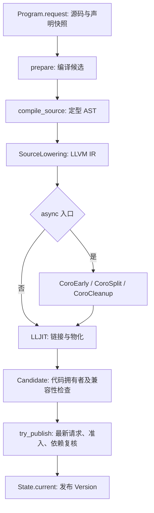

# Runtime、源码与 JIT 的结构和执行链

状态：正式源码执行结构，包含对象单继承、基类接收者视图、`async/yield`、共享签名绑定和单入口兼容方法体发布。本页维护模块分工、调用链及结构性技术债；具体行为以[运行时协议](runtime-model.md)和[语言契约](language-contract.md)为准，构建命令见 [README](../README.md)。

## 结构判断

当前类型与对象身份、引用根和执行准入都归同一 Runtime；源码前端、LLVM 降低和宿主桥接承担不同转换职责。没有发现另建对象身份、协程 GC 或平行业务调度器的路径。

完整源码执行链现在由正式宿主库 `atelier_source` 和隔离 DLL `atelier_source_backend` 提供。机器快照与统计由验收消费者持有；生成帧只预留接收者槽，不再认识机器快照。公共接口使用 Runtime Scalar，编译分类和 DLL 位表示留在实现内。

## 模块与实际构建归属

| 模块 | 入口与拥有的职责 | 当前目标、依赖与边界 |
| --- | --- | --- |
| 类型与对象 Runtime | [runtime.hpp](../src/runtime/runtime.hpp)、[runtime.cpp](../src/runtime/runtime.cpp)：类型发布、对象身份、值操作、根、GC 和原生调用 | 正式静态目标 `atelier_runtime`；不依赖 LLVM、语言前端或验收代码 |
| 执行协议 | [execution.hpp](../src/runtime/execution.hpp)、[execution.cpp](../src/runtime/execution.cpp)：ExecutionScope、根槽执行帧、Coroutine 状态和拥有者 | 同属 `atelier_runtime`；核心通过 CoroutineFrame 接受具体帧，不依赖 LLVM 布局 |
| 原生定义生产者 | [native.hpp](../src/runtime/native.hpp)：从 C++ 类型和成员生成 TypeDefinition | 头文件适配，使用同一 Runtime 定义与 Invoker 协议 |
| 语言前端 | [source.hpp](../src/language/source.hpp)、[source.cpp](../src/language/source.cpp)：词法、语法、类型检查和定型 AST | 源码仅依赖标准库，编入 `atelier_source_backend`。Environment 借用到编译结束，AST 拥有降低所需数据 |
| LLVM 降低与代码资源 | [source_backend.cpp](../src/jit/source_backend.cpp)：SourceLowering、协程转换、LLJIT、CompiledBusiness | 正式 DLL `atelier_source_backend`；LLVM、STL 和分配所有权留在 DLL 内 |
| Windows 展开信息 | [windows_unwind.cpp](../src/jit/windows_unwind.cpp)：JITLink 分配期间登记和撤销动态展开表 | 源码后端和平台探针共用私有 LLVM support OBJECT 目标，各自按分配动作管理资源；没有复制注册表 |
| 源码程序拥有者 | [program.hpp](../src/source/program.hpp)、[program.cpp](../src/source/program.cpp)：Program、声明、候选、发布、入口与租约 | 正式静态库 `atelier_source`；公共调用参数/结果使用 Scalar，使用已有 Coroutine 表达协程拥有关系 |
| Runtime 桥接 | [bridge.hpp](../src/source/detail/bridge.hpp)、[bridge.cpp](../src/source/detail/bridge.cpp)：Binding、Invocation、目录映射、引用槽与原生服务 | `atelier_source` 内部实现；不包含机器快照、统计或具体测试模式。内部观察点供验收组合其状态 |
| 端到端消费者 | [公共最小消费者](../acceptance/source/main.cpp)、[关停消费者](../acceptance/source/shutdown.cpp)、[连续会话](../acceptance/source/session.cpp)、[完整验收](../acceptance/jit/business.cpp)及其 inl 分组 | 公共消费者使用正式接口，连续会话另读取分配器和 OS 统计；完整验收通过内部接缝检查 raw ABI 和故障路径，均使用同一正式实现 |
| 阶段测量 | [measure.cpp](../acceptance/source/measure.cpp)：正式接口的有界时间与资源样本 | 显式目标 `atelier_source_measure`，不随普通构建或验收运行此专项目标；不向生产层加入统计状态 |

构建权威来源：[CMakeLists.txt](../CMakeLists.txt)、[jit.cmake](../cmake/jit.cmake)。消费者链接 `atelier_source`，由它接入 `atelier_runtime` 与源码后端 DLL；LLVM 头文件不传播到公共接口。`atelier_jit_probe` 只承担平台验收。`ATELIER_BUILD_JIT_ACCEPTANCE=OFF` 可关闭平台/JIT 完整验收与后端故障注入，正式库及 `source_acceptance` 保持可用。

`ValueType`、`ScalarKind` 和 `FunctionSignature` 分别服务编译分类、私有 ABI 和 Runtime 语义描述。前两者由真实编译产物/元数据核对，不建立业务类型身份；它们的存在不等于三套类型体系。私有 ABI 尚不是永久通用调用协议。

## 从源码到发布



1. `Contract` 从同一 Runtime 捕获继承后的成员目录、完整祖先/内联记录依赖及原生服务地址；类型快照包含 `base`。`request` 拥有源码与声明快照，保存请求号，不运行源码。
2. `prepare` 调用 DLL 编译接口。前端按 Environment 检查名称与类型，后端通过服务索引降低成员访问；同步与协程共用 SourceLowering，只有协程经过协程转换。
3. `Candidate` 已拥有实际链接后的代码。准备阶段按捕获信息检查兼容性；首次发布时通过 `Runtime::resolve_signature` 建立不可变声明。
4. `try_publish` 再检查最新请求、所属程序、声明、Runtime 准入和依赖。完成可能失败的工作后才替换 current。忙时保留候选；新请求失败保留已发布版本，不允许提交过期候选。

**线程边界：** 当前整个适配器按单线程使用。prepare 的编译与兼容检查主要使用快照，但也检查程序拥有者的存活状态；这不足以授权与程序关闭/发布并发执行。后台编译需要单独确定请求、关闭和提交的同步契约。

## 从入口到执行、清理

### 同步调用

```text
Entry.invoke 选择当前 Version / Lease.invoke 使用固定 Version
  → Version.invoke → ExecutionScope 准入、参数与接收者检查
  → execute_admitted 创建本次 Invocation
  → atelier_invoke_business → 生成代码 → BusinessServices
  → Runtime.read / write / call 等既有入口
  → 生成清理 → 检查引用槽已清空 → 提交结果 → 退出执行作用域
```

内部 `execute_typed` 执行完整目录/布局检查后也进入 `execute_admitted`，供 raw ABI 等验收使用。已发布 Version 使用自己的已验证元数据。公共入口和内部观察入口共用同一执行与清理实现；正式消费者通过程序入口或版本租约使用已发布代码。

同步和协程共用 `check_source_receiver`，验证实际对象 `is_a` 绑定类型，再经 `ExecutionFrame::hold(slot, id, binding.type)` 建立声明视图。基类字段和方法继续通过同一 Runtime 访问入口调整地址；桥接不复制对象，也不保留旧的精确类型接收者路径。

### 协程

```text
bind<R, Args...>(FunctionExecution::coroutine) → 同一个 Entry
  → Entry.start / Lease.start → 固定 Version、复制参数、稳定 Frame
  → Coroutine.create → ready（不执行源码体）
  → Coroutine.resume → ExecutionScope → Frame.resume → DLL resume
  → 生成代码与既有 BusinessServices → yield / 完成 / 错误
```

- 挂起保留 Invocation、引用槽和旧 Version，释放本次执行作用域。宿主此后可以推进 GC 或发布兼容版本。
- 完成、失败和取消通过各自协议释放生成帧；运行中取消仅登记请求，等本次恢复返回后处理。具体优先级见[协程协议](runtime-model.md#协程核心协议)。
- 同步和协程终结均由 `Invocation::references_cleared()` 检查执行强根与弱槽已经清空；验证发生在 RAII 兜底前。机器快照的 ObjectRoot 归验收消费者，生成槽清理不负责这个外部拥有者。
- `BusinessServices::call` 进入原有 `Runtime::call` 和原生借用保护。源码挂起点不保留普通原生调用栈中的借用地址。
- 服务状态、宿主首因错误与生成代码的结果契约错误各有明确来源；清理和结果提交仍沿同一执行链，不由消费者拼装第二条错误路径。

## 所有权与释放责任

| 拥有者/对象 | 持有什么 | 释放或失效规则 |
| --- | --- | --- |
| Runtime | 类型、对象实例、根状态与 GC | 宿主显式管理寿命，须覆盖活动调用及非终态帧 |
| source::Program / State | 不可变 Contract/Declaration、当前 Version | 幂等 close 关闭新请求、准备、发布和 Entry，释放 current；已有租约和帧保留其版本 |
| Entry | 弱程序身份 | 每次调用只选取一次当前版本；本身不保活代码或接收者 |
| Lease | 一个固定 Version | 释放最后一个代码持有者前，旧版本仍可调用 |
| Version | 编译代码及对应签名、布局和绑定依赖 | 保持该版本的代码与调用描述一致；不拥有 Runtime |
| Coroutine / Control | 稳定 CoroutineFrame、状态、完成结果/错误 | 外层拥有者析构等价于取消；活动恢复局部保活，终态释放帧 |
| 宿主 Frame | Version、Invocation、DLL 协程句柄 | 先销毁 DLL 帧，再销毁 Invocation，最后释放 Version |
| DLL BusinessCoroutineState | CompiledBusiness、参数副本、LLVM 帧和状态 | 先调用本版本 destroy，再释放代码拥有者；恢复期间局部保活允许外壳被回调销毁 |

这两层恢复保活服务不同接口：核心拥有者和原始 DLL 外壳都可能在回调中失效，不能仅按 shared_ptr 数量判断重复。Runtime、回调用户数据及 DLL 的外部寿命要求仍由宿主承担。

## 当前取舍

- 显式根槽接入已有 GC、引用屏障和撤销协议；当前语言尚无通用记录值帧，不预先引入 statepoint 或另一个根表。
- 每个发布 Version 独立拥有编译单元，活动调用、协程与租约保持该版本的恢复/清理入口及展开信息。共享 LLJIT 会改变符号空间、错误归属和独立退休责任，目前没有采用。
- 发布检查 Runtime 静止，挂起帧保留旧版本；安全点推进 GC，不在轮询中暗中换代码。一般调用图、内联依赖和结构迁移需由具体增量另行定义。
- 原生异常在受控边界转成状态，生成代码显式清理后提交结果。Windows 展开表服务当前栈回溯与代码寿命，不授权 C++ 异常穿越任意生成帧。

工业来源及历史对照见[JIT 研究](research/jit-industrial-research.md)、[协程研究](research/coroutine-runtime-research.md)和[早退清理实验](research/jit-cleanup-experiment.md)。这些材料不另维护执行合同。

## 已知成本与能力边界

| 项目 | 现状与实际影响 | 处理时机与最小方向 |
| --- | --- | --- |
| 分配、根槽扫描和代码退休 | 协程有多处分配，根扫描受历史槽位高水位影响，最后代码拥有者在调用线程承担退休 | 以[阶段测量](research/runtime-stage-measurements.md)及连续运行证据评估消费者预算；当前没有已证明需要池化、根表替换或退休队列的负载 |
| 诊断与源码调试未贯通 | 编译有源名/行列，平台有动态展开信息；尚无协程挂起源码位置、源码断点和局部变量查看 | 编辑器消费者需要定位挂起/错误时，再贯通 source position、代码版本和运行状态 |

`await`、一般函数调用、多类型环境、引用/记录参数和布局迁移属于尚未实现的能力。它们不因出现在研究报告中就成为当前缺陷或必须立即完成的债务。MLIR、有栈协程和并发调度也没有因本次结构核查获得新增实施范围。

正式接口的成本也需保留可见性：公共 Scalar 参数最多八项时在栈上转码，更多参数按需分配；冷端 Candidate 为隐藏内部状态增加一份独立存储，Request 私有构造目前使用独立 shared_ptr 控制块。迁移没有证明吞吐提升，协程已有的固定拥有链仍保持原有分配职责。

本次迁移调整了模块与构建归属、公共宿主接口及私有生成槽布局；类型身份、调用结果、取消、发布和版本清理语义保持原契约。内部 ABI 不承诺旧布局的二进制兼容，宿主与后端随同一次构建更新。

## 证据与维护入口

- 模块迁移的历史验收见[阶段记录](research/runtime-stage-closeout.md#源码模块迁移的历史证据)。`out/review/runtime-structure/verification.json`保留迁移前的历史快照，不代表当前路径。
- 当前阶段的关停、资源基线和结束条件见[阶段收尾](research/runtime-stage-closeout.md)；可重跑的测量代码随源码维护，原始日志保存在本机 `out/review/`。
- ABI 结果诊断与 async 绑定的[关闭记录](research/runtime-stage-closeout.md#已关闭的历史缺陷)保留原始证据；它们不再是现行缺陷。
- 当前行为更新 `runtime-model.md`，语法统一更新根目录 `LANGUAGE.md`，本页维护结构与已知边界。研究文件不作为另一份当前实现清单。
