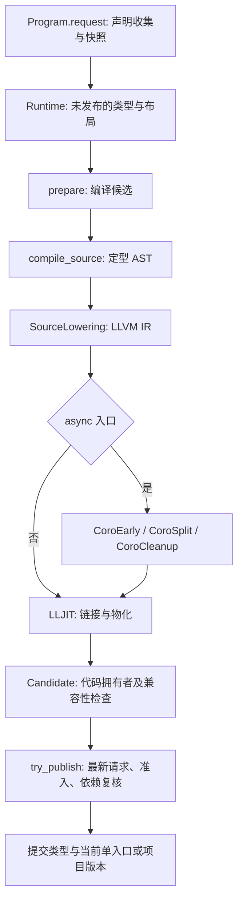

# Runtime、源码与 JIT 的结构和执行链

状态：正式源码执行结构，包含对象单继承、强引用序列、受保护原生借用、成组引用修改、基类接收者视图、`async/yield`、共享签名绑定、String/Array/记录拥有型局部、源码 enum/struct、原生派生 class、跨文件与同模块函数、受控原生算法调用及兼容方法体整组发布。本页维护模块分工、调用链及结构性技术债；具体行为以[运行时协议](runtime-model.md)和[语言契约](language-contract.md)为准，构建命令见 [README](../README.md)。

## 结构判断

当前类型与对象身份、引用根和执行准入都归同一 Runtime；源码前端、LLVM 降低和宿主桥接承担不同转换职责。没有发现另建对象身份、协程 GC 或平行业务调度器的路径。

完整源码执行链由正式宿主库 `atelier_source` 和隔离 DLL `atelier_source_backend` 提供。生成帧只预留接收者槽，不认识验收机器快照。公共接口使用 Runtime Scalar 值与 Argument 借用，编译分类和 DLL 位表示留在实现内。按调用诊断由消费者通过 `Diagnostics` 持有，计数、源码位置与产物遵循[诊断合同](source-diagnostics.md)。

## 模块与实际构建归属

| 模块 | 入口与拥有的职责 | 当前目标、依赖与边界 |
| --- | --- | --- |
| 类型与对象 Runtime | [runtime.hpp](../src/runtime/runtime.hpp)、[runtime.cpp](../src/runtime/runtime.cpp)：类型发布、对象身份、值操作、根、GC 和原生调用 | 正式静态目标 `atelier_runtime`；不依赖 LLVM、语言前端或验收代码 |
| 执行协议 | [execution.hpp](../src/runtime/execution.hpp)、[execution.cpp](../src/runtime/execution.cpp)：ExecutionScope、定型引用/持久根执行帧、Coroutine 状态和拥有者 | 同属 `atelier_runtime`；核心通过 CoroutineFrame 接受具体帧，不依赖 LLVM 布局 |
| 原生定义生产者 | [native.hpp](../src/runtime/native.hpp)：从 C++ 类型和成员生成 TypeDefinition；[自动反射工具](../tools/reflection/main.cpp)产生这些注册调用 | `atelier_reflect` 是构建期工具，薄宏入口为 [reflection.hpp](../src/runtime/reflection.hpp)；生成代码使用同一 Runtime 定义与 Invoker 协议 |
| 语言前端 | [source.hpp](../src/language/source.hpp)、[source.cpp](../src/language/source.cpp)：类型检查和定型 AST；[declarations.cpp](../src/language/declarations.cpp)、[lexer.hpp](../src/language/lexer.hpp)：共享声明解析与词法，字段/参数/局部共用类型名称解析 | 同一前端按宿主与 LLVM DLL 各自 ABI 编译，STL 对象不跨 DLL；宿主复用定型常量求值，完整方法编译与 LLVM 降低留在后端。Environment 借用到编译结束，AST 拥有降低所需数据 |
| LLVM 降低与代码资源 | [source_backend.cpp](../src/jit/source_backend.cpp)：SourceLowering、协程转换、LLJIT、CompiledBusiness | 正式 DLL `atelier_source_backend`；LLVM、STL 和分配所有权留在 DLL 内 |
| Windows 展开信息 | [windows_unwind.cpp](../src/jit/windows_unwind.cpp)：JITLink 分配期间登记和撤销动态展开表 | 源码后端和平台探针共用私有 LLVM support OBJECT 目标，各自按分配动作管理资源；没有复制注册表 |
| 源码程序拥有者 | [program.hpp](../src/source/program.hpp)、[program.cpp](../src/source/program.cpp)：Program、声明、候选、发布、入口与租约 | 正式静态库 `atelier_source`；公共调用使用 Scalar 值与 Argument 借用，结果使用 Scalar 或数学值的 ValueOutput，使用已有 Coroutine 表达协程拥有关系 |
| Runtime 桥接 | [bridge.hpp](../src/source/detail/bridge.hpp)、[bridge.cpp](../src/source/detail/bridge.cpp)：Binding、Invocation、目录映射、引用槽与原生服务 | `atelier_source` 内部实现；按需汇总调用计数与拥有值余额。内部策略观察点继续供验收使用，不推进 GC |
| 调用诊断 | [diagnostics.hpp](../src/source/diagnostics.hpp)、[diagnostics.cpp](../src/source/diagnostics.cpp)：采集句柄、版本/源码位置、资源与状态快照 | `atelier_source`；可选编译插桩写固定 POD 记录，Coroutine 最终状态由原有 Runtime 拥有者通知。报告不保活执行代码或 Runtime |
| 源码调试 | [debugger.hpp](../src/source/debugger.hpp)、[debugger.cpp](../src/source/detail/debugger.cpp)：精确断点、动态源码帧、单步及有界快照 | `atelier_source`；JIT 服务复用 Invocation，ExecutionInspection 复用 Runtime 只读准入；暂停保留原生栈，见[调试合同](source-debugger.md) |
| 端到端消费者 | [公共验收分派入口](../acceptance/source/main.cpp)、[关停消费者](../acceptance/source/shutdown.cpp)、[交错会话](../acceptance/source/session.cpp)、[完整验收](../acceptance/jit/business.cpp)及其 inl 分组 | 公共消费者使用正式接口，交错会话用 OS 查询验证代码/展开表退休；完整验收通过内部接缝检查 raw ABI 和故障路径，均使用同一正式实现 |

构建权威来源：[CMakeLists.txt](../CMakeLists.txt)、[jit.cmake](../cmake/jit.cmake)。消费者链接 `atelier_source`，由它接入 `atelier_runtime` 与源码后端 DLL；LLVM 头文件不传播到公共接口。`atelier_jit_probe` 只承担平台验收。后端 DLL 始终导出两个故障注入入口（[source_backend_verification.hpp](../src/jit/source_backend_verification.hpp)），它们只走编译与链接路径，供 `jit_acceptance` 使用。

`ValueType`、`BusinessType/BusinessParameter` 和 `FunctionSignature` 分别服务编译分类、私有 ABI 和 Runtime 语义描述。前两者由真实编译产物/元数据核对，不建立业务类型身份；它们的存在不等于三套类型体系。枚举索引只定位捕获的 Runtime 目录；ParameterPassing 在宿主与编译链间共用。私有 ABI 尚不是永久通用调用协议。

`atelier_foundation` 独立管理 Array/String 的拥有存储及 Span/StringView 的借用接口；不依赖 Runtime。`runtime/foundation.hpp` 只生产现有 TypeDefinition，数组元素元数据和受保护字段借用归 `atelier_runtime`，宏生成器复用 NativeRegistration。值构析与对象 GC 共用已有执行链。原生字段直接偏移与 Array/String 序列视图沿同一 TypeInfo 发布；`atelier_source` 捕获布局和共享签名，前端检查同步借用和拥有值能力，后端直接操作调用方存储；拥有型记录/String/Array 在生成栈上构造，生命周期和序列修改通过同一 Runtime 操作。没有独立容器身份或第二套调用入口，见[原生值借用](native-value-borrows.md)。具体操作见[基础库](foundation.md)。

对象字段的 `ReferenceSequence`、`ReferenceField`、`with_native` 和 `apply_reference_changes` 均归 `atelier_runtime`。字段定位复用注册元数据和继承地址调整，单槽与批量写入共用引用校验/屏障；序列追踪使用既有 GC 灰队列，原生借用复用回调准入保护。调用链为“字段定位 → 整批验证/复制/容量准备 → 无回调提交 → 屏障与必要的重新追踪”。对象引用序列尚未开放源码容器操作；原生无 GC 引用的 Array 同步借用是单独的已支持值形式。完整接口边界见[引用序列与受保护原生访问](runtime-model.md#引用序列与受保护原生访问)。

## 从源码到发布



1. `Contract` 从同一 Runtime 捕获继承后的成员目录、完整祖先/内联记录依赖及原生服务地址；类型快照包含 `base`。`request` 拥有源码与声明快照，保存请求号；新增 enum/struct/class 经 Runtime 内部类型批次解析和计算布局，暂不发布，也不运行源码。
2. `prepare` 调用 DLL 编译接口。前端按 Environment 检查名称与类型，后端通过服务索引降低成员访问；同步与协程共用 SourceLowering，只有协程经过协程转换。
3. `Candidate` 已拥有实际链接后的代码。准备阶段按捕获信息检查兼容性；首次发布通过 Runtime 的共享签名解析器建立不可变声明；有新类型时，解析器使用同一未发布批次。
4. `try_publish` 再检查最新请求、所属程序、声明、Runtime 准入和依赖。签名、版本分配和类型容器预留完成后，无回调提交新类型与当前代码版本。新增类型要求注册仍开放且 GC 空闲；单纯代码更新仍允许暂停 GC。忙时保留候选；新请求失败保留已发布版本，不允许提交过期候选。

项目快照的文件映射与类结构由 [module.cpp](../src/language/module.cpp) 收集，方法体继续交给同一定型前端。每个接收者环境共享一个 LLVM 模块；项目版本一次持有并切换全部入口，公共源码只保留一份，准备每个环境时临时拼接。具名 Entry 按稳定槽位取版本，原调用、错误及资源清理入口不变。详见[项目快照发布](source-function-modules.md#项目快照与多个公开入口)。

**线程边界：** 当前整个适配器按单线程使用。prepare 的编译与兼容检查主要使用快照，但也检查程序拥有者的存活状态；这不足以授权与程序关闭/发布并发执行。后台编译需要单独确定请求、关闭和提交的同步契约。

## 从入口到执行、清理

### 同步调用

```text
Entry.invoke 选择当前 Version / Lease.invoke 使用固定 Version
  → Version.invoke → ExecutionScope 准入、参数与接收者检查
  → execute_admitted 创建本次 Invocation
  → atelier_invoke_business → 生成代码 → BusinessServices
  → Runtime.read / write / call 等既有入口
  → 生成清理 → 检查引用槽已清空 → 提交结果 → 退出执行作用域
```

内部 `execute_typed` 执行完整目录/布局检查后也进入 `execute_admitted`，供 raw ABI 等验收使用。已发布 Version 使用自己的已验证元数据。公共入口和内部观察入口共用同一执行与清理实现；正式消费者通过程序入口或版本租约使用已发布代码。

同步和协程共用 `check_source_receiver`，验证实际对象 `is_a` 绑定类型，再经 `ExecutionFrame::hold(slot, id, binding.type)` 建立声明视图。基类字段和方法继续通过同一 Runtime 访问入口调整地址；桥接不复制对象，也不保留旧的精确类型接收者路径。

### 协程

```text
bind<R, Args...>(FunctionExecution::coroutine) → 同一个 Entry
  → Entry.start / Lease.start → 固定 Version、复制参数、稳定 Frame
  → Coroutine.create → ready（不执行源码体）
  → Coroutine.resume → ExecutionScope → Frame.resume → DLL resume
  → 生成代码与既有 BusinessServices → yield / 完成 / 错误
```

- 挂起保留 Invocation、引用槽和旧 Version，释放本次执行作用域。同 Runtime 的所有外层执行也已退出时，宿主才可以推进 GC 或发布兼容版本。
- 完成、失败和取消通过各自协议释放生成帧；运行中取消仅登记请求，等本次恢复返回后处理。具体优先级见[协程协议](runtime-model.md#协程核心协议)。
- 同步和协程终结均由 `Invocation::resources_cleared()` 检查执行强根与弱槽已经清空、源码拥有值存活计数归零；验证发生在 RAII 兜底前。机器快照的 ObjectRoot 归验收消费者，生成槽清理不负责这个外部拥有者。
- `BusinessServices::call` 进入原有 `Runtime::call` 和原生借用保护。源码挂起点不保留普通原生调用栈中的借用地址。
- 服务状态、宿主首因错误与生成代码的结果契约错误各有明确来源；清理和结果提交仍沿同一执行链，不由消费者拼装第二条错误路径。

## 数学值的直接执行

`math/math.hpp` 提供纯 C++ 数学值与算法；`math/runtime.hpp` 产出同一 Runtime 的类型定义。Runtime 初始化完成规范布局校验后发布 `TypeInfo::math`，绑定桥将该分类连同字段偏移传给语言目录。编译器仍使用 record + 目录索引，没有第二份数学类型注册表。

数学表达式经 `jit/math_lowering.hpp` 形成 LLVM 向量值；访问内存时只读写真实分量，三维向量不会因 SIMD 宽度越界或改变数组步长。局部数学值、内部按值参数与结果可以由 O2 消除中间存储。原生方法与公开源码入口的数学返回沿同一带类型结果缓冲暂存和提交；double 的私有 ABI payload 为 64 位。一般记录/容器继续使用原有生命周期路径。

整模块执行普通 O2 管线，协程先完成拆分；数学向量运算先展开分量，使循环向量化可按目标 SIMD 宽度重新组合；内部函数允许优化器内联，公开入口保持稳定地址。没有 fast-math 标志，也不承诺不同 CPU 或 C++ 编译环境的逐位浮点确定性。规范与能力范围见[数学合同](math.md)。

## 所有权与释放责任

| 拥有者/对象 | 持有什么 | 释放或失效规则 |
| --- | --- | --- |
| Runtime | 类型、对象实例、根状态与 GC | 宿主显式管理寿命，须覆盖活动调用及非终态帧 |
| source::Program / State | 不可变 Contract/Declaration、当前 Version | 幂等 close 关闭新请求、准备、发布和 Entry，释放 current；已有租约和帧保留其版本 |
| Entry | 弱程序身份 | 每次调用只选取一次当前版本；本身不保活代码或接收者 |
| Lease | 一个固定 Version | 释放最后一个代码持有者前，旧版本仍可调用 |
| Version | 编译代码（工程模块里可与旧 Version 共同持有）及对应签名、布局和绑定依赖 | 保持该版本的代码与调用描述一致；代码在最后一个持有它的 Version 释放后回收；不拥有 Runtime |
| Coroutine / Control | 稳定 CoroutineFrame、状态、完成结果/错误 | 外层拥有者析构等价于取消；活动恢复局部保活，终态释放帧 |
| 宿主 Frame | Version、Invocation、DLL 协程句柄 | 先销毁 DLL 帧，再销毁 Invocation，最后释放 Version |
| DLL BusinessCoroutineState | CompiledBusiness、参数副本、LLVM 帧和状态 | 先调用本版本 destroy，再释放代码拥有者；恢复期间局部保活允许外壳被回调销毁 |

这两层恢复保活服务不同接口：核心拥有者和原始 DLL 外壳都可能在回调中失效，不能仅按 shared_ptr 数量判断重复。Runtime、回调用户数据及 DLL 的外部寿命要求仍由宿主承担。

## 当前取舍

- 同步引用槽由最外层执行区间保护，不逐局部登记持久根；跨挂起的持有槽仍接入已有 GC、引用屏障和撤销协议。当前语言尚无通用含引用记录帧，不预先引入 statepoint 或另一个根表。
- 单源 Program 的每个 Version 独立拥有编译代码。工程模块里，一个编译单元的入口共享该单元的 LLJIT；输入未变的单元沿用已发布的代码，新旧 Version 共同持有，最后一个持有者释放时回收。活动调用、协程与租约保持所在 Version 的恢复/清理入口及展开信息。不同单元之间不共享 LLJIT：共享会改变符号空间、错误归属和独立退休责任，目前没有采用。
- 发布检查 Runtime 静止，挂起帧保留旧版本；宿主在执行区间外推进 GC，源码轮询既不收集也不暗中换代码。模块内无环调用图已纳入同一代码版本；跨模块调用、内联依赖和结构迁移尚未定义。
- 原生异常在受控边界转成状态，生成代码显式清理后提交结果。Windows 展开表服务当前栈回溯与代码寿命，不授权 C++ 异常穿越任意生成帧。

工业来源见 [JIT 研究](research/jit-industrial-research.md)和[协程研究](research/coroutine-runtime-research.md)，它们不另维护执行合同。

## 源码类型生产

`runtime/detail/type_publication.hpp` 是内部生产者事务，原生 `register_types` 和源码 Program 共用 Runtime 的校验、布局与提交实现。预备身份只在候选元数据中使用，公开 Runtime 查询和调用不能访问；候选未提交即丢弃时，类型名和身份均未占用。

首次成功发布固定源码类型集合与定义。独立模块可依次发布各自类型；已有程序按其捕获依赖复核，后续无关类型不重排旧编译目录。仍含新类型的候选须重验完整目录位置，目录变化后重新请求，防止预备身份冲突。类型身份与布局不随代码版本退休，详见[源码类型声明](source-type-declarations.md)。

## 模块内函数执行

前端先收集模块签名，再检查各函数体与调用图；返回的定型 Program 拥有独立 Function AST 和共用类型目录。接收者需求、值存储使用及借用保持效果沿无环图传播，入口可达性决定实际编译范围。

一个 LLVM module 拥有公开入口及内部函数，逐函数降低复用同一实现。内部函数使用 LLVM 定型参数：标量按值、引用按地址；公共入口和原生调用继续使用既有边界描述。每个函数的值和实参暂存放在自己的生成栈上，循环不追加栈分配。原生调用暂存需求取可达函数的最大实际原生调用参数数。

引用槽由一个 Invocation 提供，各可达函数占用互不重叠的固定区间，接收者槽共用；同步 Invocation 使用身份存储，协程 Invocation 使用持久根存储。无环调用图保证同一函数没有并存的递归激活；每个函数只清理自身区间和拥有值，公开入口最终清空接收者槽并检查全部资源归零。辅助调用错误携带原失败原因逐层返回。协程在同步助手退出后才能挂起，取消时不存在尚未返回的助手帧。

代码版本持有整个编译模块，内部直接调用不会解析到较新的模块版本。此设计没有新增 Runtime 函数注册表或通用源码分派入口。当前限制与验收见[同模块多函数](source-function-modules.md)。

## 已知成本与能力边界

| 项目 | 现状与实际影响 | 处理时机与最小方向 |
| --- | --- | --- |
| 分配、根槽扫描和代码退休 | 协程有多处分配，根扫描受历史槽位高水位影响，最后代码拥有者在调用线程承担退休 | [测量记录](research/runtime-stage-measurements.md)仅为历史资源基线，原测量入口已移除；交错会话只验证寿命，不评估预算。当前没有已证明需要池化、根表替换或退休队列的负载 |
| 源码调试宿主接入 | 核心已有源码断点、单步、只读局部值和源码调用栈；平台继续提供动态展开信息 | 编辑器面板与 Control 调试指令仍处于[接入方案](modules/editor/control.md#源码调试接入待实现)阶段；核心能力与 C++ 单步、变量写入等边界见[调试合同](source-debugger.md) |

`await`、跨模块调用、递归、多对象类型环境、对象引用参数、资源记录/容器按值调用和布局迁移属于尚未实现的能力；plain record 同步按值参数/结果、原生/描述型记录与容器的同步借用、记录/String/Array 拥有型局部、源码 enum/struct 及 BorrowSafe 原生调用已落地。它们不因出现在研究报告中就成为当前缺陷或必须立即完成的债务；MLIR、有栈协程和并发调度没有实施计划。

正式接口的成本也需保留可见性：公共 Scalar 参数最多八项时在栈上转码，更多参数按需分配；冷端 Candidate 为隐藏内部状态增加一份独立存储，Request 私有构造使用独立 shared_ptr 控制块。

内部 ABI 不承诺二进制兼容，宿主与后端随同一次构建更新。

## 维护入口

- 当前行为更新 `runtime-model.md`，语法统一更新根目录 `LANGUAGE.md`，本页维护结构与已知边界。研究文件不作为另一份当前实现清单。
